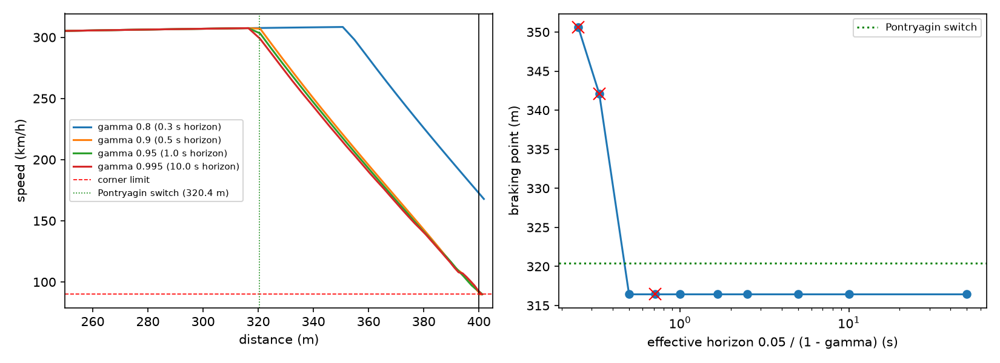

# The 1-D braking problem: Pontryagin vs value iteration

Point mass on the car's g-g envelope, 288 km/h at s = 0, a 90 km/h corner at 400 m. Pontryagin's bang-bang solution switches from full throttle to full braking at **320.4 m**.
Value iteration solves the discounted RL objective the agent uses (progress / 10 per
50 ms step, the env's crash penalty, full-throttle progress after a safe corner) on an
801 x 361 (s, v) grid with 41 acceleration levels; red crosses mark crashes.

| gamma | Horizon | Braking point | Corner speed | Crashed |
|---|---|---|---|---|
| 0.8 | 0.3 s | 350.6 m | 167.9 km/h | yes |
| 0.85 | 0.3 s | 342.1 m | 143.7 km/h | yes |
| 0.9 | 0.5 s | 316.4 m | 89.9 km/h | no |
| 0.93 | 0.7 s | 316.4 m | 91.1 km/h | yes |
| 0.95 | 1.0 s | 316.4 m | 89.9 km/h | no |
| 0.97 | 1.7 s | 316.4 m | 89.9 km/h | no |
| 0.98 | 2.5 s | 316.4 m | 89.9 km/h | no |
| 0.99 | 5.0 s | 316.4 m | 89.9 km/h | no |
| 0.995 | 10.0 s | 316.4 m | 89.9 km/h | no |
| 0.999 | 50.0 s | 316.4 m | 89.9 km/h | no |

Reading: a crash forfeits all future progress, so its true cost is the discounted
value of everything after the corner. With a short horizon that value is small, the
progress gained by braking later wins, and the agent arrives too fast. The RL
environment's gamma = 0.995 (10 s horizon) is long enough that the discounted
optimum brakes where the minimum-time optimum does, up to grid resolution.
