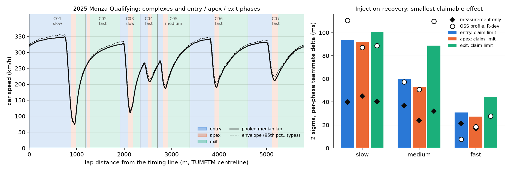

# Drivers-lite pilot: 2025 qualifying, four circuits (PILOT, no rankings)

*Pilot of plan section 3.4 (method: plan-v1 section 6). It tests the measurement pipeline, not the drivers. Every teammate number below is an example of what the pipeline outputs, with its error bars; none of it is a claim about who is faster.*

Code: `src/apexzero/drivers/`, run by `scripts/drivers_pilot.py` (stages `registration`, `pilot`, `tune`, `injection`, `report`). Data: OpenF1 (CC BY-NC-SA 4.0) and the TUMFTM centrelines. This is the second version, after code review; section 9 lists what changed.

**Lockbox.** The circuits that pass registration are all R-test circuits. Only the public telemetry is registered and timed on them. No RL agent, OCP or QSS lap is evaluated on them. Injection-recovery laps on these circuits use each session's own pooled speed profile. The QSS-profile check and the smoother tuning run on R-dev geometry only (`qss_model` refuses R-test names in code). The synthetic noise *levels* are calibrated against the real pilot sessions (section 2). That measures the feed; it does not fit anything to those circuits.

## 1. Registration onto the TUMFTM centreline

The fit is a similarity transform: a 5-degree rotation grid with both handednesses, then trimmed ICP. The gate is the plan's: RMS <= 3 m and lap-length mismatch <= 1%. The length is the feed's own driven-line length (a spline through the samples of the fastest laps) times the fitted scale, compared with the centreline length. Fitted rotations are -0.1 to +0.2 degrees and scales 0.9940 to 1.0029, with no reflection. So the feed and TUMFTM frames share orientation and units up to a translation.

| Circuit (OpenF1) | TUMFTM | Layout | RMS (m) | p95 (m) | Length | Scale | Outside corridor | Excursion p99 (m) | Inside offset (m) | Plan gate |
|---|---|---|---|---|---|---|---|---|---|---|
| Melbourne | Melbourne | **old** | 5.42 | 12.7 | -1.38% | 0.9960 | 12.7% | +16.0 | +1.68 | fail |
| Shanghai | Shanghai | current | 4.46 | 8.4 | -1.36% | 0.9983 | 12.2% | +7.4 | +1.60 | fail |
| Suzuka | Suzuka | current | 1.72 | 3.4 | -0.36% | 1.0006 | 0.5% | -0.2 | +0.58 | pass |
| Sakhir | Sakhir | current | 3.35 | 6.2 | -1.31% | 0.9984 | 4.0% | +2.5 | +1.94 | fail |
| Catalunya | Catalunya | **old** | 6.90 | 16.9 | -0.83% | 0.9987 | 11.3% | +27.5 | +0.14 | fail |
| Montreal | Montreal | current | 2.46 | 4.5 | -0.83% | 1.0013 | 1.9% | +0.2 | +1.36 | pass |
| Spielberg | Spielberg | current | 3.48 | 7.0 | -1.07% | 0.9940 | 13.3% | +3.8 | +2.77 | fail |
| Silverstone | Silverstone | current | 4.00 | 7.9 | -1.16% | 0.9981 | 9.0% | +3.1 | +2.64 | fail |
| Spa-Francorchamps | Spa | current | 2.62 | 5.3 | -0.72% | 0.9995 | 5.6% | +3.1 | +1.69 | pass |
| Hungaroring | Budapest | current | 2.66 | 5.0 | -1.16% | 0.9992 | 7.2% | +1.3 | +1.73 | fail |
| Zandvoort | Zandvoort | **old** | 3.62 | 6.4 | -1.80% | 1.0029 | 7.2% | +11.3 | +2.72 | fail |
| Monza | Monza | current | 2.36 | 4.5 | -0.46% | 0.9996 | 4.5% | +1.2 | +1.49 | pass |
| Austin | Austin | current | 3.46 | 6.3 | -1.65% | 0.9984 | 2.7% | +0.8 | +1.98 | fail |
| Mexico City | MexicoCity | current | 3.48 | 6.3 | -1.44% | 0.9970 | 6.3% | +0.9 | +1.55 | fail |
| Interlagos | SaoPaulo | current | 3.40 | 6.5 | -1.51% | 1.0004 | 6.5% | +0.9 | +2.78 | fail |
| Yas Marina Circuit | YasMarina | **old** | 9.17 | 18.9 | -5.98% | 0.9957 | 19.1% | +35.0 | +2.40 | fail |

No TUMFTM centreline: Jeddah, Miami, Imola, Monte Carlo, Baku, Singapore, Las Vegas, Lusail. *Inside offset* is the mean lateral offset towards the inside of corners tighter than 150 m radius. *Excursion* is the distance beyond the nearer TUMFTM track edge (negative = inside the track).

**Reading.**

- The plan's gate rejects all 4 outdated TUMFTM layouts, as it should. It also rejects 8 of the 12 current layouts. It passes only Suzuka, Montreal, Spa-Francorchamps, Monza, and that alone chose the four pilot circuits.
- The likely cause is the feed's track model, which is not the centreline. In corners tighter than 150 m radius it sits 0.6 to 2.8 m to the inside, and its lap is 0.4 to 1.6% shorter. That looks like a racing line (an inference from these two statistics; not checked against an outside source). The 1% length test compares that line's length with the centreline's, so it is biased by design, and the 3 m RMS mixes in the lateral line offset. A twisty circuit can fail on the line alone.
- The excursion beyond the TUMFTM edges separates the two groups much more sharply. At the 99th percentile it is at most +7.4 m on current layouts and at least +11.3 m on old ones. **Proposal, not applied here:** gate on excursion p99 <= 8 m and report RMS and length as diagnostics. On this table that would pass 12 of 12 current layouts and 0 of 4 old ones. The threshold was picked after looking at this table, so it is checked on other seasons below.
- Projecting a racing-line model onto the centreline is still a fixed, monotone map, the same for every car. So s(t) stays comparable between teammates. The cost is a speed / centreline-rate ratio that varies along the lap. The smoother estimates it from all laps (section 2).

**The proposed gate on seasons it was not chosen on.** The same registration on every mapped qualifying session of other years (same code, same 8 m threshold):

| Season | Current layouts | Plan gate passes | Excursion gate passes | Max excursion p99, current (m) | Old layouts | Excursion gate passes (old) | Min excursion p99, old (m) |
|---|---|---|---|---|---|---|---|
| 2023 | 11 | 4 | 11 | +3.8 | 4 | 0 | +11.9 |
| 2024 | 12 | 4 | 12 | +7.2 | 4 | 0 | +11.8 |

The gate definition is the plan owner's call; it is flagged for them, and this pilot keeps the plan's gate as written. Checking the TUMFTM length against the official circuit length (which would catch layout changes without the line bias) was not done: it needs an official-length table that is not in the repository.

## 2. s(t) per lap, the held-out sector anchor, and synthetic calibration

What the feed looks like (measured on Monza 2025 while building the smoother):

- Projected positions scatter about 2 m *along* the track, with heavy tails. A ~0.7 m pattern sits on top, the same for every car. The snapping audit's 13 cm is the lateral scatter only.
- Speed comes in whole km/h, on its own ~3.7 Hz clock. The location and car_data clocks show no lag (best lag within +/-0.05 s).
- `date_start` is off by up to ~0.1 s: consecutive laps disagree with start + duration by up to 0.2 s. Lap and sector durations are exact. The estimated start-time corrections below have a robust sd of 54 to 76 ms, close to the 58 ms of a uniform +/-0.1 s error.

The smoother is an RTS smoother on [s, v, a] driven by white jerk. It fuses positions, speed and hard anchors at the official lap and sector times. Speed is modelled as a per-lap scale times a pooled path-ratio profile times ds/dt. The timing-line positions and each lap's start-time correction come from unanchored fits first. The median correction is pinned to zero, because a common shift is not identifiable. Hyperparameters were tuned on QSS-profile synthetic laps on R-dev geometry (Catalunya, Hockenheim), over jerk PSD 25, 50, 100, 400, 3000, 20000 m^2/s^5 x speed sigma 0.35, 0.7, 1.2, 2, 3.5, 6 m/s. The best point is jerk PSD 400 and speed sigma 1.2 m/s (pair-delta RMS 17.0 ms), inside the grid on both axes. The surface is flat: 12 of 36 grid points score within 10% of the best (17.0 to 18.4 ms).

**Held-out sector anchor (plan gate 3).** Each lap is refitted without the S2/S3 anchor, the time it reaches the S2/S3 line is predicted, and it is compared with the official S1 + S2. For each lap the line's position is the median over the *other* laps, and the path-ratio profile is re-estimated without any S2 anchor; the start and S1 lines and the start-time corrections still use every lap. The same check on synthetic laps calibrates the synthetic feed. The line wobble (`SynthConfig.wobble_sd`) is the one chosen from [0.005, 0.009, 0.015, 0.022, 0.03] whose synthetic held-out spread is closest to the real one. Natural lap-to-lap variation is then set per corner type x phase, from the real within-driver spread minus the synthetic measurement error (table below).

| Session | Laps fitted | Median (ms; line offset, not a bias) | Held-out robust sd (ms) | p95 abs (ms) | Synthetic robust sd (ms) | Wobble | Start corr. sd (ms) | Position sigma (m) |
|---|---|---|---|---|---|---|---|---|
| 2025 Suzuka Qualifying | 89 | -23 | 11.5 | 46 | 10.5 | 0.009 | 65 | 1.47 |
| 2025 Montreal Qualifying | 87 | -13 | 16.1 | 41 | 17.4 | 0.022 | 54 | 1.65 |
| 2025 Spa-Francorchamps Qualifying | 83 | +5 | 18.9 | 31 | 15.7 | 0.015 | 76 | 1.65 |
| 2025 Monza Qualifying | 93 | -5 | 12.2 | 26 | 12.6 | 0.015 | 67 | 1.58 |

Within-driver spread of phase times (real, laps of one driver in one Q segment) against the synthetic measurement error at the calibrated wobble, median over a circuit's cells of each type, in ms (real / synthetic measurement). Where the synthetic number is larger, the synthetic feed is noisier than the real one there, which makes the budget conservative; natural variation is then set to zero.

| Session | slow entry | slow apex | slow exit | medium entry | medium apex | medium exit | fast entry | fast apex | fast exit |
|---|---|---|---|---|---|---|---|---|---|
| 2025 Suzuka | 49 / 14 | 40 / 20 | 58 / 13 | 35 / 9 | 20 / 6 | 27 / 9 | 15 / 7 | 13 / 5 | 15 / 4 |
| 2025 Montreal | 40 / 23 | 46 / 26 | 50 / 27 | 29 / 29 | 30 / 13 | 51 / 19 | 2 / 4 | 9 / 10 | 26 / 16 |
| 2025 Spa-Francorchamps | 53 / 21 | 64 / 22 | 52 / 15 | 27 / 19 | 33 / 9 | 47 / 18 | 7 / 7 | 8 / 8 | 13 / 12 |
| 2025 Monza | 50 / 18 | 43 / 19 | 34 / 18 | 16 / 7 | 19 / 8 | 45 / 18 | 27 / 17 | 18 / 7 | 33 / 14 |

In 3 of 36 circuit x cell combinations the synthetic measurement error alone exceeds the real total spread. Real lap-to-lap variation is several times larger in slow phases than in fast ones, which is why natural variation is set per cell and not as one number.

A single crossing time far from the anchors is good to 11 to 19 ms (robust sd); that spread is the held-out statistic. The synthetic column comes from the injection runs themselves. The per-session medians (-23 to +5 ms) are not an absolute bias and say nothing about a physics reference: the line position itself comes from the unanchored fits, so the median only measures how far the anchored and unanchored fits disagree about where the S2 line is. It is common to all laps of a session and cancels between teammates.

**Segmentation.** Complexes per circuit: Suzuka 9, Montreal 9, Spa-Francorchamps 12, Monza 7. The plan asks for 12-20. Corners less than 80 m apart always merge, because at 3.7 Hz (one sample every 6-25 m) a chicane's halves cannot be timed apart. Below 12, the code keeps the natural count rather than splitting chicanes or straights to fill a quota. Each complex is split into entry / apex / exit at positions on the pooled (median) reference speed. It is typed (slow < 120, medium 120-200, fast > 200 km/h) by the observed envelope apex speed, as the plan specifies: the 95th percentile of the clean laps' own speed, a percentile rather than the maximum so that one bad fit cannot move a corner across a threshold. 2 of 37 complexes get a different type than the median lap would give them.

## 3. Lap filter

| Session | Laps fitted (checks 1-7 passed) | Traffic (< 1.0 s ahead in a corner) | Pass every check | New set (of those) | Exclusions before fitting (all laps) | Teammate pairs | Laps per driver in pairs |
|---|---|---|---|---|---|---|---|
| 2025 Suzuka Qualifying | 89 | 47 (53%) | 42 | 36 | untimed 104, out-lap 96, in-lap 76, not push 18, tracking: position gap 2.4 s 4, tyre MEDIUM 4, deleted 2 | 7 | 1: 7, 2: 5, 3: 1, 4: 1 |
| 2025 Montreal Qualifying | 87 | 60 (69%) | 27 | 14 | out-lap 103, untimed 99, in-lap 83, tyre MEDIUM 78, not push 52, deleted 7 | 4 | 1: 3, 2: 2, 3: 3 |
| 2025 Spa-Francorchamps Qualifying | 83 | 35 (42%) | 48 | 37 | out-lap 102, untimed 100, in-lap 82, not push 15, deleted 4, flag 2, tyre MEDIUM 2 | 6 | 1: 3, 2: 5, 3: 1, 4: 1, 5: 1, 6: 1 |
| 2025 Monza Qualifying | 93 | 29 (31%) | 64 | 50 | untimed 104, out-lap 103, in-lap 83, not push 17, tyre MEDIUM 13, flag 7, deleted 5 | 10 | 1: 5, 2: 7, 3: 3, 4: 3, 6: 2 |

Traffic removes 31 to 69% of otherwise clean push laps. That is the plan's rule taken literally: any car less than 1.0 s ahead anywhere in any corner window. Spot checks at Montreal found real slow cars on out-laps and cool-down laps, on the racing line (the same lateral offset as fast cars, so not the pit lane). Other cars' positions are projected globally; samples more than 7 m from the centreline (pit lane, garage) and samples further from the previous one than a car can drive (branch jumps at Suzuka's crossover) are dropped. With the 102% rule per Q segment and laps compared only within a Q segment, pairs end up with 1 to 6 laps per driver (last column: laps -> number of drivers), most with 1 or 2. That is the binding constraint on everything below. *New set* is a covariate (the stints table's tyre age <= 1), not a filter. Tyre compounds come from the OpenF1 stints table only; Montreal's MEDIUM count is large and was not cross-checked against a second source.

Deleted laps: race control's 'LAP n' is one ahead of OpenF1's lap numbering (in 2023-25 qualifying, 483 of the 489 deletion messages that give both a lap number and the deleted time give OpenF1 lap n - 1's time to the millisecond). The parser now matches the deleted time to a lap duration first, falls back to n - 1, and handles messages with neither (track-limit '(NEXT LAP PIT)' and double-yellow deletions) and reinstatements.

## 4. Injection-recovery error budget (plan gate 2)

For each pilot circuit: 20 synthetic teammate pairs (10 pairs x 2 sessions), 3 laps per driver in one Q segment, comparing each driver's top-2 laps as in the real analysis. Every B driver got injected effects of +40 ms in each slow-corner entry, +20 ms in each medium-corner apex and -20 ms in each fast-corner exit. Every phase of every lap also carries natural variation at the calibrated per-cell level (section 2).

How the laps are degraded:

- resampled on the empirical location and car_data interval distributions;
- positions with Student-t (3 dof) along-track noise at each session's measured scale, 13 cm lateral noise and decimetre rounding;
- speed with a per-lap scale (sd 0.2%) and a smooth line wobble at the calibrated level (150 m correlation), then rounded to whole km/h;
- brake binarised (the timing pipeline does not use it);
- start times jittered by +/-0.1 s.

The laps then go through the real s(t), phase and teammate-delta code. **Held fixed, so not part of this budget:** registration (the session's transform is reused), segmentation and corner types (the session's), the lap filter, traffic and the Q-segment structure (every synthetic lap is a clean push lap in a single segment), and the track model (synthetic positions scatter about the TUMFTM centreline, not about a racing-line-like model as the real feed does). The line wobble is drawn independently for every lap; persistent per-car errors are added only in the sensitivity run below.

*Measurement* = estimated minus true delta over the same laps: the pipeline's own error. *Recovered - injected* adds natural variation over 2 laps per driver. Its 2 sigma is the **claim limit**, the plan's "2 sigma of the resulting error". It applies to a pair with 2 laps per driver in one Q segment; for other lap counts the example in section 6 scales it by sqrt(var factor) (`PairDelta.var_factor`), which assumes independent laps.

| Corner type | Phase | Cells | Per-lap meas. sd (ms) | Meas. bias (ms) | Meas. 2 sigma (ms) | Injected (ms) | Recovered mean (ms) | Recovered - injected sd (ms) | **Claim limit (ms)** | QSS R-dev claim limit (ms) |
|---|---|---|---|---|---|---|---|---|---|---|
| slow | entry | 180 | 36 | +0.0 | 40 | +40 | +43.5 | 46.8 | **94** | 111 |
| slow | apex | 180 | 26 | -0.7 | 45 | +0 | -7.0 | 46.1 | **92** | 87 |
| slow | exit | 180 | 33 | -1.1 | 40 | +0 | -1.3 | 50.3 | **101** | 89 |
| medium | entry | 220 | 21 | +0.9 | 37 | +0 | -0.2 | 30.0 | **60** | 57 |
| medium | apex | 220 | 14 | +0.1 | 24 | +20 | +19.2 | 26.5 | **53** | 51 |
| medium | exit | 220 | 18 | -0.6 | 32 | +0 | +2.4 | 44.4 | **89** | 110 |
| fast | entry | 340 | 11 | +0.1 | 21 | +0 | -0.4 | 15.4 | **31** | 8 |
| fast | apex | 340 | 10 | -0.2 | 17 | +0 | -0.0 | 13.6 | **27** | 18 |
| fast | exit | 340 | 15 | +0.8 | 27 | -20 | -19.2 | 22.2 | **44** | 28 |

Complex level (entry + apex + exit), claim limit by corner type: slow 166 ms (measurement only 28); medium 113 ms (measurement only 31); fast 57 ms (measurement only 33).

Corner type x phase summed over the lap (the driver-profile cells of the plan's model):

| Cell | Pairs | Meas. sd (ms) | Injected total (ms) | Recovered - injected mean (ms) | Recovered - injected sd (ms) | Claim limit (ms) |
|---|---|---|---|---|---|---|
| slow entry | 80 | 30.1 | +90 | +8.0 | 66.5 | 133 |
| slow apex | 80 | 34.3 | +0 | -15.6 | 65.3 | 131 |
| slow exit | 80 | 30.7 | +0 | -2.9 | 75.1 | 150 |
| medium entry | 80 | 30.1 | +0 | -0.4 | 53.6 | 107 |
| medium apex | 80 | 18.8 | +55 | -2.2 | 42.1 | 84 |
| medium exit | 80 | 26.1 | +0 | +6.6 | 71.4 | 143 |
| fast entry | 80 | 21.5 | +0 | -1.9 | 34.8 | 70 |
| fast apex | 80 | 18.2 | +0 | -0.1 | 29.5 | 59 |
| fast exit | 80 | 26.1 | -85 | +3.2 | 45.8 | 92 |

**False positives and detection, out of sample.** The claim limits are fitted on one synthetic session per circuit and scored on the other (and the reverse), so the rate is not 5% by construction. 6.1% of 1480 zero-injected phase cells exceed their limit (about 5% is expected at 2 sigma; neighbouring injected phases also leak into them). Detection, right sign and above the limit: slow entry (+40 ms) 16% of 180, medium apex (+20 ms) 12% of 220, fast exit (-20 ms) 11% of 340 cells.

**Reading.** The injected effects come back unbiased within their error: recovered means are -7.0 to +3.5 ms off the injected values. The smallest claimable per-phase teammate effect, from one car-session with 2 laps per driver, is 27 to 101 ms depending on corner type and phase. The pipeline's own share is 17 to 45 ms. A +40 ms slow-corner entry is 0.4x its limit (94 ms), and one synthetic car-session flags it in 16% of cases. Natural lap-to-lap variation, not the pipeline, dominates the limit in slow and medium phases. The pipeline's own error dominates in fast phases. Ratios of QSS-profile limits (R-dev geometry, median calibration: wobble 0.015, natural 3 to 46 ms by cell) to pilot limits are 0.25 to 1.24, median 0.95. 6 of 9 cells agree within 25%. The largest disagreement is fast entry (0.25), where the calibrated natural variation is 3 ms, so the limit is mostly measurement error, and that does depend on the profile.

**Persistent per-car errors (sensitivity run).** The per-lap budget above lets every error average down over laps. Two that would not were added to the same synthetic sessions (same seeds; the persistent terms come from a separate random stream, so the true phase times and every other draw are identical): a line pattern shared by all of a driver's laps, as large as the calibrated per-lap wobble (0.009 to 0.022), as if a driver always took a different line than the pooled path-ratio profile assumes; and an along-track position offset per car of sd 1 m (antenna or transponder position). Each was run alone and then both together. These sizes are a scenario, not a measurement. The extra error they add to a teammate delta (sd over pairs and cells):

| Corner type | Phase | Line pattern only (ms) | Position offset only (ms) | Both (ms) | Both, 2 sigma (ms) | Both, lap sum of the cell (ms) | Claim limit per car-session (ms) |
|---|---|---|---|---|---|---|---|
| slow | entry | 27.0 | 25.8 | 37.7 | 75 | 73.8 | 94 |
| slow | apex | 24.3 | 2.4 | 24.1 | 48 | 32.8 | 92 |
| slow | exit | 24.8 | 25.4 | 38.0 | 76 | 77.4 | 101 |
| medium | entry | 21.6 | 11.2 | 25.6 | 51 | 54.2 | 60 |
| medium | apex | 12.6 | 1.0 | 12.7 | 25 | 19.3 | 53 |
| medium | exit | 22.4 | 9.3 | 24.6 | 49 | 43.9 | 89 |
| fast | entry | 15.5 | 2.6 | 15.9 | 32 | 28.4 | 31 |
| fast | apex | 10.0 | 1.0 | 10.1 | 20 | 22.4 | 27 |
| fast | exit | 18.3 | 3.3 | 18.5 | 37 | 36.3 | 44 |

Median over cells: 21.6 ms from the line pattern, 3.3 ms from the 1 m position offset. Unlike the per-lap errors, both are the same in every lap of a car, so more laps do not reduce them.

**Season projection, qualified.** If 20 car-sessions per pair were independent and nothing about a car persisted, the per-phase limits would shrink to 6 to 23 ms (limit / sqrt(20)). A persistent per-car error does not shrink with more sessions. With the scenario above treated as such a floor, the per-phase limits only reach 21 to 79 ms, and the corner type x phase lap sums 43 to 158 ms. Neither number is a measured property of the feed: the persistent error sizes are assumed. Split-half across sessions (section 5) is the data's own test of what persists.

## 5. Placebo and split-half reliability (real data)

**Placebo (gate 4).** Driver labels were shuffled within each car-session *and Q segment* (500 shuffles, top-2 laps per Q segment, 27 pairs, 723 phase cells). The signed mean of shuffled deltas is not reported: it is about zero by symmetry for any pipeline, so it tests nothing. Three statistics that can fail:

- *Synthetic limits against the real null.* 10.9% of shuffled cells exceed the synthetic claim limit for their corner type and phase (scaled to each pair's lap counts; 723 cells). If the synthetic budget were as wide as the real null spread this would be about 5%; more means the synthetic budget is too narrow for the real data, less means it is too wide. Shuffled real data still contain any real effect, mixed between the labels, which pushes this share up. With the true labels the share is 14.0%. For 5% of shuffled cells to exceed them, the limits would have to be 1.36x wider; until that is understood, the section 4 limits should be read as optimistic.
- *Real against shuffled |delta|, per corner type x phase* (1 = the true labels explain nothing beyond lap-to-lap variation):

| Cell | slow entry | slow apex | slow exit | medium entry | medium apex | medium exit | fast entry | fast apex | fast exit |
|---|---|---|---|---|---|---|---|---|---|
| Mean abs. real / shuffled | 1.09 | 1.25 | 1.09 | 1.14 | 1.14 | 0.97 | 1.15 | 1.21 | 1.09 |
| Cells | 58 | 58 | 58 | 67 | 67 | 67 | 116 | 116 | 116 |

- *Pooled permutation test.* The sum of squared deltas over all cells under the true labels against the same sum under shuffled labels gives p = 0.002: the probability that random labels explain at least as much phase-level variance as the real ones.

A small p or a ratio above 1 says the labels carry structure. It does not say that structure is the driver's: setup and any per-car measurement offset (antenna position, a car that always takes a different line than the pooled profile assumes) are confounded with the label, and a within-car shuffle cannot tell them apart. A per-cell test is not possible here: with 2 laps per driver there are only 3 distinct splits.

**Split-half (gate 5).** The gate is Spearman rho >= 0.5. Halves are cut inside each Q segment. The p-value flips the sign of whole pairs' second halves at random (2000 draws, one-sided), because cells of one pair share laps and session-level errors and are not independent; the naive p that treats every cell as independent is shown for comparison.

| Split | Level | Pairs | Cells | Spearman rho | p (pair-level permutation) | p (naive) |
|---|---|---|---|---|---|---|
| odd vs even ranked laps, within session | phase | 13 | 345 | +0.14 | 0.026 | 0.0078 |
| odd vs even ranked laps, within session | corner type x phase | 13 | 117 | +0.10 | 0.193 | 0.26 |
| alternate sessions (pairs in both halves) | corner type x phase | 9 | 81 | +0.11 | 0.237 | 0.32 |

No split reaches the 0.5 gate. The within-session halves need 2+ clean laps per driver in the same Q segment, so few pairs qualify and most compare one lap with one lap. Driver, setup and any per-car measurement offset are confounded in them. The across-session split has only the pairs that appear in both halves of four sessions. Both are underpowered pilots of the gate. The plan's version (odd vs even rounds over a season) needs the full calendar.

## 6. Example teammate per-corner table (pilot, not a ranking)

2025 Monza Qualifying, Ferrari. Delta = HAM minus LEC, so positive means HAM took longer. Laps are compared only within a Q segment (laps used: Q1: LEC 2, HAM 2; Q2: LEC 2, HAM 2; Q3: LEC 2, HAM 2); each segment's delta is the difference of the two drivers' mean phase times there (top-2 per driver), and the segments are averaged with weights 1 / (1/n_A + 1/n_B). The lap delta is +90 ms, and the phase deltas below add up to it exactly. A cell would be **bold** only if it cleared both the claim limit for its corner type and phase, scaled to these lap counts (x 0.58), and twice this car's own placebo spread.

| Complex | Type | Entry (ms) | Apex (ms) | Exit (ms) | Complex (ms) | Above both limits |
|---|---|---|---|---|---|---|
| C01 | slow | -22 | -28 | -29 | -79 | - |
| C02 | fast | -1 | -3 | -1 | -6 | - |
| C03 | slow | -4 | +34 | -14 | +16 | - |
| C04 | fast | +18 | +18 | +21 | +56 | - |
| C05 | medium | +12 | +7 | +14 | +33 | - |
| C06 | fast | **-34** | **+33** | +11 | +10 | entry, apex |
| C07 | fast | +10 | +28 | +22 | +60 | - |

Neither bold rule includes persistent per-car errors or the section 5 finding that the synthetic limits are too narrow for the real null. With the section 4 persistent-error scenario added to the limit (in quadrature, 2 sigma), C06 apex would still clear it and C06 entry would not. The table has 21 cells, and on shuffled real data 11% of cells exceed the limit (section 5), so about 2.3 cells above it are expected with no driver effect at all.

10 of 27 pilot pairs have clean laps from both drivers in more than one Q segment. With this few laps per driver, single cells mostly sit inside the error budget. That is the expected pilot outcome. It is why the plan pools over a season with a hierarchical model before saying anything about a driver.

## 7. R1 envelope (input to the later model)

R1 is, per car-session, the best time in each phase across both teammates' clean laps; the plan's model works on y = t - R1 per lap and phase. Summary only (no per-driver numbers). *Best lap - R1* is how far a car-session's best clean lap is from the sum of its best phases (car-sessions with 2+ clean laps); the last three columns are the median per-lap y summed over each corner type's phases.

| Session | Car-sessions with clean laps | Median best lap - R1 (ms) | Range (ms) | Median y, slow (ms) | Median y, medium (ms) | Median y, fast (ms) |
|---|---|---|---|---|---|---|
| 2025 Suzuka Qualifying | 10 | 376 | 144 to 724 | 367 | 337 | 242 |
| 2025 Montreal Qualifying | 10 | 217 | 151 to 869 | 506 | 351 | 74 |
| 2025 Spa-Francorchamps Qualifying | 10 | 712 | 252 to 1008 | 326 | 493 | 251 |
| 2025 Monza Qualifying | 10 | 510 | 180 to 660 | 371 | 88 | 382 |

The R1 envelope is a minimum over a handful of noisy laps, so it is biased low (more laps, lower envelope), and with one clean lap a car-session's y is zero everywhere. Teammate deltas do not depend on it.

## 8. Not done, or uncertain

- **Registration gate.** As written it passes 4 of 12 current-layout 2025 circuits (section 1), and that is what limits the pilot to four circuits. The corridor-excursion gate is a proposal; it is flagged to the plan owner, not applied.
- **Scope.** Four circuits, one qualifying session each. Sprint qualifying was not run. Most circuits stay below the plan's 12 complexes because chicanes are never split.
- **Synthetic realism.** The synthetic feed is calibrated on two statistics per session (held-out S2 spread; within-driver spread per corner type x phase). The single wobble knob stands in for every unmodelled error source, so how the measurement error splits between phases is a model assumption (section 2 table). Natural variation is Gaussian and independent between phases. Persistent per-car errors are only a sensitivity scenario with assumed sizes (section 4). The ~0.7 m position pattern common to all cars is not synthesised; it is common-mode, but that it cancels is untested. No clock latency (none was measured). The QSS check profiles are computed on the centreline, not a racing line.
- **The synthetic budget looks too narrow.** On shuffled real data 11% of cells exceed the claim limits instead of about 5% (section 5); the limits would need to be 1.36x wider. Part of that may be real effects mixed into the shuffles, part unmodelled real error.
- **Smoother.** The tuned point is inside the extended grid. The error surface is flat near the optimum.
- **Lap filter.** Compounds come from the stints table only (no second source). The new-set flag is a covariate and the tow flag is computed, but neither enters the teammate deltas yet.
- **Not built (later plan steps).** The hierarchical model (M1/M2), R2 calibration, the circularity check, the multiverse and external validity. Brake and throttle are loaded but unused.
- **Underpowered gates.** Many real pairs have 1 lap per driver in a segment. The placebo tests label exchangeability within car-sessions, not across a season.

Compute: the pilot stage took 71 s of CPU over four sessions. Registration takes ~2 s of CPU per session; calibration, injection-recovery and tuning take a few minutes each. Everything ran single-process at nice 15 on the M3 Pro alongside other jobs.

## 9. Changes after code review

The first version (archived with its outputs in `outputs/drivers-lite/archive-v1/`) had these problems; every number above is from the corrected code.

- **Teammate laps from different Q segments.** Each driver's top-2 laps were taken from all shared Q segments together, so in 4 of 25 pairs (including the old Spa example table) one driver's laps came from a different segment than the other's, and track evolution entered the delta. Laps are now compared only within a segment; a test checks that a Q-segment-wide offset leaves every delta unchanged. The placebo and split-half are stratified by Q segment too. The first version's placebo p = 0.027 and split-half rho 0.29 / 0.39 / 0.11 are superseded.
- **Deleted laps off by one.** Race control's 'LAP n' was read as OpenF1 lap n; it is lap n - 1. Every deletion flagged the lap after the deleted one, and two truly deleted push laps (Spa, Monza) were in the clean tables.
- **Placebo statistic.** The signed mean of shuffled deltas (zero by symmetry) was read as evidence; it is replaced by the statistics in section 5.
- **In-sample false-positive rate.** The 5.8% was scored against limits fitted on the same synthetic cells; it is now out of sample.
- **Held-out S2 not fully held out**, and its median read as a model bias (section 2). **Smoother grid** stopped at the optimum on both axes (jerk 100, speed sigma 1.2); it is wider now. **Calibration test** replayed one candidate's seed and wobble. **Interior position gaps** of up to 4.5 s were accepted. **Traffic** could see phantom cars at Suzuka's crossover. **Corner types** came from the median lap, not the envelope. **R1** was built but not reported.
