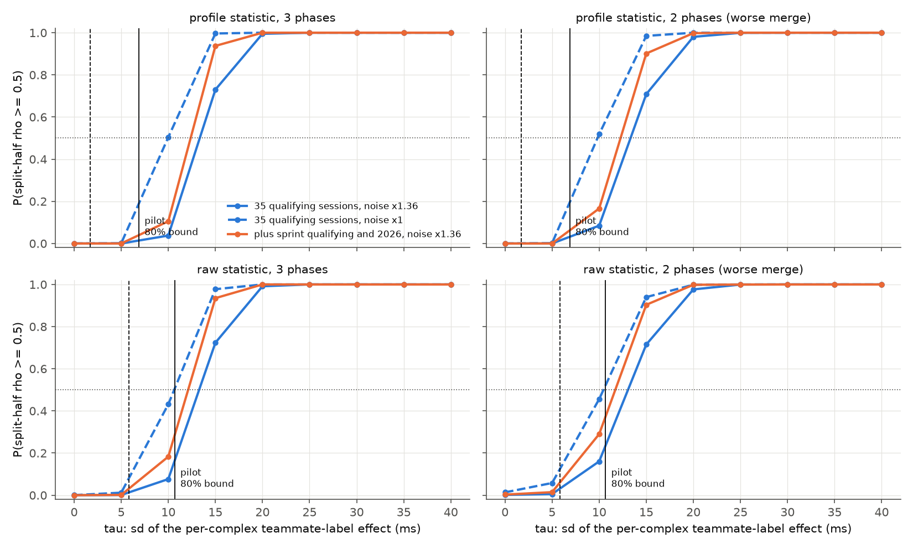

# Drivers DV-B0: power of the split-half gate (EXPLORATORY)

*Follow-through item DV-B0. The plan, the model and the go/no-go rule were committed before the first run: [drivers-power-plan.md](drivers-power-plan.md). This is a simulation from the noise budgets recorded in [drivers-pilot.md](drivers-pilot.md). It reads no laps, positions or timing from any session outside the four pilot sessions; for the season designs it reads team rosters only.*

Code: `scripts/drivers_power.py` (simulation) and `scripts/drivers_power_report.py` (this page), from the cached `drivers_pilot.py` stages. Output: `outputs/drivers-lite/power/power.json`. 2,000 simulated seasons per grid point, seed 20261025; 8 CPU-min on the M3 Pro.

## Verdict

**NO-GO for DV-B.** The rule: with the profile statistic, noise x1.36 and no persistent errors, P(rho >= 0.5) must reach 0.5 at the pilot's 80% upper bound on tau, tau_80 = 6.9 ms, for 3 phases or for both 2-phase merges, in some scope. P(pass) there:

| Scope | 3 phases | 2 phases (entry + apex / exit) | 2 phases (entry / apex + exit) | Reaches 0.5 |
|---|---|---|---|---|
| 35 qualifying sessions, 2023-25 | 0.01 | 0.03 | 0.03 | no |
| plus 2023-25 sprint qualifying at the same circuits | 0.05 | 0.08 | 0.08 | no |
| plus 2026 qualifying at current-layout circuits | 0.04 | 0.06 | 0.07 | no |

The best case is plus 2023-25 sprint qualifying at the same circuits.

## 1. What the simulation is built from

The model and its parameters are fixed in the plan. The numbers it took from disk:

- **Yield.** 27 pair deltas from 40 pilot car-sessions (67.5%): a car-session gives a teammate delta only if both drivers have clean laps in a shared Q segment.
- **Lap counts.** The pilot pairs' variance factors (1 = 2 laps per driver in one segment) have median 1.00 and range 0.33 to 2.00; 7 of 27 pairs compare one lap with one lap.
- **Noise per car-session** (recorded injection-recovery runs, lap sum per corner type x phase at 2 laps per driver; median over the four circuits of the sd, ms): slow entry 68, slow apex 64, slow exit 69, medium entry 44, medium apex 40, medium exit 67, fast entry 30, fast apex 26, fast exit 31.
- **Overall gap.** From the pilot's 27 lap deltas (9 pairs seen in more than one session): rms lap delta 368 ms, within-pair spread between sessions 336 ms. After the lap-delta noise, the constant gap g has sd 152 ms and the per-session part eta 304 ms at noise x1 (153 and 273 ms at x1.36). Most of a teammate gap therefore changes from session to session, which is noise for the raw statistic.

| Scope | Sessions | Rounds | Teammate pairs | Pair-sessions | Pairs in both halves (mean) | Usable sessions per pair, median | Usable sessions, two longest pairs (mean) |
|---|---|---|---|---|---|---|---|
| 35 qualifying sessions, 2023-25 | 35 | 35 | 26 | 350 | 21.2 | 8 | 23.7 |
| plus 2023-25 sprint qualifying at the same circuits | 47 | 35 | 26 | 470 | 21.5 | 11 | 31.8 |
| plus 2026 qualifying at current-layout circuits | 55 | 43 | 32 | 558 | 25.4 | 11 | 34.4 |

*Pair-sessions* are every car-session in the rosters; each yields a delta with the pilot's probability, so *usable sessions* are after that. Sprint qualifying shares its round, and so its half, with the round's qualifying.

## 2. How large tau could be: the pilot's own split-half

The pilot's across-session split-half (9 pairs in both halves) gives rho = +0.11 on the raw deltas (as in the pilot report) and +0.01 on the profile. The same model on the pilot's exact design turns these into bounds on tau (3 phases, no persistent errors, so anything persistent in the pilot counts as signal):

| Statistic | Noise | tau_hat (ms) | tau_80 (ms) |
|---|---|---|---|
| profile | x1 | 1 | 5 |
| profile | x1.36 | 2 | 7 |
| raw | x1 | 4 | 9 |
| raw | x1.36 | 6 | 11 |

tau_hat is where the simulated pilot's median rho equals the observed one; tau_80 is where the observed rho falls at the 20th percentile, an 80% upper bound. With nine pairs and two sessions per half the pilot bounds tau only loosely.

## 3. Power

*Solid vertical line: the pilot's tau_80; dashed: tau_hat (noise x1.36, the panel's statistic). 2-phase panels show the lower of the two merges. No persistent errors.*

tau at which P(pass) reaches 0.5 and 0.8 (ms, interpolated on the 5 ms grid; no persistent errors):

| Scope | Phases | Statistic | x1: 0.5 | x1: 0.8 | x1.36: 0.5 | x1.36: 0.8 |
|---|---|---|---|---|---|---|
| 35 qualifying sessions, 2023-25 | 3 phases | profile | 10 | 13 | 13 | 16 |
| 35 qualifying sessions, 2023-25 | 3 phases | raw | 11 | 13 | 13 | 16 |
| 35 qualifying sessions, 2023-25 | 2 phases (entry + apex | exit) | profile | 10 | 13 | 13 | 16 |
| 35 qualifying sessions, 2023-25 | 2 phases (entry + apex | exit) | raw | 10 | 14 | 13 | 17 |
| 35 qualifying sessions, 2023-25 | 2 phases (entry | apex + exit) | profile | 10 | 13 | 13 | 17 |
| 35 qualifying sessions, 2023-25 | 2 phases (entry | apex + exit) | raw | 10 | 14 | 13 | 17 |
| plus 2023-25 sprint qualifying at the same circuits | 3 phases | profile | 8 | 10 | 12 | 14 |
| plus 2023-25 sprint qualifying at the same circuits | 3 phases | raw | 8 | 11 | 12 | 14 |
| plus 2023-25 sprint qualifying at the same circuits | 2 phases (entry + apex | exit) | profile | 8 | 11 | 12 | 14 |
| plus 2023-25 sprint qualifying at the same circuits | 2 phases (entry + apex | exit) | raw | 8 | 12 | 11 | 14 |
| plus 2023-25 sprint qualifying at the same circuits | 2 phases (entry | apex + exit) | profile | 8 | 11 | 12 | 14 |
| plus 2023-25 sprint qualifying at the same circuits | 2 phases (entry | apex + exit) | raw | 8 | 12 | 11 | 14 |
| plus 2026 qualifying at current-layout circuits | 3 phases | profile | 8 | 10 | 12 | 14 |
| plus 2026 qualifying at current-layout circuits | 3 phases | raw | 8 | 11 | 12 | 14 |
| plus 2026 qualifying at current-layout circuits | 2 phases (entry + apex | exit) | profile | 8 | 10 | 12 | 14 |
| plus 2026 qualifying at current-layout circuits | 2 phases (entry + apex | exit) | raw | 8 | 12 | 12 | 14 |
| plus 2026 qualifying at current-layout circuits | 2 phases (entry | apex + exit) | profile | 8 | 11 | 12 | 14 |
| plus 2026 qualifying at current-layout circuits | 2 phases (entry | apex + exit) | raw | 9 | 12 | 12 | 14 |

P(pass) on the 35 qualifying sessions, noise x1.36, no persistent errors, by tau (ms):

| Phases | Statistic | 0 | 5 | 10 | 15 | 20 | 25 | 30 | 35 | 40 |
|---|---|---|---|---|---|---|---|---|---|---|
| 3 phases | profile | 0.00 | 0.00 | 0.04 | 0.73 | 0.99 | 1.00 | 1.00 | 1.00 | 1.00 |
| 3 phases | raw | 0.00 | 0.00 | 0.08 | 0.72 | 0.99 | 1.00 | 1.00 | 1.00 | 1.00 |
| 2 phases (entry + apex | exit) | profile | 0.00 | 0.00 | 0.08 | 0.73 | 0.98 | 1.00 | 1.00 | 1.00 | 1.00 |
| 2 phases (entry + apex | exit) | raw | 0.00 | 0.01 | 0.16 | 0.72 | 0.98 | 1.00 | 1.00 | 1.00 | 1.00 |
| 2 phases (entry | apex + exit) | profile | 0.00 | 0.00 | 0.08 | 0.71 | 0.98 | 1.00 | 1.00 | 1.00 | 1.00 |
| 2 phases (entry | apex + exit) | raw | 0.00 | 0.01 | 0.17 | 0.71 | 0.98 | 1.00 | 1.00 | 1.00 | 1.00 |

## 4. False passes from persistent per-car errors

With the pilot's persistent-error scenario (a line pattern and a 1 m position offset per car) held constant across a pair's sessions, the gate can pass with no driver effect at all. P(pass) at tau = 0, noise x1.36:

| Scope | Phases | Raw | Profile |
|---|---|---|---|
| 35 qualifying sessions, 2023-25 | 3 phases | 0.46 | 0.51 |
| 35 qualifying sessions, 2023-25 | 2 phases (entry + apex | exit) | 0.54 | 0.63 |
| 35 qualifying sessions, 2023-25 | 2 phases (entry | apex + exit) | 0.66 | 0.76 |
| plus 2023-25 sprint qualifying at the same circuits | 3 phases | 0.74 | 0.77 |
| plus 2023-25 sprint qualifying at the same circuits | 2 phases (entry + apex | exit) | 0.78 | 0.82 |
| plus 2023-25 sprint qualifying at the same circuits | 2 phases (entry | apex + exit) | 0.86 | 0.90 |
| plus 2026 qualifying at current-layout circuits | 3 phases | 0.73 | 0.78 |
| plus 2026 qualifying at current-layout circuits | 2 phases (entry + apex | exit) | 0.77 | 0.83 |
| plus 2026 qualifying at current-layout circuits | 2 phases (entry | apex + exit) | 0.86 | 0.91 |

**Would the pilot have seen them?** (post hoc.) The same scenario on the pilot's exact design at tau = 0 gives a split-half rho with median +0.43 (profile) and +0.37 (raw) at noise x1; +0.31 (profile) and +0.29 (raw) at noise x1.36. The pilot observed +0.01 and +0.11; a value that low comes up in 0.1% (profile) and 2.6% (raw) of simulated pilots at x1; 1.2% (profile) and 7.3% (raw) of simulated pilots at x1.36. So errors of the scenario's size most likely do not repeat across sessions. The table above is a worst case; the pilot's bound on tau already covers anything persistent, driver or car.

## 5. Reading

- **The gap.** On the 35 qualifying sessions with 3 phases and noise x1.36, the profile gate passes half the time at tau = 13 ms per complex. The pilot's own data put tau at about 2 ms, with an 80% upper bound of 7 ms: the gate needs an effect 1.9 times the bound. Read on the lap, tau is per complex of a type and phase, so on a circuit with four fast complexes the fast-entry lap sum has an sd of about 53 ms at the gate's tau.
- **More sessions barely help.** Adding sprint qualifying and 2026 moves the 50% point to 12 ms (from 13), and that scope is optimistic: neither set is registered and sprint qualifying has fewer laps. More sessions shrink the noise of each half only as the square root of their number.
- **Two phases** leave the 50% point where it is: 13 ms (entry + apex | exit) and 13 ms (entry | apex + exit), against 13 ms with three. Merging cancels the timing error at the dropped boundary, but a merged cell also sums two effects and two phases' natural variation, so the choice of 2 or 3 phases does not decide the gate.
- **Raw against profile.** The raw statistic's 50% point is 13 ms. Most of a teammate gap changes from session to session (section 1), so the overall gap adds noise to the raw statistic about as much as it adds reliable signal; the raw statistic does not pass for free.
- **A pass would not mean much on its own.** With the persistent-error scenario held across sessions, the profile gate passes with no driver effect in 51% of seasons on the 35 sessions with 3 phases, and up to 91% with more sessions or 2 phases (section 4). The pilot argues against errors of that size repeating: had they repeated, its profile rho would have had a median of +0.31, and the observed one or lower in 1.2% of cases (a post hoc check). A smaller per-car line or antenna offset that does repeat is still indistinguishable from a driver effect in this design.

## 6. What it means for DV-B

**No-go.** Under every choice decision #18 leaves open (2 or 3 phases, raw or profile, sprint qualifying and 2026 in or out) the gate would most likely fail at the effect sizes the pilot allows, so a pre-registered run would spend 15-25 h to confirm a failure the simulation already predicts. DV-B is not run. The two-track plan's fallback stands: 2-3 teammate-pair case studies, labelled as case studies, each cell above its claim limit and its placebo spread. The #18 choices need not be made unless something below changes.

What would change the verdict: a real effect several times larger than the pilot's bound (the pilot has nine pairs, so this cannot be ruled out, only made unlikely); a lower per-car-session noise (more laps per driver, or a better timing model); or a much larger pool of sessions with the same pairs, which 2023-25 does not have. A case study that pools one long-running pair over all its sessions is the nearest thing to the gate's question that the data can carry.

## 7. Caveats

- **The noise is synthetic.** It is the injection-recovery budget of four circuits, calibrated to the real feed on two statistics per session, and scaled by 1.36 because the real placebo spread was wider. Real sessions at other circuits may be noisier or quieter; each simulated session borrows one of the four.
- **The effect model is simple.** tau is the same for every corner type and phase, independent between cells, and constant across circuits and seasons. A driver whose effect is concentrated in one cell, or that changes with the car, is not modelled.
- **Two phases are approximated** by merging recorded phases; a real 2-phase cut at the minimum-speed point sits between the two merges, which bracket it.
- **The gap model rests on 27 pilot lap deltas**, 9 pairs of them repeated. Its sds are rough; they matter only for the raw statistic.
- **Yield and lap counts** are the pilot's (four 2025 sessions). Other seasons, and sprint qualifying above all, may give fewer clean laps.
- **The calibration has nine pairs.** tau_80 is an 80% bound from a small design; the true effect could be larger. The verdict says the gate is unlikely to pass, not that it cannot.

## 8. Deviations from the plan

- The report is written by a second script, `scripts/drivers_power_report.py`, as `drivers_report.py` does for the pilot; the plan named only `drivers_power.py`.
- The profile statistic is also added to the library (`deltas.split_half_across(..., profile=True)`, with tests), so that a pre-registration could use it as is. The simulation implements the same statistic on its own arrays.
- **Post hoc, added after seeing section 4:** the pilot's exact design at tau = 0 with the persistent errors on (`pilot_persistent`), to ask whether the pilot would have seen them. It does not enter the decision rule.
