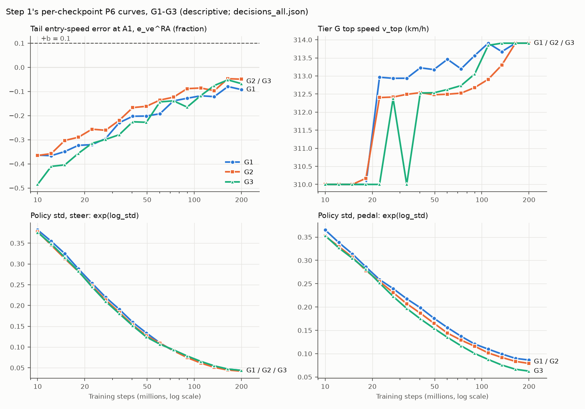

# Interpretability leftovers IN-1 to IN-4: results (exploratory and descriptive; 25 Oct 2026)

Plan: [`interp-leftovers-plan.md`](interp-leftovers-plan.md), committed in `916edaa` before anything here was computed. Its amendment 1 (`79977af`) was committed after IN-1's two built-in checks had been run and before any result below was computed (Section 7). The items are IN-1 to IN-4 of the follow-through plan ([`docs/plan/follow-through.md`](../plan/follow-through.md), Section 7.8).

Code: `scripts/interp_leftovers.py` (subcommands `in1` to `in4`) with `tests/test_interp_leftovers.py`. Results: `outputs/interp-leftovers/in1.json` to `in4.json`, each with a provenance block (script sha256, HEAD, every input's sha256, times), plus `in3_p6_curves.csv` and `p6_curves.png`. Files under `outputs/` are local and not in git. The figure is committed as [`interp-leftovers-p6.png`](interp-leftovers-p6.png).

**Labels.**
- **Every number here is exploratory or descriptive.** None changes a confirmatory decision of step 1, step 2 or H4R.
- IN-1 and IN-2 are exploratory summaries outside step 2's frozen code. Their band labels ("lawful", "inconclusive") use H2′'s rule and are descriptive labels only.
- IN-3 and IN-4 are descriptive.
- No network, closed loop, gradient or solver was run: every number comes from files already on disk.
- R_TEST was not touched. IN-4 reads only the 12 R-dev circuits, each passed through `lockbox_guard`, and nothing reads `outputs/sealed/`.

## 1. Summary

**IN-1: the anchored-key G with step 2's pair weighting and CIs (exploratory).**
- The pre-registered summary that came out empty in step 2 now exists for all 12 finals and 8 earlier snapshots. It is computed by the frozen `stages.anchored_edges` on copies of the anchored rows with `w_is_cell` set to true.
- **The nine generalists' anchored G is 0.719–0.859 against 0.760–0.851 on the shared A2 states.**
  - Every anchored CI overlaps the network's A2 CI.
  - Every CI's upper end is at least 0.832, far from a deficit (0.5).
  - No generalist tracks the edge less on its own fast approaches than on the shared states. Step 2's sentence "on each agent's own fast-approach states, G is the same range as on the shared A2 states" stands with intervals.
- E1.1's first clause holds for 7 of 9 networks. It asks that the pair-weighted value lie within ±0.03 of the per-key median. G1s2 (+0.039) and G3s2 (+0.060) fall outside, both upward.
- **E1.2 holds.**
  - The earlier snapshots' G is 0.806–0.888.
  - No later snapshot's CI lies wholly above the agent's earliest one.
- **E1.3 holds.**
  - The specialists exclude 59–94% of their anchored keys and are descriptive.
  - S1's G is undefined: no pair survives.

**IN-2: H2′ on the 306 keys valid for all nine generalists (exploratory).**
- **On the common keys, G3 is no longer the only lawful generalist: G2 is lawful too.**
  - G2: 0.852 [0.827, 0.863], against its confirmatory 0.832 [0.791, 0.854].
  - G3: 0.851 [0.827, 0.867], almost exactly its confirmatory 0.851 [0.825, 0.867].
- **E2.1 holds.**
  - G3's median lies inside the other eight's range, 0.789–0.852.
  - Another generalist's CI also clears 0.8.
- **E2.2 holds.** 8 of 9 medians rise, by up to +0.042 (G3's by only +0.0001). G1s1's falls by 0.0003.
- **E2.3 holds.** The lowest upper end is 0.814.
- The two sensitivities give the same labels.
- **Reading.** G3's own number does not depend on its exclusions. What made it the only lawful network is the key set: the tight-corner keys it loses to "argmin off plateau" are the keys where the other networks score lowest (step 2, Section 5.1). Step 2's "about 80% for a corner-wide shift, in all three variants" is the better summary.

**IN-3: step 1's outputs never written up (descriptive).**
- **P2d** is as expected.
  - Hairpin v_min is nearer the key than the centreline QSS for all 9 generalists (`frac_nearer_qss` 0–0.31).
  - The line-conditioned excess is −0.025 to −0.056, inside ±b.
- **P3 ratio** is only partly as expected.
  - The slope is near 0 in 5 of 9 networks.
  - The other four are positive (+0.27 to +0.58), the opposite sign to a time-to-corner signature. They are exactly the four networks whose P3 was inconclusive.
  - Refitting b without the 310 km/h cells moves it by +0.001 to +0.137. The move is within 0.05 in 7 of 9 networks; G1 (+0.052) and G2s2 (+0.137) fall outside.
- **P6d** is as expected: `large_first` is false for G1–G3, because the large radii never become competent.
- **P8-F** is as expected: F is 0–0.17.
- **The P6 curves** are as expected.
  - Tail e_ve^RA at A1 stays below 0 (and so below +b) at every checkpoint.
  - The policy std falls monotonically.
  - v_top rises, but only from 310.0 to 313.9 km/h.

**IN-4: H4R's lap gap on circuits both arms complete (descriptive).**
- **The real-width networks are slightly slower where both arms finish.**
  - Median Δ: v1 +0.56 points (8 of 9 circuits positive), v3 +0.02 points (5 of 9).
  - Paired by seed: +0.37 points [+0.09, +0.64]. That is 8 of 10 pairs positive, with a descriptive two-sided p of 0.039.
- **E4.2 holds.** Every form of the rise is below 1 point; the largest is +0.56.
- **E4.1 holds only in v1.** The paired mean is above 0, but v3's Δ (+0.02) is below the expected +0.2 to +0.8.
- **For GW-4.** The copied-width arm costs well under 1 point, so criterion 3 stands as written, with this as its reference.
  - With 5 seeds per arm, the per-network median gap varies by an SD of 0.23–0.70 points within an arm.
  - So a variant's arm difference is known only to about ±0.45–0.8 points (95%, normal approximation).

## 2. Inputs and checks (all passed)

**Input checks.**
- Step 2's `decisions.json` and step 1's `decisions_all.json` were checked by the sha256s the plan names.
- All step 2 row files were checked against their provenance sidecars:
  - the 35 A2 files and the optimum's `opt-fields/rows.jsonl`;
  - the 12 `fields-anchored` and 8 `fields-earlier` files.
- `keys/lists.json` was checked against its embedded content hash.
- The 20 H4R `eval_rdev.json` files were checked against `manifest.json`'s `eval_sha256`, and the manifest by its sha256 (`f4731356…`).

**Frozen code.**
- `src/`, `scripts/fields.py` and `scripts/psychophysics.py` were clean against HEAD at every run; the script refuses to run otherwise.
- Nothing was written under `outputs/fields/`, `outputs/psychophysics/` or `outputs/h4r/`.

**IN-1, structure.**
- None of the six A2 horizon twins is among the anchored rows.
- No two anchored keys of one agent share (pair, approach, direction, phase).
- Every anchored row had `w_is_cell` false, so the copy is what lets them in.

**IN-1, check (i).**
- The copy changed none of the 35 A2 row files.
- On the copied A2 rows, the frozen `analyse_edges` reproduces `decisions.json` exactly, compared as serialised JSON with 20,000 draws: `H2` for all 9 entries and `edge_descriptive` for all 35.

**IN-1, check (ii)**, as amended (Section 7).
- Plain per-key medians reproduce every entry of step 2's Sections 7.8 and 7.9: G, B, T and key counts.
- The rule is step 2's hand rule: the frozen exclusions plus the row's overall branch verdict.
- The frozen rule keeps 7 keys that the hand rule drops, because their c_min branch verdict passes while their overall verdict fails:
  - G2s2 2, G3 2, G3 at 134.1M 1, S2 1 and S3 1.
  - This moves a generalist's or snapshot's per-key G by at most 0.001 (G3 at 134.1M), and a specialist's by at most 0.003 (S3).

**IN-2, check.** |K| = 306 of 427, as expected. The plain per-key medians on K reproduce step 2's Section 5.1 values for all nine networks.

**IN-4, checks.**
- Every evaluation's `ocp_lap_s` equals `lap_time` in `outputs/ocp/<circuit>.pkl` exactly.
- Every `gap` equals median lap / `ocp_lap_s` − 1 exactly (240 network-circuits).
- The manifest's `completion` and `completed` match the evaluations.

## 3. IN-1: the anchored-key G with pair weighting and CIs (exploratory)

Method (plan, Section 2). Each agent's anchored rows were copied with `w_is_cell` true and passed to the frozen `stages.anchored_edges`. Every other rule is step 2's:
- non-capped keys only;
- the exclusion reasons in their order;
- the optimum's anchored rows;
- pair values per (pair, approach), with A1 and tier B as separate approaches and the two directions weighted equally;
- a pair is undefined when more than 3/8 of its listed keys are excluded;
- the median over geometries, with the cluster-bootstrap CI over geometries (20,000 draws, stream 101, restarted per summary);
- coverage under the 30% rule.

The band label is H2′'s rule applied as a descriptive label. Source: `outputs/interp-leftovers/in1.json`.

### 3.1 The finals

| Agent | Excluded (coverage) | G [95% CI] | Geometries | Pairs defined | Band label (descr.) | Per-key G, Section 7.9 | A2 G [95% CI] (Section 5.1) | T [CI] (label) | B (m) [CI] |
|---|---|---|---|---|---|---|---|---|---|
| G1 | 0.3% | 0.801 [0.762, 0.870] | 24 | 54 / 54 | inconclusive | 0.787 | 0.790 [0.742, 0.836] | 0.735 [0.695, 0.796] (mixed) | 0.94 [0.67, 1.18] |
| G1s1 | 15.0% | 0.824 [0.787, 0.878] | 19 | 39 / 54 | inconclusive | 0.815 | 0.811 [0.789, 0.837] | 0.800 [0.750, 0.834] (mixed) | 0.93 [0.59, 1.93] |
| G1s2 | 0.3% | 0.852 [0.745, 0.890] | 24 | 54 / 54 | inconclusive | 0.814 | 0.825 [0.724, 0.859] | 0.742 [0.700, 0.802] (mixed) | 1.37 [0.95, 1.67] |
| G2 | 0.0% | 0.843 [0.792, 0.859] | 26 | 56 / 56 | inconclusive | 0.833 | 0.832 [0.791, 0.854] | 0.767 [0.728, 0.778] (mixed) | 0.96 [0.82, 1.16] |
| G2s1 | 0.0% | 0.824 [0.703, 0.856] | 26 | 56 / 56 | inconclusive | 0.802 | 0.803 [0.767, 0.840] | 0.736 [0.672, 0.775] (mixed) | 1.25 [0.87, 1.87] |
| G2s2 | 0.6% | 0.794 [0.742, 0.884] | 25 | 55 / 56 | inconclusive | 0.787 | 0.778 [0.764, 0.835] | 0.720 [0.656, 0.790] (mixed) | 1.25 [0.82, 2.01] |
| G3 | 16.6% | 0.859 [0.842, 0.878] | 18 | 36 / 56 | lawful | 0.851 | 0.851 [0.825, 0.867] | 0.808 [0.782, 0.844] (mixed) | 0.72 [0.45, 1.00] |
| G3s1 | 0.1% | 0.719 [0.573, 0.834] | 26 | 56 / 56 | inconclusive | 0.744 | 0.760 [0.665, 0.806] | 0.732 [0.683, 0.755] (mixed) | 1.62 [0.94, 2.50] |
| G3s2 | 0.0% | 0.790 [0.649, 0.832] | 26 | 56 / 56 | inconclusive | 0.730 | 0.774 [0.731, 0.799] | 0.751 [0.700, 0.767] (mixed) | 1.52 [0.85, 2.26] |
| S1 | **79.0%** (descriptive) | undefined | 0 | 0 / 56 | — | 0.144 | — | undefined | undefined |
| S2 | **59.1%** (descriptive) | 0.488 [0.250, 0.847] | 11 | 21 / 46 | — | 0.485 | — | 0.901 [0.236, 0.952] (mixed) | 3.01 [2.36, 3.52] |
| S3 | **94.2%** (descriptive) | 0.714 [0.669, 0.745] | 3 | 5 / 56 | — | 0.717 | — | 0.589 [0.516, 0.633] (mixed) | 2.17 [1.00, 2.25] |

**Exclusions and coverage.**
- The generalists' exclusions are mostly "argmin off plateau": G3 112 of its 682 non-capped anchored keys and G1s1 99 of 665. The rest are single branch or invalid-outcome keys.
- The specialists' exclusions are almost all "invalid outcome": the closed loop crashes before the window's end (step 2, Section 7.11).
- Per-key G under the frozen rule differs from Section 7.9 only for G2s2 and G3 (2 more keys each), and by under 0.001.

**Directions.** Left and right G and the asymmetry index are in `in1.json`. For the generalists |index| ≤ 0.072, and the CI excludes 0 only for G1s2 (−0.045) and G2s1 (+0.039).

### 3.2 The earlier snapshots (A1 keys only)

The finals' A1-only summary (amendment 1) is given for comparison. The snapshots' keys are step 1's P6c checkpoint keys, which cover fewer stimuli than the finals' A1 keys (step 2, Section 7.8), so the key sets differ.

| Snapshot | Excluded | G [95% CI] | Geometries (pairs) | Band label (descr.) | Per-key G (Section 7.8) |
|---|---|---|---|---|---|
| G1 @ 73.7M | 0.0% | 0.814 [0.754, 0.826] | 20 (20) | inconclusive | 0.787 |
| G1 @ 109.9M | 0.0% | 0.806 [0.781, 0.850] | 20 (20) | inconclusive | 0.827 |
| G1 @ 134.1M | 0.0% | 0.819 [0.803, 0.861] | 20 (20) | lawful | 0.822 |
| G1 final, A1 | — | 0.784 [0.763, 0.858] | 24 (24) | inconclusive | 0.793 |
| G2 @ 134.1M | 7.7% | 0.849 [0.820, 0.866] | 18 (18 of 21) | lawful | 0.870 |
| G2 @ 163.8M | 0.0% | 0.855 [0.823, 0.861] | 21 (21) | lawful | 0.834 |
| G2 final, A1 | — | 0.843 [0.792, 0.857] | 26 (26) | inconclusive | 0.834 |
| G3 @ 109.9M | 0.5% | 0.857 [0.818, 0.944] | 24 (24) | lawful | 0.893 |
| G3 @ 134.1M | 0.0% | 0.888 [0.846, 0.899] | 24 (24) | lawful | 0.891 |
| G3 @ 163.8M | 22.9% | 0.850 [0.830, 0.865] | 13 (13 of 24) | lawful | 0.848 |
| G3 final, A1 | — | 0.859 [0.842, 0.882] | 18 (18 of 26) | lawful | 0.844 |

T is "mixed" for every snapshot except G3 at 109.9M, where it is "corridor-anchored": 0.841 [0.811, 0.849].

### 3.3 Against the expected directions

- **E1.1 holds in two of its three clauses.**
  - Every generalist's CI upper end is above 0.5. The lowest is 0.832, for G3s2.
  - Every anchored CI overlaps the network's A2 CI, and none lies wholly below it.
  - The pair-weighted G lies within ±0.03 of the per-key median for 7 of 9 networks. The exceptions are G1s2 (0.852 against 0.814, +0.039) and G3s2 (0.790 against 0.730, +0.060). Both are upward: the plain per-key medians understated these two networks against the pre-registered weighting.
  - Reading (plan, Section 2): step 2's sentence stands, now with intervals. On their own fast-approach states the generalists' G is 0.72–0.86, the same range as on the shared A2 states (0.76–0.85). The anchored CIs are wider, on 18–26 geometries against 36–47.
- **E1.2 holds.**
  - Every earlier snapshot's G is in [0.78, 0.90] (0.806–0.888).
  - No later snapshot's CI lies wholly above the agent's earliest one. G3 peaks at 134.1M (0.888) and ends at 0.859 on A1.
  - G is about 0.8–0.9 by the earliest snapshot tested and does not rise with further training.
- **E1.3 holds.** All three specialists exceed the 30% limit (59–94% excluded) and are descriptive. Their values come from the keys they survive and are not comparable with the generalists'.

## 4. IN-2: H2′ on the A2 keys valid for all nine generalists (exploratory)

Method (plan, Section 3). K is the 306 primary non-capped A2 keys with no exclusion of any reason in any of the nine step-1 generalists, under step 2's frozen `edge_key_measures`.
- **Primary.** Each network's keys outside K are excluded as "not common", and every pair keeps its listed keys (all 62 pairs, 427 keys). Then:
  - `analysis.summarise` with `measures.h2_decision`;
  - `h2_network`'s coverage label (every network's excluded share is 28.3%, under 30%);
  - R18's variant rule over the nine labels.
- **(a)** Keys outside K are dropped from the pairs instead.
- **(b)** G3s2's failing gate2-trained key (`2f3c4793…`, in K) is also left out of K.

Source: `outputs/interp-leftovers/in2.json`.

| Network | Label on K (descr.) | Median G on K [95% CI] | Geometries | Pairs defined | Left | Right | Asymmetry [CI] | Confirmatory H2′ (step 2, Section 5.1) |
|---|---|---|---|---|---|---|---|---|
| G1 | inconclusive | 0.812 [0.786, 0.876] | 34 | 43 | 0.815 | 0.802 | +0.021 [+0.001, +0.036] | inconclusive, 0.790 [0.742, 0.836] |
| G1s1 | inconclusive | 0.811 [0.783, 0.828] | 34 | 43 | 0.791 | 0.838 | −0.035 [−0.083, +0.003] | inconclusive, 0.811 [0.789, 0.837] |
| G1s2 | inconclusive | 0.850 [0.799, 0.894] | 34 | 43 | 0.834 | 0.857 | −0.024 [−0.045, +0.006] | inconclusive, 0.825 [0.724, 0.859] |
| G2 | **lawful** | 0.852 [0.827, 0.863] | 34 | 43 | 0.836 | 0.868 | −0.009 [−0.080, +0.032] | inconclusive, 0.832 [0.791, 0.854] |
| G2s1 | inconclusive | 0.837 [0.797, 0.864] | 34 | 43 | 0.867 | 0.793 | +0.079 [+0.045, +0.129] | inconclusive, 0.803 [0.767, 0.840] |
| G2s2 | inconclusive | 0.821 [0.780, 0.860] | 34 | 43 | 0.790 | 0.874 | −0.043 [−0.088, +0.037] | inconclusive, 0.778 [0.764, 0.835] |
| G3 | **lawful** | 0.851 [0.827, 0.867] | 34 | 43 | 0.833 | 0.856 | −0.030 [−0.053, −0.010] | lawful, 0.851 [0.825, 0.867] |
| G3s1 | inconclusive | 0.796 [0.735, 0.814] | 34 | 43 | 0.827 | 0.709 | +0.132 [+0.035, +0.182] | inconclusive, 0.760 [0.665, 0.806] |
| G3s2 | inconclusive | 0.789 [0.774, 0.822] | 34 | 43 | 0.787 | 0.835 | −0.017 [−0.084, +0.003] | descriptive (gate2-trained), 0.774 [0.731, 0.799] |

**Variant level (R18, descriptive).**
- Over the nine labels, v1, v2 and v3 are all **inconclusive**.
- With G3s2 descriptive (gate2-trained), as step 2 treated it, v3 is **seed-specific**, as in step 2.
- So a v2 network (G2) and a v3 network (G3) are lawful on K, but no variant is.

**Sensitivities.**

| Network | (a) label | (a) median G [CI] | (a) geometries |
|---|---|---|---|
| G1 | inconclusive | 0.800 [0.770, 0.872] | 37 |
| G1s1 | inconclusive | 0.810 [0.768, 0.828] | 37 |
| G1s2 | inconclusive | 0.841 [0.745, 0.888] | 37 |
| G2 | lawful | 0.851 [0.828, 0.862] | 37 |
| G2s1 | inconclusive | 0.837 [0.791, 0.852] | 37 |
| G2s2 | inconclusive | 0.817 [0.776, 0.860] | 37 |
| G3 | lawful | 0.852 [0.827, 0.867] | 37 |
| G3s1 | inconclusive | 0.782 [0.679, 0.813] | 37 |
| G3s2 | inconclusive | 0.783 [0.754, 0.821] | 37 |

- **(a)** keeps 47 pairs, all of them defined, on 37 geometries. The labels are those of the primary.
- **(b)** removes one key from K. It changes no network's pooled summary or label. Only the right-turn summaries and the asymmetry indices move, because one more right-turn pair becomes undefined (44 to 43 defined).

**Against the expected directions.**
- **E2.1 holds.**
  - G3's median on K (0.851) lies within the other eight's range (0.789–0.852; G2 is above it).
  - G3's CI still clears 0.8, but so does G2's.
  - Under (a), G3's 0.8515 sits 0.0008 above G2's 0.8508, so the range clause fails by that margin. G2's CI still clears 0.8.
- **E2.2 holds.** 8 of 9 medians on K are above their confirmatory values: seven by +0.015 to +0.042, and G3 by only +0.0001. G1s1's is 0.0003 below.
- **E2.3 holds.** Every CI's upper end is above 0.5; the lowest is 0.814.

**Reading** (plan, Section 3).
- Another generalist, G2, becomes lawful on K. By the plan's reading, G3's verdict reflects its key set more than its tracking.
  - G3's own median and CI are unchanged on K, so its G is not an artefact of its exclusions.
  - What sets it apart in step 2 is that the keys it loses are the tight-corner keys where the other networks, G2 among them, score lowest. On the same keys, G2 tracks the edge as well as G3.
- Step 2's one-sentence summary is the better one: about 80% of the edge's move for a corner-wide shift, in all three variants.
- On K the generalists run 0.789–0.852. The two lawful labels sit at the top of that range, and two more (G1s2 and G2s1) have CIs whose lower ends are within 0.003 of 0.8.
- The confirmatory H2′ decisions stand as decided.

## 5. IN-3: step 1's outputs never written up (descriptive)

Source: `outputs/psychophysics/analysis/decisions_all.json`, the non-confirmatory run of 21 Oct, checked by sha256. Nothing was recomputed: the values are tabulated from the file (`outputs/interp-leftovers/in3.json`). b is the file's `band`, 0.1 (10%).

### 5.1 P2d (exploratory; the nine generalists)

Hairpin pairs (θ ≥ 120°). `frac_nearer_qss` is the share whose v_min is nearer the centreline QSS value than the key's. The line-conditioned speed is e_vmin^line = v_min / v_ss(ρ_min) − 1, the minimum speed against the steady-state speed of the line's own tightest radius; the excess is the agent's minus the key's.

| Network | n | frac_nearer_qss | Median line excess |
|---|---|---|---|
| G1 | 26 | 0.000 | −0.035 |
| G1s1 | 26 | 0.000 | −0.056 |
| G1s2 | 24 | 0.000 | −0.033 |
| G2 | 24 | 0.000 | −0.031 |
| G2s1 | 26 | 0.308 | −0.030 |
| G2s2 | 22 | 0.136 | −0.034 |
| G3 | 27 | 0.037 | −0.049 |
| G3s1 | 26 | 0.308 | −0.025 |
| G3s2 | 27 | 0.222 | −0.025 |

**As expected.**
- `frac_nearer_qss` is below 0.5 for all 9: v_min is nearer the key than the centreline QSS.
- The median line excess is within ±b for all 9. On their own line the agents use 2.5–5.6 points less of the steady-state speed than the key does.

### 5.2 P3 ratio (secondary, descriptive; the nine generalists)

The slope is the within-geometry slope of log(d_b / d_b^phys) on log v_b. A time-to-corner rule would make it negative.

| Network | n runs | Slope | Median d_b / d_b^phys | At 310 km/h | b (P3) | P3 verdict | b without 310 km/h | Shift |
|---|---|---|---|---|---|---|---|---|
| G1 | 1,049 | +0.007 | 1.384 | 1.408 | 1.006 | confirm | 1.058 | **+0.052** |
| G1s1 | 1,133 | **+0.580** | 1.342 | 1.347 | 1.261 | inconclusive | 1.278 | +0.017 |
| G1s2 | 1,096 | −0.004 | 1.336 | 1.350 | 1.004 | confirm | 1.022 | +0.018 |
| G2 | 1,137 | **+0.273** | 1.399 | 1.414 | 1.142 | inconclusive | 1.188 | +0.046 |
| G2s1 | 1,165 | **+0.327** | 1.376 | 1.393 | 1.148 | inconclusive | 1.173 | +0.025 |
| G2s2 | 1,081 | +0.096 | 1.295 | 1.291 | 1.011 | confirm | 1.148 | **+0.137** |
| G3 | 1,165 | −0.086 | 1.387 | 1.393 | 0.947 | confirm | 0.956 | +0.008 |
| G3s1 | 1,198 | +0.191 | 1.397 | 1.427 | 1.056 | confirm | 1.057 | +0.001 |
| G3s2 | 1,093 | **+0.453** | 1.430 | 1.455 | 1.220 | inconclusive | 1.256 | +0.036 |

**Partly as expected.**
- **The slope** is near 0 (|slope| < 0.2) in 5 of 9 networks.
  - The other four are positive, +0.27 to +0.58: the networks brake relatively earlier at higher speed. That is the opposite sign to a time-to-corner signature, so none shows one.
  - These four are exactly the four networks whose P3 was inconclusive, with b of 1.14–1.26, above P3's band. The positive slope and the high b look like one feature.
- **b without the 310 km/h cells** is within 0.05 of P3's b in 7 of 9 networks. G1 (+0.052) and G2s2 (+0.137) fall outside.
  - Every shift is positive: the 310 km/h cells, where d_max saturates at 500 m, pull b down.
  - G1's P3 b moves from 1.006 to 1.058, still below its band's upper edge of 1.10 (step 1, Section 4.1).
  - G2s2's moves from 1.011 to 1.148, which would be above it.
- The agents brake 30–43% further from the corner than d_b^phys (median ratio 1.30–1.43).

### 5.3 P6d and P8-F (exploratory; G1–G3)

| Agent | P6d median t_R, large radii (69.8–87.3 m) | P6d median t_R, mid radii (28.6–44.7 m) | large_first | P8-F: F (single-corner with twin agreement / reproduced) |
|---|---|---|---|---|
| G1 | never | 163.8M | false | 0.125 (1 of 8) |
| G2 | never | 134.1M | false | 0.000 (0 of 7) |
| G3 | never | 109.9M | false | 0.167 (1 of 6) |

**As expected.**
- **P6d.** `large_first` is false for G1–G3, consistent with P6a's refutation. The large radii are never competent at any checkpoint, so this is not an ordering among competent radii (Section 5.4).
- **P8-F.** F ≤ 0.2 for G1–G3, consistent with P8-tail's refutation and with P8-bulk's context reading. At most one reproduced crash unit per agent is single-corner with twin agreement.

### 5.4 The per-checkpoint P6 curves (G1–G3)

*The four panels are tail e_ve^RA at A1 against +b, v_top, and exp(log_std) for steer and pedal, against training steps on a log axis. Each line is one agent, with a marker shape and a label at its end.*

**G1**

| Checkpoint | Tail e_ve^RA at A1 | v_top (km/h) | exp(log_std), steer | exp(log_std), pedal |
|---|---|---|---|---|
| 10.0M | −0.364 | 310.0 | 0.382 | 0.365 |
| 12.2M | −0.366 | 310.0 | 0.355 | 0.338 |
| 14.9M | −0.349 | 310.0 | 0.325 | 0.314 |
| 18.2M | −0.323 | 310.0 | 0.288 | 0.286 |
| 22.2M | −0.321 | 313.0 | 0.254 | 0.259 |
| 27.1M | −0.295 | 312.9 | 0.220 | 0.239 |
| 33.1M | −0.230 | 312.9 | 0.191 | 0.218 |
| 40.5M | −0.203 | 313.2 | 0.160 | 0.198 |
| 49.4M | −0.202 | 313.2 | 0.134 | 0.176 |
| 60.3M | −0.192 | 313.5 | 0.110 | 0.156 |
| 73.7M | −0.139 | 313.2 | 0.091 | 0.137 |
| 90.0M | −0.128 | 313.6 | 0.077 | 0.121 |
| 109.9M | −0.118 | 313.9 | 0.065 | 0.110 |
| 134.1M | −0.121 | 313.7 | 0.054 | 0.099 |
| 163.8M | −0.080 | 313.9 | 0.047 | 0.090 |
| 200.0M | −0.092 | 313.9 | 0.044 | 0.086 |

**G2**

| Checkpoint | Tail e_ve^RA at A1 | v_top (km/h) | exp(log_std), steer | exp(log_std), pedal |
|---|---|---|---|---|
| 10.0M | −0.365 | 310.0 | 0.378 | 0.352 |
| 12.2M | −0.358 | 310.0 | 0.345 | 0.330 |
| 14.9M | −0.303 | 310.0 | 0.313 | 0.307 |
| 18.2M | −0.290 | 310.2 | 0.282 | 0.278 |
| 22.2M | −0.256 | 312.4 | 0.247 | 0.255 |
| 27.1M | −0.261 | 312.4 | 0.213 | 0.231 |
| 33.1M | −0.220 | 312.5 | 0.184 | 0.207 |
| 40.5M | −0.167 | 312.5 | 0.153 | 0.187 |
| 49.4M | −0.162 | 312.5 | 0.127 | 0.165 |
| 60.3M | −0.136 | 312.5 | 0.109 | 0.144 |
| 73.7M | −0.124 | 312.5 | 0.091 | 0.129 |
| 90.0M | −0.088 | 312.7 | 0.075 | 0.116 |
| 109.9M | −0.086 | 312.9 | 0.062 | 0.102 |
| 134.1M | −0.097 | 313.3 | 0.051 | 0.092 |
| 163.8M | −0.047 | 313.9 | 0.045 | 0.083 |
| 199.9M | −0.049 | 313.9 | 0.042 | 0.079 |

**G3**

| Checkpoint | Tail e_ve^RA at A1 | v_top (km/h) | exp(log_std), steer | exp(log_std), pedal |
|---|---|---|---|---|
| 10.0M | −0.485 | 310.0 | 0.376 | 0.353 |
| 12.2M | −0.411 | 310.0 | 0.348 | 0.327 |
| 14.9M | −0.404 | 310.0 | 0.316 | 0.305 |
| 18.2M | −0.357 | 310.0 | 0.283 | 0.281 |
| 22.2M | −0.315 | 310.0 | 0.245 | 0.252 |
| 27.1M | −0.299 | 312.4 | 0.210 | 0.223 |
| 33.1M | −0.279 | 310.0 | 0.181 | 0.197 |
| 40.5M | −0.226 | 312.5 | 0.151 | 0.175 |
| 49.4M | −0.228 | 312.5 | 0.124 | 0.154 |
| 60.3M | −0.143 | 312.6 | 0.107 | 0.135 |
| 73.7M | −0.139 | 312.7 | 0.093 | 0.117 |
| 90.0M | −0.165 | 313.1 | 0.078 | 0.100 |
| 109.9M | −0.117 | 313.8 | 0.066 | 0.087 |
| 134.1M | −0.075 | 313.9 | 0.055 | 0.076 |
| 163.8M | −0.052 | 313.9 | 0.047 | 0.067 |
| 199.9M | −0.068 | 313.9 | 0.044 | 0.063 |

**P6a's t_R per tier A radius.** t_R is the first checkpoint from which the radius is competent at every later checkpoint, a checkpoint counting only when it passes P6's checkpoint gate (`analysis.t_r`). "Never" means no such checkpoint, so the radius is not competent at the final.

| R (m) | G1 | G2 | G3 |
|---|---|---|---|
| 6.0, 7.5, 9.4 | never | never | never |
| 8.4 | 163.8M | 199.9M | never |
| 10.5 | never | never | 134.1M |
| 11.7 | never | 163.8M | 109.9M |
| 13.1–44.7 (8 radii) | 163.8M | 134.1M | 109.9M |
| 55.9, 69.8, 87.3, 109, 171, 300 | never | never | never |

**As expected.**
- **Tail e_ve^RA at A1 stays below +b at every checkpoint.**
  - Its maximum is −0.080 for G1, −0.047 for G2 and −0.052 for G3.
  - It is below 0 throughout, rising from −0.36 to −0.49 at 10M to −0.05 to −0.09 at the final: overspeed never appears.
- **The policy std falls monotonically.** Spearman ρ = −1 for both components of all three agents:
  - steer from 0.38 to 0.04;
  - pedal from 0.35–0.37 to 0.06–0.09.
- **v_top rises** (ρ 0.96–0.97), but only from 310.0 km/h to 313.9 km/h.
  - 310.0 km/h is the fastest null straight's start speed, and the car's top speed is 315 km/h. Until 18–22M steps v_top stays within 0.2 km/h of the start speed, and G3 drops back to it at 33.1M.
  - So the curve is a near-saturated step, not a steady rise.
- **Competence is not ordered by size.** It arrives for the eight mid radii (13.1–44.7 m) at the same checkpoint per agent, and never for the tightest radii or for 55.9 m and above. Whether the common checkpoint reflects the radii or the checkpoint gate cannot be told from `decisions_all.json`.

**Not covered.** The checkpoint × radius competence matrix behind t_R is not stored in `decisions_all.json`. The plan leaves recomputing it to a dated amendment.

## 6. IN-4: H4R's lap gap on circuits both arms complete (descriptive)

**Data.**
- The 20 H4R networks' `eval_rdev.json`: 10 runs per circuit, completed when completion > 0.5 (H4R's rule).
- A circuit's gap is the median lap of the completed runs over the s-OCP lap, minus 1, in points (100 × gap).

Source: `outputs/interp-leftovers/in4.json`.

### 6.1 Primary: per circuit, the arms' median gaps (width test, Section 5.3)

| Variant | Circuit | Baseline: median gap (networks) | Real width: median gap (networks) | Δ (points) |
|---|---|---|---|---|
| v1 | Brands Hatch | 7.79 (3) | 8.30 (3) | +0.51 |
| v1 | Catalunya | 6.15 (3) | 6.69 (5) | +0.54 |
| v1 | Hockenheim | 7.22 (2) | 8.74 (3) | +1.51 |
| v1 | Melbourne | 10.10 (2) | 9.45 (3) | −0.65 |
| v1 | Moscow Raceway | 8.33 (2) | 10.94 (3) | +2.61 |
| v1 | Nürburgring | 6.88 (4) | 7.50 (5) | +0.62 |
| v1 | Oschersleben | 9.49 (2) | 10.05 (2) | +0.56 |
| v1 | Sepang | 6.88 (5) | 7.67 (5) | +0.79 |
| v1 | Zandvoort | 6.74 (2) | 7.12 (5) | +0.39 |
| v3 | Brands Hatch | 8.47 (5) | 9.03 (4) | +0.56 |
| v3 | Catalunya | 6.69 (5) | 6.64 (5) | −0.05 |
| v3 | Hockenheim | 8.05 (3) | 8.10 (4) | +0.05 |
| v3 | Moscow Raceway | 8.48 (4) | 8.50 (4) | +0.02 |
| v3 | Nürburgring | 7.37 (5) | 7.34 (5) | −0.03 |
| v3 | Oschersleben | 9.88 (4) | 10.09 (4) | +0.21 |
| v3 | Sepang | 7.50 (5) | 7.39 (5) | −0.11 |
| v3 | Sochi | 6.12 (1) | 6.06 (1) | −0.06 |
| v3 | Zandvoort | 7.18 (4) | 7.26 (5) | +0.08 |

| Variant | Circuits both arms complete | Median Δ (points) | Δ > 0 | Width test (exploratory, different seeds and code) |
|---|---|---|---|---|
| v1 | 9 | **+0.56** | 8 of 9 | +0.30, 8 of 9 |
| v3 | 9 | **+0.02** | 5 of 9 | +0.57, 8 of 8 |

### 6.2 Paired by seed

Per same-seed pair, the mean over circuits both networks complete of (real width − baseline), in points:

| Pair | Circuits | Mean difference |
|---|---|---|
| v1 / s10 | 4 | +1.01 |
| v1 / s11 | 4 | +0.84 |
| v1 / s12 | 6 | +0.77 |
| v1 / s13 | 3 | +0.74 |
| v1 / s14 | 2 | +0.15 |
| v3 / s10 | 6 | +0.33 |
| v3 / s11 | 6 | +0.01 |
| v3 / s12 | 6 | −0.43 |
| v3 / s13 | 5 | +0.46 |
| v3 / s14 | 8 | −0.15 |
| **Mean over 10 pairs** | | **+0.37** [+0.09, +0.64] |

- The bracket is a 95% percentile bootstrap over pairs (20,000 draws, seed 0).
- The two-sided p from all 1,024 sign flips is 0.039 (40 of 1,024). It is descriptive.
- 8 of 10 pairs are positive, and all five v1 pairs. No pair lacks a common circuit.

### 6.3 GW-4's statistic: each network's median gap over its completed circuits

| | Baseline mean (SD) | Real width mean (SD) | Difference | SE of the difference (derived) |
|---|---|---|---|---|
| v1, all completed circuits | 7.31 (0.70) | 7.83 (0.62) | **+0.52** | 0.42 |
| v1, circuits both arms complete | 7.31 (0.70) | 7.78 (0.50) | +0.47 | 0.39 |
| v3, all completed circuits | 7.59 (0.46) | 7.68 (0.23) | **+0.09** | 0.23 |
| v3, circuits both arms complete | 7.59 (0.46) | 7.51 (0.21) | −0.08 | 0.23 |
| Both variants, all completed circuits (10 vs 10) | 7.45 (0.58) | 7.75 (0.45) | **+0.30** | 0.23 |
| Both variants, circuits both arms complete | 7.45 (0.58) | 7.65 (0.39) | +0.20 | 0.22 |

- SDs have 5 networks per arm and variant (10 when pooled), with ddof 1.
- The SE is sqrt(s_b²/n_b + s_r²/n_r). It is derived here to say how well a 1-point criterion can be read; it is not a test.

### 6.4 The seed study's pooled statistic (mixes circuit sets)

The median over completed (network, circuit) pairs:

| Variant | Baseline | Real width | Difference |
|---|---|---|---|
| v1 | 6.90 (25 completions) | 7.72 (38) | +0.82 |
| v3 | 7.71 (36) | 7.64 (39) | −0.07 |

This is the width test's Section 5.3 statistic. It compares different circuit sets: the real-width arm adds circuits the baselines do not complete.

### 6.5 Against the expected directions, and the reading for GW-4

- **E4.1 holds in v1 only.**
  - v1's primary Δ (+0.56) is inside +0.2 to +0.8; v3's (+0.02) is below it.
  - The paired mean (+0.37) is above 0.
  - On fresh seeds and same-commit code, the slower-where-both-finish effect of the width test replicates in v1 (+0.56 against +0.30). It is close to zero in v3 (+0.02 against +0.57). This mirrors H4R's completion result, where v1 carried the gain (h4r.md, Section 6.1).
- **E4.2 holds.** Every form of the rise is below 1 point:
  - the primary Δ (+0.56, +0.02);
  - the paired mean (+0.37, CI upper end +0.64);
  - GW-4's statistic, +0.52, +0.09 and +0.30 (v1, v3, both) on all completed circuits, and +0.47, −0.08 and +0.20 on common circuits.
- **Reading for GW-4** (plan, Section 5). Copying the real widths costs well under 1 point of lap gap, so criterion 3 ("the median lap gap rises by under about 1 point") stands as written, with this as its copied-width reference: about +0.5 points in v1, about 0 in v3, about +0.3 for both variants together.
- **How well it can be read.**
  - With 5 seeds per arm, the per-network median gap has a within-arm SD of 0.2–0.7 points.
  - A variant's arm difference therefore carries a standard error of about 0.23–0.42 points, so a 95% half-width of about 0.45–0.8 points.
  - A 1-point criterion read on one variant can separate a rise of about 0.5 from one of about 1.5, but not 0.5 from 1.
  - Both variants pooled (10 per arm) narrow the half-width to about 0.45 points.
  - GW-3 should say in advance which form, which circuit set and which pooling the criterion uses.

## 7. Amendment, procedure and deviations

- **Plan.** Committed in `916edaa`, before any computation.
- **Amendment 1** (`79977af`, 25 Oct). It was written after IN-1's two built-in checks were run, and before any summary, CI or label of IN-1 and before anything of IN-2 to IN-4.
  - Check (i) had passed.
  - Check (ii) had failed by one or two keys in four table entries. The cause was step 2's hand rule (overall branch verdict) against the frozen per-outcome branch verdict (Section 2).
  - The amendment fixed the check's rule, kept the frozen rule for the summaries, added three descriptive extras and fixed the operational readings of E1–E4. The extras are the finals' A1-only summary, R18 with G3s2 descriptive, and IN-4's built-in checks.
  - The only numbers seen before it were the check's own per-key medians and counts, which equal step 2's published tables.
- **Runs.**
  - The script and tests were committed in `6e64a60`. All four items were first run from that commit (25 Oct, 02:30–02:34). IN-3 was also run once more, at 02:32, from the working tree with the figure change below, to look at the figure.
  - The script was then changed, in `5226e00`, in two ways that do not touch any number:
    - the figure's line-end labels are merged where lines end together;
    - the script's sha256 is taken at import, so a run's provenance names the code it ran.
  - All four items were rerun from `5226e00` (02:34–02:37). The results are identical to the first run's in every field but the provenance block.
- **Run times.** IN-1 took 137 s, most of it check (i). IN-2 took 15 s; IN-3 and IN-4 took under 2 s each. Each was one process, under `nice`.
- **No other deviation.**

## 8. What it means, and what next

- **Edge tracking.**
  - Two of step 2's open threads close.
  - The anchored-key summary agrees with the A2 one: about 0.72–0.86 on the agents' own fast approaches, with intervals, and no rise with training from the earliest snapshot tested (73.7M–134.1M steps).
  - G3's unique lawful verdict was a matter of which keys each network keeps, not of G3 tracking the edge better.
  - The generalists' corner-wide gain is about 0.8–0.85 on common keys. It is lower on the tight corners where the networks' closest approach leaves the trapezoid's plateau.
  - None of this bears on the locality result (real-road following of about 0.1–0.2; [locality.md](locality.md)).
- **Step 1.**
  - P3's inconclusive networks are the ones whose braking distance grows faster than physics with speed (positive ratio slope), not ones with a time-to-corner rule.
  - The P6 curves show caution decreasing smoothly with training and overspeed never appearing.
  - Competence arrives for the mid radii at one checkpoint and never for the largest. That points to the competence criterion or the checkpoint gate, rather than an order of learning by size, as what shapes P6a and P6d. Checking it needs the competence matrix, which needs an amendment.
- **GW-4.**
  - Criterion 3 has a reference: copying real widths cost +0.5 points in v1, about 0 in v3, and +0.3 points pooled, all below 1 point.
  - With 5 seeds per arm a variant's difference is known to about ±0.5–0.8 points. GW-3's pre-registration should fix the statistic (per-network median gap on common circuits, or the per-circuit Δ), the pooling over variants and how a borderline value is read.
