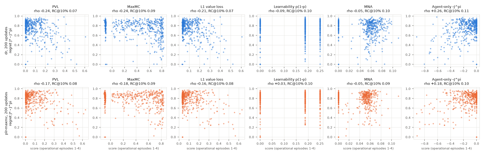
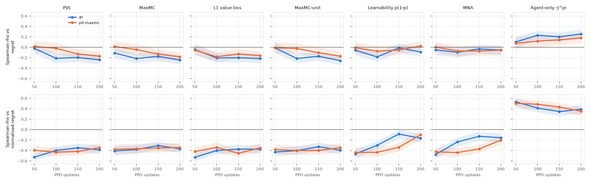

# E5 maze audit, pilot: do PVL and MaxMC track exact regret on JaxUED's own agents?

JaxUED's maze example (`third_party/jaxued_examples/maze_plr.py`, vendored unmodified) was
trained twice with its own code, seed 0, at its defaults, including its 30,000-update linear learning-rate schedule, and stopped
after 200 updates (1.6M env steps; the default run is 30,000 updates,
so this is 0.7% of it; the learning rate is still at least 99.3% of its initial value):
- **dr**: `--replay_prob 0 --exploratory_grad_updates`: every update trains on fresh generator levels;
- **plr-maxmc**: `--score_function MaxMC`: PLR-perp with replay 0.8, rank prioritisation (beta 0.3),
  staleness 0.3 and a 4,000-level buffer. It takes no gradient step on new levels, and replay starts
  only once the buffer is half full (about 63 updates), so it learns from fewer updates than dr.

Every audited checkpoint plays the same 500 generator mazes (13x13, 25 walls, 5x5 view;
497 have a reachable goal) for 8 episodes each: one AutoReplay stream per maze with
the stochastic policy, step for step as JaxUED's `sample_trajectories_rnn` (checked in the tests).
- **Scores** use episodes 1-4: what JaxUED's new-level branch computes on a rollout that
  ends after 4 episodes. PVL and MaxMC come from JaxUED's own `compute_gae` and
  `jaxued.utils` (gamma 0.995, lambda 0.98, time limits terminal). L1, MaxMC-unit,
  learnability p(1-p) (success = goal reached) and MNA use our primitives and the score spec's
  aggregation.
- **Native** PVL and MaxMC are what PLR at JaxUED's defaults stores for a new level: one 256-step
  rollout from a reset with a fresh LSTM carry (a second, independent stream), scored on every
  episode that completes in it (1 at the median, 1 to 11).
  No level scored -inf (JaxUED's value when no episode completes): with the 250-step time limit every 256-step rollout completes one.
- **Targets**: J^pi is the mean discounted return of episodes 5-8, so the scores and
  the target share no sampling noise. J* is the exact BFS optimum (`apexzero.maze.oracle`) with the
  run's own gamma and time limit. The plan's two primary targets are absolute regret J* - J^pi (all
  500 mazes) and normalised regret (J* - J^pi) / J* (the 497 mazes with J* > 0; it is undefined
  on the others).
- **Baselines**: agent-only (-J^pi on the scored episodes), J* and BFS path length (policy-agnostic),
  random, and oracle-operational (J* - J^pi on the scored episodes, divided by J* for the normalised
  target), a reference, not a ceiling.

Checks on every audited checkpoint:
- our PVL and MaxMC equal JaxUED's to 2.8e-07 (float32 vs float64);
- no episode beat the BFS optimum, so regret >= 0 for every episode, not just on average.
  The 3 mazes without a reachable goal have J* = J^pi = 0; on the rest the smallest
  per-maze regret is 0.004.

## Spearman rho with regret [95% bootstrap CI over levels]

**dr**

| | @50 updates | @100 updates | @150 updates | @200 updates |
|---|---|---|---|---|
| *solve rate* | 12% | 26% | 31% | 34% |
| *mean regret* | 0.852 | 0.791 | 0.770 | 0.746 |
| *regret held by the top 10%* | 0.11 | 0.12 | 0.12 | 0.12 |
| PVL | -0.02 [-0.12, +0.08] | -0.21 [-0.30, -0.12] | -0.20 [-0.28, -0.11] | -0.24 [-0.33, -0.14] |
| MaxMC | -0.11 [-0.21, -0.00] | -0.22 [-0.30, -0.13] | -0.17 [-0.26, -0.08] | -0.24 [-0.32, -0.15] |
| L1 value loss | -0.04 [-0.14, +0.06] | -0.20 [-0.29, -0.11] | -0.20 [-0.29, -0.11] | -0.21 [-0.30, -0.12] |
| MaxMC-unit | -0.01 [-0.11, +0.09] | -0.21 [-0.30, -0.12] | -0.17 [-0.26, -0.08] | -0.26 [-0.34, -0.16] |
| Learnability p(1-p) | -0.06 [-0.15, +0.05] | -0.18 [-0.27, -0.10] | -0.01 [-0.10, +0.07] | -0.09 [-0.18, -0.00] |
| MNA | -0.05 [-0.15, +0.06] | -0.09 [-0.19, -0.00] | -0.03 [-0.12, +0.06] | -0.05 [-0.14, +0.03] |
| PVL, native 256-step | +0.04 [-0.05, +0.14] | -0.06 [-0.15, +0.03] | -0.13 [-0.23, -0.04] | -0.19 [-0.28, -0.10] |
| MaxMC, native 256-step | -0.08 [-0.18, +0.01] | -0.04 [-0.14, +0.05] | -0.11 [-0.20, -0.02] | -0.21 [-0.30, -0.11] |
| Agent-only -J^pi | +0.10 [-0.01, +0.21] | +0.23 [+0.14, +0.32] | +0.20 [+0.11, +0.29] | +0.26 [+0.16, +0.34] |
| J* (policy-agnostic) | +0.17 [+0.05, +0.29] | -0.02 [-0.12, +0.07] | -0.20 [-0.30, -0.11] | -0.23 [-0.32, -0.13] |
| Random | -0.03 [-0.11, +0.06] | +0.04 [-0.05, +0.13] | -0.03 [-0.12, +0.06] | +0.01 [-0.08, +0.09] |
| Oracle-operational | +0.45 [+0.35, +0.54] | +0.31 [+0.22, +0.40] | +0.23 [+0.13, +0.32] | +0.27 [+0.17, +0.36] |
| BFS steps | -0.13 [-0.26, -0.02] | +0.06 [-0.04, +0.16] | +0.24 [+0.15, +0.33] | +0.26 [+0.17, +0.35] |

**plr-maxmc**

| | @50 updates | @100 updates | @150 updates | @200 updates |
|---|---|---|---|---|
| *solve rate* | 11% | 12% | 18% | 28% |
| *mean regret* | 0.858 | 0.845 | 0.822 | 0.783 |
| *regret held by the top 10%* | 0.11 | 0.11 | 0.11 | 0.12 |
| PVL | +0.02 [-0.09, +0.12] | -0.02 [-0.12, +0.09] | -0.13 [-0.22, -0.03] | -0.17 [-0.26, -0.08] |
| MaxMC | +0.01 [-0.09, +0.12] | -0.04 [-0.15, +0.06] | -0.13 [-0.23, -0.03] | -0.18 [-0.27, -0.09] |
| L1 value loss | -0.05 [-0.15, +0.05] | -0.18 [-0.27, -0.08] | -0.13 [-0.22, -0.03] | -0.16 [-0.25, -0.07] |
| MaxMC-unit | -0.01 [-0.11, +0.09] | -0.02 [-0.12, +0.08] | -0.10 [-0.20, +0.00] | -0.17 [-0.26, -0.08] |
| Learnability p(1-p) | -0.01 [-0.11, +0.10] | -0.07 [-0.18, +0.03] | -0.05 [-0.14, +0.04] | +0.03 [-0.06, +0.11] |
| MNA | +0.00 [-0.10, +0.11] | -0.07 [-0.18, +0.04] | -0.07 [-0.16, +0.03] | -0.05 [-0.15, +0.04] |
| PVL, native 256-step | +0.07 [-0.03, +0.16] | +0.05 [-0.04, +0.15] | -0.23 [-0.31, -0.13] | -0.11 [-0.20, -0.01] |
| MaxMC, native 256-step | +0.06 [-0.04, +0.15] | -0.01 [-0.11, +0.09] | -0.20 [-0.29, -0.11] | -0.13 [-0.22, -0.03] |
| Agent-only -J^pi | +0.08 [-0.04, +0.19] | +0.12 [+0.00, +0.23] | +0.14 [+0.04, +0.24] | +0.18 [+0.09, +0.28] |
| J* (policy-agnostic) | +0.21 [+0.09, +0.33] | +0.10 [-0.01, +0.22] | -0.06 [-0.17, +0.05] | -0.15 [-0.24, -0.05] |
| Random | +0.00 [-0.09, +0.09] | +0.01 [-0.08, +0.09] | -0.01 [-0.10, +0.08] | +0.03 [-0.06, +0.12] |
| Oracle-operational | +0.45 [+0.35, +0.55] | +0.38 [+0.28, +0.48] | +0.26 [+0.16, +0.36] | +0.21 [+0.11, +0.31] |
| BFS steps | -0.17 [-0.30, -0.05] | -0.07 [-0.19, +0.05] | +0.10 [-0.01, +0.20] | +0.18 [+0.08, +0.28] |

## Spearman rho with normalised regret, on the 497 mazes with J* > 0 [95% bootstrap CI over levels]

**dr**

| | @50 updates | @100 updates | @150 updates | @200 updates |
|---|---|---|---|---|
| *mean normalised regret* | 0.944 | 0.877 | 0.855 | 0.829 |
| *normalised regret held by the top 10%* | 0.11 | 0.11 | 0.12 | 0.12 |
| PVL | -0.53 [-0.59, -0.46] | -0.40 [-0.47, -0.32] | -0.35 [-0.42, -0.27] | -0.39 [-0.46, -0.30] |
| MaxMC | -0.41 [-0.49, -0.31] | -0.38 [-0.46, -0.30] | -0.31 [-0.38, -0.23] | -0.37 [-0.44, -0.28] |
| L1 value loss | -0.53 [-0.59, -0.45] | -0.40 [-0.47, -0.32] | -0.37 [-0.45, -0.29] | -0.38 [-0.46, -0.29] |
| MaxMC-unit | -0.43 [-0.51, -0.34] | -0.40 [-0.48, -0.32] | -0.33 [-0.40, -0.25] | -0.39 [-0.47, -0.31] |
| Learnability p(1-p) | -0.47 [-0.55, -0.37] | -0.30 [-0.38, -0.22] | -0.09 [-0.17, -0.00] | -0.16 [-0.25, -0.07] |
| MNA | -0.48 [-0.55, -0.39] | -0.24 [-0.32, -0.15] | -0.13 [-0.21, -0.04] | -0.16 [-0.24, -0.07] |
| PVL, native 256-step | -0.25 [-0.34, -0.15] | -0.14 [-0.23, -0.05] | -0.23 [-0.32, -0.15] | -0.27 [-0.35, -0.18] |
| MaxMC, native 256-step | -0.16 [-0.26, -0.06] | -0.10 [-0.19, -0.00] | -0.14 [-0.24, -0.05] | -0.21 [-0.30, -0.12] |
| Agent-only -J^pi | +0.53 [+0.44, +0.61] | +0.41 [+0.33, +0.49] | +0.34 [+0.27, +0.42] | +0.39 [+0.30, +0.47] |
| J* (policy-agnostic) | -0.62 [-0.67, -0.56] | -0.44 [-0.51, -0.36] | -0.53 [-0.59, -0.46] | -0.52 [-0.58, -0.44] |
| Random | +0.02 [-0.07, +0.11] | +0.07 [-0.02, +0.16] | +0.01 [-0.09, +0.09] | +0.02 [-0.06, +0.11] |
| Oracle-operational | +0.53 [+0.44, +0.61] | +0.41 [+0.33, +0.48] | +0.34 [+0.26, +0.41] | +0.38 [+0.29, +0.46] |
| BFS steps | +0.62 [+0.56, +0.67] | +0.44 [+0.36, +0.51] | +0.53 [+0.46, +0.59] | +0.52 [+0.44, +0.58] |

**plr-maxmc**

| | @50 updates | @100 updates | @150 updates | @200 updates |
|---|---|---|---|---|
| *mean normalised regret* | 0.951 | 0.937 | 0.912 | 0.869 |
| *normalised regret held by the top 10%* | 0.11 | 0.11 | 0.11 | 0.12 |
| PVL | -0.40 [-0.48, -0.31] | -0.43 [-0.51, -0.35] | -0.42 [-0.49, -0.34] | -0.34 [-0.43, -0.26] |
| MaxMC | -0.38 [-0.46, -0.28] | -0.37 [-0.45, -0.27] | -0.35 [-0.44, -0.26] | -0.35 [-0.42, -0.26] |
| L1 value loss | -0.42 [-0.50, -0.33] | -0.34 [-0.43, -0.24] | -0.45 [-0.52, -0.38] | -0.35 [-0.43, -0.27] |
| MaxMC-unit | -0.38 [-0.47, -0.29] | -0.40 [-0.48, -0.31] | -0.40 [-0.48, -0.31] | -0.35 [-0.43, -0.26] |
| Learnability p(1-p) | -0.44 [-0.52, -0.34] | -0.43 [-0.52, -0.35] | -0.34 [-0.42, -0.25] | -0.10 [-0.19, -0.02] |
| MNA | -0.43 [-0.51, -0.33] | -0.44 [-0.52, -0.35] | -0.37 [-0.45, -0.29] | -0.20 [-0.29, -0.12] |
| PVL, native 256-step | -0.15 [-0.24, -0.05] | -0.26 [-0.34, -0.16] | -0.30 [-0.39, -0.21] | -0.21 [-0.30, -0.12] |
| MaxMC, native 256-step | -0.11 [-0.21, -0.01] | -0.19 [-0.28, -0.09] | -0.20 [-0.29, -0.10] | -0.18 [-0.27, -0.09] |
| Agent-only -J^pi | +0.50 [+0.41, +0.59] | +0.49 [+0.39, +0.57] | +0.43 [+0.35, +0.51] | +0.35 [+0.27, +0.43] |
| J* (policy-agnostic) | -0.59 [-0.65, -0.53] | -0.66 [-0.71, -0.60] | -0.62 [-0.67, -0.56] | -0.51 [-0.58, -0.44] |
| Random | +0.01 [-0.08, +0.11] | +0.05 [-0.04, +0.14] | +0.05 [-0.04, +0.14] | +0.04 [-0.05, +0.13] |
| Oracle-operational | +0.50 [+0.41, +0.59] | +0.48 [+0.39, +0.57] | +0.43 [+0.35, +0.51] | +0.35 [+0.26, +0.42] |
| BFS steps | +0.59 [+0.53, +0.65] | +0.66 [+0.60, +0.71] | +0.62 [+0.56, +0.67] | +0.51 [+0.44, +0.58] |

## RC@10% for regret: share of the total in the score's top 50 of 500 levels

**dr**

| | @50 updates | @100 updates | @150 updates | @200 updates |
|---|---|---|---|---|
| PVL | 0.08 [0.07, 0.09] | 0.09 [0.08, 0.09] | 0.08 [0.07, 0.09] | 0.07 [0.06, 0.08] |
| MaxMC | 0.08 [0.08, 0.09] | 0.09 [0.08, 0.10] | 0.09 [0.09, 0.10] | 0.09 [0.08, 0.10] |
| L1 value loss | 0.08 [0.07, 0.09] | 0.09 [0.08, 0.09] | 0.08 [0.07, 0.09] | 0.07 [0.06, 0.08] |
| MaxMC-unit | 0.08 [0.08, 0.09] | 0.08 [0.07, 0.09] | 0.09 [0.08, 0.09] | 0.08 [0.07, 0.09] |
| Learnability p(1-p) | 0.09 [0.08, 0.09] | 0.09 [0.09, 0.10] | 0.10 [0.10, 0.10] | 0.10 [0.09, 0.10] |
| MNA | 0.09 [0.09, 0.10] | 0.10 [0.09, 0.10] | 0.09 [0.09, 0.10] | 0.10 [0.09, 0.11] |
| PVL, native 256-step | 0.09 [0.08, 0.09] | 0.08 [0.07, 0.09] | 0.08 [0.07, 0.09] | 0.08 [0.07, 0.09] |
| MaxMC, native 256-step | 0.09 [0.08, 0.09] | 0.08 [0.07, 0.09] | 0.09 [0.08, 0.09] | 0.08 [0.07, 0.09] |
| Agent-only -J^pi | 0.10 [0.10, 0.10] | 0.10 [0.10, 0.11] | 0.10 [0.10, 0.11] | 0.11 [0.10, 0.11] |
| J* (policy-agnostic) | 0.08 [0.07, 0.09] | 0.08 [0.07, 0.09] | 0.08 [0.07, 0.09] | 0.07 [0.06, 0.08] |
| Random | 0.10 [0.09, 0.10] | 0.10 [0.09, 0.10] | 0.10 [0.09, 0.11] | 0.10 [0.10, 0.11] |
| Oracle-operational | 0.10 [0.10, 0.11] | 0.10 [0.10, 0.11] | 0.10 [0.10, 0.11] | 0.10 [0.10, 0.11] |
| Regret itself (ceiling) | 0.11 [0.11, 0.11] | 0.12 [0.12, 0.12] | 0.12 [0.12, 0.12] | 0.12 [0.12, 0.13] |

**plr-maxmc**

| | @50 updates | @100 updates | @150 updates | @200 updates |
|---|---|---|---|---|
| PVL | 0.09 [0.08, 0.09] | 0.08 [0.07, 0.09] | 0.08 [0.07, 0.09] | 0.08 [0.07, 0.09] |
| MaxMC | 0.09 [0.08, 0.09] | 0.08 [0.07, 0.09] | 0.09 [0.08, 0.09] | 0.09 [0.08, 0.10] |
| L1 value loss | 0.09 [0.08, 0.09] | 0.08 [0.07, 0.09] | 0.08 [0.07, 0.09] | 0.08 [0.07, 0.09] |
| MaxMC-unit | 0.09 [0.08, 0.09] | 0.08 [0.07, 0.09] | 0.08 [0.07, 0.09] | 0.08 [0.08, 0.09] |
| Learnability p(1-p) | 0.09 [0.09, 0.10] | 0.09 [0.08, 0.09] | 0.09 [0.09, 0.10] | 0.10 [0.10, 0.10] |
| MNA | 0.10 [0.09, 0.10] | 0.09 [0.08, 0.10] | 0.10 [0.09, 0.10] | 0.09 [0.09, 0.10] |
| PVL, native 256-step | 0.09 [0.09, 0.10] | 0.09 [0.08, 0.10] | 0.09 [0.08, 0.09] | 0.08 [0.07, 0.09] |
| MaxMC, native 256-step | 0.09 [0.09, 0.10] | 0.09 [0.08, 0.10] | 0.09 [0.08, 0.09] | 0.08 [0.08, 0.09] |
| Agent-only -J^pi | 0.10 [0.10, 0.10] | 0.10 [0.10, 0.10] | 0.10 [0.10, 0.10] | 0.10 [0.10, 0.11] |
| J* (policy-agnostic) | 0.08 [0.08, 0.09] | 0.08 [0.07, 0.08] | 0.08 [0.08, 0.09] | 0.08 [0.07, 0.08] |
| Random | 0.10 [0.09, 0.10] | 0.10 [0.09, 0.10] | 0.10 [0.09, 0.10] | 0.10 [0.09, 0.11] |
| Oracle-operational | 0.10 [0.10, 0.11] | 0.10 [0.10, 0.10] | 0.10 [0.10, 0.11] | 0.10 [0.10, 0.11] |
| Regret itself (ceiling) | 0.11 [0.11, 0.11] | 0.11 [0.11, 0.11] | 0.11 [0.11, 0.12] | 0.12 [0.12, 0.12] |

*Regret itself (ceiling)* ranks levels by the target regret: no score can capture more.
Ties at the cut-off share the remaining slots, so a constant score captures exactly 0.10.

## RC@10% for normalised regret: share of the total in the score's top 50 of 497 levels

| | dr @50 | dr @100 | dr @150 | dr @200 | plr-maxmc @50 | plr-maxmc @100 | plr-maxmc @150 | plr-maxmc @200 |
|---|---|---|---|---|---|---|---|---|
| PVL | 0.08 | 0.08 | 0.07 | 0.07 | 0.08 | 0.07 | 0.08 | 0.07 |
| MaxMC | 0.08 | 0.09 | 0.09 | 0.08 | 0.08 | 0.08 | 0.08 | 0.09 |
| L1 value loss | 0.08 | 0.08 | 0.07 | 0.07 | 0.08 | 0.07 | 0.08 | 0.07 |
| MaxMC-unit | 0.08 | 0.08 | 0.08 | 0.08 | 0.08 | 0.08 | 0.08 | 0.08 |
| Learnability p(1-p) | 0.08 | 0.09 | 0.10 | 0.10 | 0.09 | 0.08 | 0.09 | 0.10 |
| MNA | 0.09 | 0.09 | 0.09 | 0.10 | 0.09 | 0.09 | 0.09 | 0.09 |
| PVL, native 256-step | 0.08 | 0.08 | 0.08 | 0.07 | 0.09 | 0.09 | 0.08 | 0.08 |
| MaxMC, native 256-step | 0.08 | 0.08 | 0.08 | 0.08 | 0.09 | 0.09 | 0.08 | 0.08 |
| Agent-only -J^pi | 0.10 | 0.11 | 0.11 | 0.11 | 0.10 | 0.11 | 0.11 | 0.11 |
| J* (policy-agnostic) | 0.07 | 0.07 | 0.07 | 0.06 | 0.08 | 0.07 | 0.08 | 0.07 |
| Regret itself (ceiling) | 0.11 | 0.11 | 0.12 | 0.12 | 0.11 | 0.11 | 0.11 | 0.12 |

(Point estimates; the CIs are in fidelity.json.)

## Against the best baseline: paired difference in rho [95% CI], Holm-adjusted p

The plan calls a score uninformative if it is not above the best of the agent-only and
policy-agnostic baselines (agent-only -J^pi, J*, BFS steps; paired CI). Each cell is
rho(score) - rho(best baseline), where the best baseline is taken per bootstrap resample, and
the two-sided bootstrap p-value of 'no difference', Holm-adjusted over the six headline scores
of that checkpoint and target. The native scores are listed without adjustment.

**dr, regret**

| | @50 updates | @100 updates | @150 updates | @200 updates |
|---|---|---|---|---|
| *best baseline (point estimate)* | J* (policy-agnostic) | Agent-only -J^pi | BFS steps | BFS steps |
| PVL | -0.19 [-0.32, -0.13]; p_H 0.006 | -0.44 [-0.61, -0.26]; p_H 0.006 | -0.44 [-0.60, -0.29]; p_H 0.006 | -0.50 [-0.67, -0.34]; p_H 0.006 |
| MaxMC | -0.28 [-0.41, -0.19]; p_H 0.006 | -0.45 [-0.62, -0.26]; p_H 0.006 | -0.41 [-0.57, -0.27]; p_H 0.006 | -0.50 [-0.67, -0.35]; p_H 0.006 |
| L1 value loss | -0.21 [-0.33, -0.15]; p_H 0.006 | -0.44 [-0.60, -0.25]; p_H 0.006 | -0.44 [-0.60, -0.29]; p_H 0.006 | -0.48 [-0.65, -0.31]; p_H 0.006 |
| MaxMC-unit | -0.18 [-0.31, -0.11]; p_H 0.006 | -0.45 [-0.62, -0.26]; p_H 0.006 | -0.41 [-0.57, -0.27]; p_H 0.006 | -0.52 [-0.69, -0.37]; p_H 0.006 |
| Learnability p(1-p) | -0.23 [-0.35, -0.14]; p_H 0.006 | -0.42 [-0.58, -0.24]; p_H 0.006 | -0.25 [-0.40, -0.13]; p_H 0.006 | -0.35 [-0.50, -0.22]; p_H 0.006 |
| MNA | -0.22 [-0.36, -0.14]; p_H 0.006 | -0.33 [-0.49, -0.15]; p_H 0.006 | -0.27 [-0.42, -0.14]; p_H 0.006 | -0.32 [-0.47, -0.19]; p_H 0.006 |
| PVL, native 256-step | -0.13 [-0.25, -0.05]; p 0.006 | -0.29 [-0.43, -0.15]; p <0.001 | -0.37 [-0.52, -0.23]; p <0.001 | -0.45 [-0.61, -0.32]; p <0.001 |
| MaxMC, native 256-step | -0.25 [-0.39, -0.16]; p <0.001 | -0.28 [-0.41, -0.14]; p <0.001 | -0.35 [-0.50, -0.22]; p <0.001 | -0.47 [-0.63, -0.35]; p <0.001 |

**plr-maxmc, regret**

| | @50 updates | @100 updates | @150 updates | @200 updates |
|---|---|---|---|---|
| *best baseline (point estimate)* | J* (policy-agnostic) | Agent-only -J^pi | Agent-only -J^pi | BFS steps |
| PVL | -0.19 [-0.29, -0.12]; p_H 0.006 | -0.14 [-0.34, -0.06]; p_H 0.006 | -0.27 [-0.46, -0.08]; p_H 0.012 | -0.35 [-0.54, -0.20]; p_H 0.006 |
| MaxMC | -0.20 [-0.30, -0.11]; p_H 0.006 | -0.16 [-0.37, -0.08]; p_H 0.006 | -0.27 [-0.46, -0.09]; p_H 0.012 | -0.36 [-0.55, -0.22]; p_H 0.006 |
| L1 value loss | -0.26 [-0.36, -0.18]; p_H 0.006 | -0.30 [-0.48, -0.21]; p_H 0.006 | -0.27 [-0.46, -0.09]; p_H 0.012 | -0.34 [-0.53, -0.19]; p_H 0.006 |
| MaxMC-unit | -0.22 [-0.32, -0.13]; p_H 0.006 | -0.14 [-0.34, -0.07]; p_H 0.006 | -0.25 [-0.44, -0.06]; p_H 0.012 | -0.35 [-0.54, -0.20]; p_H 0.006 |
| Learnability p(1-p) | -0.22 [-0.33, -0.13]; p_H 0.006 | -0.19 [-0.40, -0.11]; p_H 0.006 | -0.19 [-0.38, -0.02]; p_H 0.030 | -0.16 [-0.33, -0.03]; p_H 0.016 |
| MNA | -0.21 [-0.32, -0.11]; p_H 0.006 | -0.19 [-0.40, -0.10]; p_H 0.006 | -0.21 [-0.40, -0.03]; p_H 0.030 | -0.24 [-0.42, -0.10]; p_H 0.006 |
| PVL, native 256-step | -0.14 [-0.26, -0.04]; p 0.007 | -0.07 [-0.24, +0.01]; p 0.063 | -0.37 [-0.52, -0.22]; p <0.001 | -0.29 [-0.46, -0.15]; p <0.001 |
| MaxMC, native 256-step | -0.15 [-0.27, -0.04]; p 0.008 | -0.13 [-0.30, -0.05]; p 0.008 | -0.35 [-0.49, -0.21]; p <0.001 | -0.31 [-0.47, -0.18]; p <0.001 |

**dr, normalised regret**

| | @50 updates | @100 updates | @150 updates | @200 updates |
|---|---|---|---|---|
| *best baseline (point estimate)* | BFS steps | BFS steps | BFS steps | BFS steps |
| PVL | -1.15 [-1.25, -1.03]; p_H 0.006 | -0.84 [-0.97, -0.71]; p_H 0.006 | -0.88 [-1.00, -0.75]; p_H 0.006 | -0.91 [-1.02, -0.77]; p_H 0.006 |
| MaxMC | -1.03 [-1.14, -0.90]; p_H 0.006 | -0.82 [-0.95, -0.69]; p_H 0.006 | -0.84 [-0.95, -0.71]; p_H 0.006 | -0.89 [-1.00, -0.75]; p_H 0.006 |
| L1 value loss | -1.15 [-1.25, -1.03]; p_H 0.006 | -0.84 [-0.97, -0.71]; p_H 0.006 | -0.90 [-1.02, -0.77]; p_H 0.006 | -0.90 [-1.02, -0.75]; p_H 0.006 |
| MaxMC-unit | -1.05 [-1.17, -0.92]; p_H 0.006 | -0.84 [-0.97, -0.71]; p_H 0.006 | -0.86 [-0.98, -0.73]; p_H 0.006 | -0.92 [-1.03, -0.78]; p_H 0.006 |
| Learnability p(1-p) | -1.09 [-1.20, -0.96]; p_H 0.006 | -0.74 [-0.87, -0.62]; p_H 0.006 | -0.62 [-0.73, -0.50]; p_H 0.006 | -0.69 [-0.79, -0.55]; p_H 0.006 |
| MNA | -1.10 [-1.21, -0.97]; p_H 0.006 | -0.67 [-0.81, -0.55]; p_H 0.006 | -0.66 [-0.78, -0.54]; p_H 0.006 | -0.68 [-0.79, -0.55]; p_H 0.006 |
| PVL, native 256-step | -0.87 [-0.99, -0.74]; p <0.001 | -0.58 [-0.71, -0.46]; p <0.001 | -0.77 [-0.89, -0.64]; p <0.001 | -0.79 [-0.91, -0.66]; p <0.001 |
| MaxMC, native 256-step | -0.78 [-0.90, -0.66]; p <0.001 | -0.53 [-0.67, -0.41]; p <0.001 | -0.67 [-0.79, -0.55]; p <0.001 | -0.74 [-0.85, -0.61]; p <0.001 |

**plr-maxmc, normalised regret**

| | @50 updates | @100 updates | @150 updates | @200 updates |
|---|---|---|---|---|
| *best baseline (point estimate)* | BFS steps | BFS steps | BFS steps | BFS steps |
| PVL | -0.99 [-1.11, -0.85]; p_H 0.006 | -1.09 [-1.20, -0.96]; p_H 0.006 | -1.04 [-1.16, -0.91]; p_H 0.006 | -0.86 [-0.98, -0.72]; p_H 0.006 |
| MaxMC | -0.97 [-1.09, -0.83]; p_H 0.006 | -1.03 [-1.14, -0.89]; p_H 0.006 | -0.97 [-1.09, -0.85]; p_H 0.006 | -0.86 [-0.98, -0.73]; p_H 0.006 |
| L1 value loss | -1.01 [-1.13, -0.88]; p_H 0.006 | -1.00 [-1.13, -0.87]; p_H 0.006 | -1.08 [-1.19, -0.95]; p_H 0.006 | -0.86 [-0.99, -0.72]; p_H 0.006 |
| MaxMC-unit | -0.98 [-1.10, -0.84]; p_H 0.006 | -1.06 [-1.18, -0.93]; p_H 0.006 | -1.02 [-1.14, -0.90]; p_H 0.006 | -0.86 [-0.99, -0.72]; p_H 0.006 |
| Learnability p(1-p) | -1.03 [-1.15, -0.89]; p_H 0.006 | -1.09 [-1.21, -0.97]; p_H 0.006 | -0.96 [-1.07, -0.84]; p_H 0.006 | -0.61 [-0.74, -0.49]; p_H 0.006 |
| MNA | -1.02 [-1.14, -0.88]; p_H 0.006 | -1.10 [-1.21, -0.97]; p_H 0.006 | -0.99 [-1.10, -0.87]; p_H 0.006 | -0.71 [-0.84, -0.59]; p_H 0.006 |
| PVL, native 256-step | -0.74 [-0.86, -0.61]; p <0.001 | -0.92 [-1.03, -0.79]; p <0.001 | -0.93 [-1.04, -0.81]; p <0.001 | -0.72 [-0.85, -0.58]; p <0.001 |
| MaxMC, native 256-step | -0.71 [-0.83, -0.58]; p <0.001 | -0.85 [-0.96, -0.73]; p <0.001 | -0.83 [-0.94, -0.70]; p <0.001 | -0.70 [-0.83, -0.57]; p <0.001 |

## Scores against regret at the last audited checkpoint

Spearman rho across checkpoints, against absolute (top) and normalised (bottom) regret
(shaded: 95% bootstrap CI):

## Lambda sensitivity of PVL and L1 (rho with regret)

| | dr @50 | dr @100 | dr @150 | dr @200 | plr-maxmc @50 | plr-maxmc @100 | plr-maxmc @150 | plr-maxmc @200 |
|---|---|---|---|---|---|---|---|---|
| PVL, lambda 0.9 | +0.00 | -0.21 | -0.20 | -0.23 | -0.00 | -0.02 | -0.12 | -0.16 |
| PVL, lambda 0.95 | -0.01 | -0.21 | -0.19 | -0.23 | +0.01 | -0.02 | -0.12 | -0.17 |
| PVL, lambda 0.98 (headline) | -0.02 | -0.21 | -0.20 | -0.24 | +0.02 | -0.02 | -0.13 | -0.17 |
| PVL, lambda 1.0 | -0.08 | -0.23 | -0.20 | -0.24 | +0.01 | -0.12 | -0.12 | -0.17 |
| L1, lambda 0.95 | -0.02 | -0.20 | -0.19 | -0.21 | -0.05 | -0.11 | -0.13 | -0.16 |
| L1, lambda 0.98 (headline) | -0.04 | -0.20 | -0.20 | -0.21 | -0.05 | -0.18 | -0.13 | -0.16 |
| L1, lambda 1.0 | -0.07 | -0.22 | -0.20 | -0.20 | -0.13 | -0.19 | -0.13 | -0.16 |

## Diagnostics: what the scores track

| | dr @50 | dr @100 | dr @150 | dr @200 | plr-maxmc @50 | plr-maxmc @100 | plr-maxmc @150 | plr-maxmc @200 |
|---|---|---|---|---|---|---|---|---|
| rho(PVL, solve rate in episodes 1-4) | +0.83 | +0.90 | +0.87 | +0.86 | +0.79 | +0.77 | +0.89 | +0.89 |
| rho(MaxMC, solve rate in episodes 1-4) | +0.82 | +0.87 | +0.82 | +0.79 | +0.79 | +0.82 | +0.87 | +0.83 |
| rho(L1 value loss, solve rate in episodes 1-4) | +0.80 | +0.88 | +0.78 | +0.78 | +0.75 | +0.39 | +0.86 | +0.83 |
| rho(PVL, regret), mazes solved at least once in 1-4 | -0.33 | -0.25 | -0.28 | -0.27 | -0.33 | -0.33 | -0.29 | -0.24 |
| rho(MaxMC, regret), mazes solved at least once in 1-4 | -0.29 | -0.23 | -0.23 | -0.22 | -0.29 | -0.30 | -0.28 | -0.19 |
| rho(L1 value loss, regret), mazes solved at least once in 1-4 | -0.33 | -0.25 | -0.28 | -0.27 | -0.33 | -0.32 | -0.29 | -0.24 |
| mazes solved at least once in 1-4 | 168 | 316 | 354 | 373 | 145 | 167 | 233 | 333 |
| median / 90th percentile regret | 0.88 / 0.93 | 0.84 / 0.92 | 0.82 / 0.91 | 0.80 / 0.91 | 0.88 / 0.94 | 0.88 / 0.93 | 0.87 / 0.93 | 0.83 / 0.92 |
| episodes in the native 256-step rollout (mean) | 1.08 | 1.16 | 1.20 | 1.26 | 1.05 | 1.04 | 1.09 | 1.16 |
| reliability of a 4-episode regret estimate | 0.45 | 0.31 | 0.23 | 0.27 | 0.45 | 0.38 | 0.26 | 0.21 |
| projected for 32 episodes (Spearman-Brown) | 0.87 | 0.78 | 0.71 | 0.74 | 0.87 | 0.83 | 0.74 | 0.68 |

The reliability row is the rank correlation of two independent 4-episode estimates
of the same regret (the oracle-operational row above). A score's observable rho with the
target is capped near the square root of it (the plan's sqrt(reliability) ceiling).

## Reading

- **In this phase the value-based scores rank mazes the wrong way round.**
  At the last checkpoint of each run (200 updates; solve rate dr 34%, plr-maxmc 28%), PVL, MaxMC,
  L1 and MaxMC-unit have rho -0.26 to -0.16 with regret.
  All six headline scores are below the best baseline at both checkpoints, every paired CI
  excluding 0 (and every Holm-adjusted p < 0.05).
- **Scores and success.** PVL, MaxMC and L1 have rho +0.39 to +0.90 with the scored episodes'
  solve rate across checkpoints, and that solve rate has rho -0.23 to -0.07 with regret.
  Restricted to mazes solved at least once in the scored episodes (checkpoints with 100 or
  more such mazes), rho with regret is -0.33 to -0.19.
- **Normalised regret (the plan's prediction for MaxMC).** Across checkpoints MaxMC has rho
  -0.24 to +0.01 with absolute and -0.41 to -0.31 with normalised regret; native
  MaxMC -0.21 to +0.06 and -0.21 to -0.10, so the prediction's premise, a high rho against absolute regret, does not hold at this stage, and the prediction cannot be tested yet.
- **Native vs 4-episode scores.** JaxUED's own 256-step score differs from the fixed-4-episode
  version by -0.10 to +0.17 in rho across checkpoints; see the rho tables.
- **RC@10% cannot discriminate yet.** Regret is compressed (median 0.80 to 0.88,
  90th percentile 0.91 to 0.94), because the agent fails most mazes and J* lies between 0.86 and 0.96 on 80% of the solvable mazes.
  Ranking by regret itself captures only 0.11 to 0.12 of it in the top 10%, so the plan's
  provisional 'faithful' bar (RC@10% >= 0.6) is out of reach for any score here. RC has to be
  read against its ceiling, and says something only once regret concentrates on a minority of mazes.
- **Target reliability.** 4 target episodes estimate regret with reliability
  0.21 to 0.45, so even a score equal to the true regret would show a rho of
  only about 0.46 to 0.67 (the square root) against it. With
  32 target episodes per maze the projected reliability is
  0.68 to 0.87; more mazes do not change it.
- **Scope.** One seed, 0.7% of a default run, and an agent that fails most mazes. The full E5 has to show whether the sign changes once the agent solves most mazes, when a solved maze's regret is about speed rather than success.

## Compute

- Training: 17.2 min wall, 29.0 CPU-min for the two runs (dr 16.9, plr-maxmc 12.1).
- Audits: 2.1 min wall, 4.0 CPU-min for 8 checkpoints (500 mazes x 8 episodes each, plus the native rollout).
- Total: **33.9 CPU-min**. Every JAX process ran single-threaded XLA at nice 10 on a
  machine shared with other jobs (load average far above the core count), so wall times are
  inflated and CPU times are probably too: niced work lands on the efficiency cores.

## Deviations from JaxUED and from the plan, and limits of this pilot

- **Episodes per score.** The headline scores fix the scored episodes at
  4 for every maze and checkpoint (spec DEV-5), so their noise does not depend on the
  agent's speed. JaxUED scores whatever completes in one 256-step rollout; the native rows
  report exactly that score, so the deviation's effect is visible in the tables.
- **Training length.** Each run is stopped after 200 of JaxUED's default 30,000 updates; nothing else in the training differs from a default run (the learning rate has barely decayed).
- **MNA** is normalised per step (DEV-11). Its gate 1[R_max > 0] equals 'any success' here,
  because the maze reward is positive exactly when the goal is reached.
- **Statistics.** CIs are percentile bootstraps over levels only (one seed, so not the plan's
  two-way seed x level bootstrap). Holm is applied over the six headline scores within each
  checkpoint and target, not over checkpoints, runs or the two targets.
- **Fresh-score audit only.** The frozen checkpoint rescores fresh generator levels. The
  scores stored in PLR's buffer (the in-buffer audit) are not analysed yet, although every
  checkpoint carries the buffer.
- **Pilot scale.** One seed, 200 updates, the 5x5 view only. SFL is not run: its maze code is
  not vendored. These numbers size and debug the full E5 (5 seeds x 16 checkpoints x 2,000
  mazes); they are not results.

Reproduce: `uv run python scripts/maze_audit.py` (artefacts in `runs/maze-audit/pilot-v2/`).
