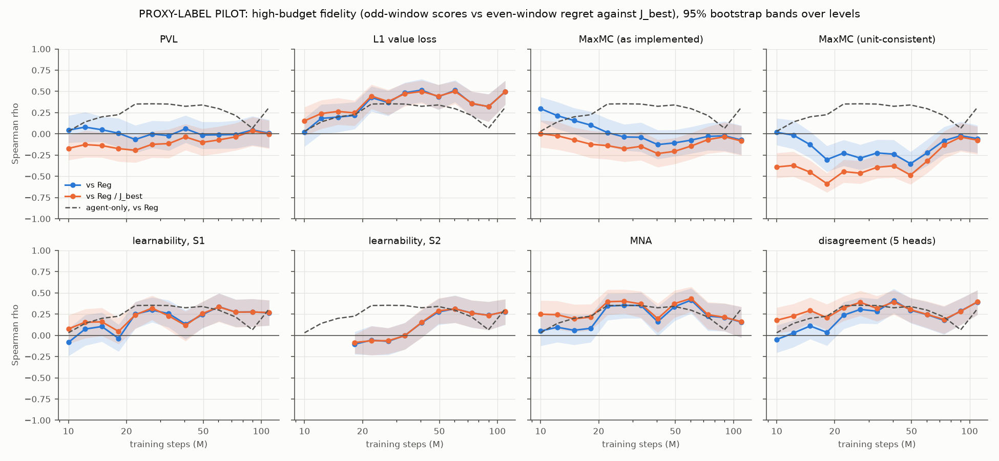
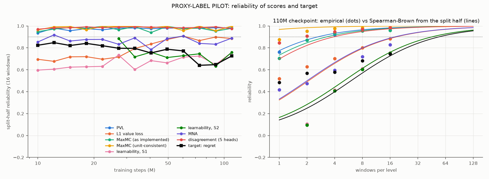

# Pilot audit: level-score fidelity on the DR pilot's early checkpoints

> **PROXY-LABEL PILOT.** Regret here is measured against **J_best**, the best mean
> return any audited checkpoint reached on the level, not against the TO-OCP optimum
> J\*_20. These numbers test the E1 machinery (plan phase 11) and must not be read as
> findings about the scores. The audit is ready for real labels: re-run with
> `--j-opt labels.npy` (J\*_20 for the same levels, in level order).

Generated by `scripts/pilot_audit.py` from `runs/dr-pilot-200M`.

## Summary (computed; proxy labels)

- **Units:** σ = 12.1-17.3; mean V(o₀) / mean G^γ = 0.944-0.997 across checkpoints, so critic values are in raw reward units (normalised values would give ~1/σ ≈ 0.06).
- **Phase:** window completion 71%-89%; phases covered: mid.
- **Gradable checkpoints:** 13 of 13 (with proxy labels, a checkpoint that attains J_best on half the levels or more has degenerate labels and is excluded from these bullets).
- **Target reliability:** split-half r of Reg at 16 windows 0.64-0.85 (median 0.79); windows for 0.9 by Spearman-Brown: median 38, range 26-81 (see the Spearman-Brown check under *Reliability and power* before trusting these budgets).
- **Score reliability**, median windows for 0.9 over gradable checkpoints: PVL 3; L1 value loss 38; MaxMC (as implemented) 4; MaxMC (unit-consistent) 1; learnability, S1 79; learnability, S2 59; MNA 21; disagreement (5 heads) 3.
- **ρ vs Reg with CI above 0** (high budget), checkpoints: PVL 0/13; L1 value loss 12/13; MaxMC (as implemented) 3/13; MaxMC (unit-consistent) 0/13; learnability, S1 8/13; learnability, S2 5/13; MNA 7/13; disagreement (5 heads) 9/13.
- **ρ above the agent-only baseline** (paired CI above 0), checkpoints: PVL 0/13; L1 value loss 4/13; MaxMC (as implemented) 0/13; MaxMC (unit-consistent) 0/13; learnability, S1 0/13; learnability, S2 0/13; MNA 0/13; disagreement (5 heads) 1/13.

## Setup

- **Checkpoints:** 13 DR-pilot checkpoints, 10.0M, 12.2M, 14.9M, 18.2M, 22.2M, 27.1M, 33.1M, 40.5M, 49.4M, 60.3M, 73.7M, 90.0M, 109.9M (single seed; training was still running, so these are early checkpoints only).
- **Levels:** the first 150 A_DR levels (`make_levels(PRNGKey(2026), 'a_dr')`), grammar fitted on R-dev only. No lockbox (R-test) circuit is used anywhere.
- **Windows:** 32 stochastic 1,200-step windows per level and checkpoint, with 1% observation noise; one chunk phase per window drawn from U{0..127} (seed 2026); mode F scoring (window end terminal), λ = 0.95 headline. The same random draws are reused at every checkpoint (common random numbers).
- **Window roles (plan 2.2):** high-budget scores use the odd windows (1, 3, ..., 31), the target the even windows; operational scores use windows 1-4 and their target windows 5-32.
- **Target:** J^π = mean discounted return over the target windows; J_best = max over checkpoints of that mean (from the target windows only, so scores and labels share no window noise); Reg = J_best − J^π, Reg_norm = Reg / J_best. J_best is a certified lower bound on J\*: every realised window is a feasible control sequence of the deterministic level.
- **Phase:** window completion rate over all windows of the audited levels (<50% early, 50-90% mid, ≥90% late).
- **Statistics:** percentile bootstrap over levels, 1000 resamples shared by all scores (Δ columns are paired against the agent-only baseline). One seed, so no seed-level variance is included: CIs are too narrow for the plan's two-way bootstrap.
- **Compute:** rollouts + window statistics 28.4 min wall, 55.0 min CPU in total (nice 15, on a machine shared with the DR run).

Baselines: *agent-only* = −J^π on the score windows; *J_best, score windows* = the policy-agnostic optimum baseline (recomputed from the score windows, in the role J\*_20 will play); *geometric* = −d_QSS, the distance the QSS profile of the level's own car covers in 60 s (shorter = slower, more technical strip); *random*. The *proxy regret, score windows (reference)* row is the oracle-operational reference, J_best − J^π on the score windows: a reference, not a ceiling.

## Units check and phase

Critic values must be in raw reward units (V = σ·V̂, spec DEV-6; `rollout_windows` multiplies by σ from the checkpoint's `ret_rms`). A calibrated critic then has mean V(o₀) ≈ mean G^γ (the *ratio* column is the units check); values left normalised would be off by the factor σ. *slope* and *r* (G on V across levels) measure something else: how well V(o₀) tells levels apart, which is limited because o₀ previews only the first few hundred metres of a ~3.5 km window.

| Checkpoint | σ | mean V(o₀) | mean G^γ | ratio | slope | r | completion | phase | S2 rate | mean J^π | mean Reg | median Reg | attains J_best | corr(J_best, J^π) |
|---|---|---|---|---|---|---|---|---|---|---|---|---|---|---|
| 10.0M | 12.09 | 51.9 | 52.1 | 0.997 | 2.29 | 0.35 | 74.3% | mid | 0.0% | 52.1 | 17.15 | 16.64 | 0% | +0.85 |
| 12.2M | 12.80 | 53.1 | 54.9 | 0.966 | 1.77 | 0.32 | 73.8% | mid | 0.0% | 55.0 | 14.21 | 13.72 | 0% | +0.90 |
| 14.9M | 13.44 | 55.4 | 56.8 | 0.974 | 1.41 | 0.29 | 74.1% | mid | 0.0% | 56.9 | 12.32 | 11.91 | 0% | +0.92 |
| 18.2M | 14.11 | 57.9 | 59.5 | 0.973 | 0.83 | 0.21 | 81.0% | mid | 0.5% | 59.4 | 9.83 | 9.54 | 0% | +0.94 |
| 22.2M | 14.74 | 59.3 | 60.8 | 0.975 | 1.35 | 0.30 | 71.2% | mid | 7.5% | 60.8 | 8.44 | 7.90 | 0% | +0.92 |
| 27.1M | 15.25 | 59.3 | 62.8 | 0.944 | 1.72 | 0.32 | 77.0% | mid | 25.2% | 62.7 | 6.53 | 5.99 | 0% | +0.94 |
| 33.1M | 15.72 | 62.8 | 64.1 | 0.980 | 1.35 | 0.30 | 73.9% | mid | 50.6% | 64.1 | 5.12 | 4.35 | 0% | +0.92 |
| 40.5M | 16.14 | 63.4 | 65.4 | 0.970 | 1.60 | 0.40 | 75.2% | mid | 63.3% | 65.3 | 3.91 | 2.66 | 1% | +0.92 |
| 49.4M | 16.52 | 65.5 | 66.6 | 0.983 | 1.07 | 0.33 | 83.9% | mid | 74.6% | 66.6 | 2.56 | 2.12 | 1% | +0.97 |
| 60.3M | 16.79 | 65.4 | 67.3 | 0.971 | 1.11 | 0.38 | 87.5% | mid | 82.3% | 67.3 | 1.95 | 1.16 | 2% | +0.96 |
| 73.7M | 17.02 | 66.7 | 68.0 | 0.981 | 0.79 | 0.30 | 83.8% | mid | 83.4% | 68.0 | 1.18 | 0.45 | 11% | +0.92 |
| 90.0M | 17.20 | 66.6 | 68.6 | 0.971 | 0.80 | 0.30 | 88.6% | mid | 88.2% | 68.6 | 0.59 | 0.08 | 41% | +0.97 |
| 109.9M | 17.34 | 67.4 | 67.9 | 0.991 | 1.17 | 0.38 | 77.6% | mid | 76.9% | 67.9 | 1.33 | 0.12 | 45% | +0.91 |

*attains J_best*: share of levels on which this checkpoint *is* the proxy optimum, so its regret is exactly 0 there (always 0% with TO-OCP labels). *corr(J_best, J^π)*: rank correlation of the two loadings of the two-loading regression; near ±1 they are unidentified. *S2 rate*: windows that complete and cover at least 97% of d_QSS (the non-saturating success).

## Fidelity across training (high budget)

Spearman ρ of each score (odd windows) against absolute regret (even windows), 95% CI.

| Score | 10M (mid) | 12M (mid) | 15M (mid) | 18M (mid) | 22M (mid) | 27M (mid) | 33M (mid) | 40M (mid) | 49M (mid) | 60M (mid) | 74M (mid) | 90M (mid) | 110M (mid) |
|---|---|---|---|---|---|---|---|---|---|---|---|---|---|
| PVL | +0.04 [-0.10, +0.22] | +0.08 [-0.10, +0.26] | +0.05 [-0.09, +0.20] | +0.01 [-0.16, +0.18] | -0.07 [-0.22, +0.10] | -0.00 [-0.17, +0.15] | -0.02 [-0.20, +0.15] | +0.06 [-0.10, +0.22] | -0.01 [-0.18, +0.14] | -0.01 [-0.17, +0.14] | -0.01 [-0.17, +0.16] | +0.05 [-0.13, +0.21] | +0.01 [-0.16, +0.17] |
| L1 value loss | +0.02 [-0.15, +0.19] | +0.18 [+0.00, +0.35] | +0.20 [+0.02, +0.36] | +0.22 [+0.06, +0.37] | +0.43 [+0.26, +0.56] | +0.37 [+0.21, +0.51] | +0.48 [+0.34, +0.60] | +0.52 [+0.37, +0.65] | +0.44 [+0.28, +0.58] | +0.51 [+0.37, +0.63] | +0.36 [+0.20, +0.50] | +0.32 [+0.15, +0.47] | +0.50 [+0.34, +0.63] |
| MaxMC (as implemented) | +0.30 [+0.15, +0.43] | +0.21 [+0.06, +0.38] | +0.16 [+0.00, +0.30] | +0.10 [-0.08, +0.26] | +0.01 [-0.15, +0.18] | -0.04 [-0.20, +0.11] | -0.04 [-0.21, +0.13] | -0.13 [-0.30, +0.05] | -0.11 [-0.26, +0.05] | -0.07 [-0.23, +0.08] | -0.03 [-0.19, +0.13] | -0.02 [-0.20, +0.15] | -0.07 [-0.24, +0.10] |
| MaxMC (unit-consistent) | +0.02 [-0.13, +0.18] | -0.02 [-0.18, +0.16] | -0.13 [-0.28, +0.03] | -0.30 [-0.45, -0.14] | -0.23 [-0.38, -0.07] | -0.29 [-0.42, -0.13] | -0.22 [-0.37, -0.07] | -0.24 [-0.39, -0.07] | -0.35 [-0.48, -0.21] | -0.22 [-0.37, -0.07] | -0.08 [-0.24, +0.08] | -0.02 [-0.19, +0.14] | -0.06 [-0.22, +0.10] |
| learnability, S1 | -0.08 [-0.24, +0.08] | +0.07 [-0.12, +0.24] | +0.10 [-0.07, +0.27] | -0.04 [-0.19, +0.13] | +0.25 [+0.08, +0.40] | +0.30 [+0.15, +0.45] | +0.26 [+0.09, +0.41] | +0.13 [-0.05, +0.30] | +0.24 [+0.08, +0.39] | +0.34 [+0.17, +0.50] | +0.27 [+0.10, +0.42] | +0.28 [+0.10, +0.43] | +0.26 [+0.12, +0.41] |
| learnability, S2 | - | - | - | -0.10 [-0.22, +0.04] | -0.06 [-0.23, +0.11] | -0.07 [-0.23, +0.09] | -0.00 [-0.17, +0.15] | +0.15 [-0.02, +0.30] | +0.28 [+0.12, +0.43] | +0.31 [+0.15, +0.47] | +0.26 [+0.09, +0.41] | +0.24 [+0.06, +0.40] | +0.28 [+0.13, +0.43] |
| MNA | +0.05 [-0.12, +0.22] | +0.10 [-0.08, +0.28] | +0.06 [-0.11, +0.24] | +0.08 [-0.08, +0.24] | +0.35 [+0.18, +0.49] | +0.35 [+0.20, +0.50] | +0.35 [+0.20, +0.51] | +0.16 [-0.01, +0.34] | +0.34 [+0.17, +0.50] | +0.41 [+0.26, +0.55] | +0.23 [+0.05, +0.38] | +0.21 [+0.05, +0.38] | +0.16 [-0.03, +0.34] |
| disagreement (5 heads) | -0.05 [-0.20, +0.12] | +0.03 [-0.14, +0.18] | +0.11 [-0.04, +0.29] | +0.04 [-0.12, +0.20] | +0.24 [+0.08, +0.39] | +0.31 [+0.14, +0.45] | +0.28 [+0.14, +0.43] | +0.41 [+0.26, +0.55] | +0.30 [+0.14, +0.44] | +0.24 [+0.08, +0.39] | +0.18 [+0.01, +0.34] | +0.29 [+0.12, +0.44] | +0.39 [+0.24, +0.53] |
| agent-only, -J^pi_score | +0.03 [-0.13, +0.19] | +0.14 [-0.03, +0.30] | +0.20 [+0.04, +0.36] | +0.23 [+0.06, +0.37] | +0.35 [+0.20, +0.49] | +0.35 [+0.19, +0.49] | +0.35 [+0.19, +0.49] | +0.32 [+0.14, +0.48] | +0.34 [+0.19, +0.48] | +0.30 [+0.14, +0.45] | +0.22 [+0.05, +0.37] | +0.07 [-0.11, +0.24] | +0.31 [+0.16, +0.46] |
| J_best, score windows | +0.33 [+0.18, +0.48] | +0.22 [+0.06, +0.38] | +0.13 [-0.02, +0.29] | +0.05 [-0.11, +0.21] | -0.04 [-0.20, +0.11] | -0.14 [-0.29, +0.03] | -0.10 [-0.25, +0.07] | -0.12 [-0.27, +0.04] | -0.21 [-0.35, -0.06] | -0.15 [-0.31, +0.00] | -0.07 [-0.23, +0.10] | +0.03 [-0.14, +0.20] | -0.11 [-0.28, +0.05] |
| geometric: -d_QSS(60 s) | -0.40 [-0.53, -0.26] | -0.31 [-0.44, -0.16] | -0.21 [-0.36, -0.06] | -0.19 [-0.33, -0.03] | -0.03 [-0.19, +0.14] | +0.04 [-0.11, +0.19] | -0.01 [-0.17, +0.17] | +0.01 [-0.14, +0.17] | +0.08 [-0.07, +0.24] | +0.06 [-0.11, +0.22] | -0.03 [-0.19, +0.13] | +0.06 [-0.11, +0.23] | -0.04 [-0.21, +0.13] |
| random | +0.07 [-0.09, +0.23] | +0.08 [-0.08, +0.23] | -0.15 [-0.30, +0.02] | -0.04 [-0.20, +0.12] | -0.16 [-0.33, +0.01] | -0.01 [-0.17, +0.16] | +0.12 [-0.03, +0.27] | +0.07 [-0.10, +0.23] | -0.11 [-0.27, +0.06] | +0.00 [-0.17, +0.18] | +0.05 [-0.13, +0.20] | +0.08 [-0.09, +0.25] | +0.02 [-0.14, +0.19] |
| proxy regret, score windows (reference) | +0.82 [+0.73, +0.89] | +0.85 [+0.77, +0.90] | +0.82 [+0.74, +0.88] | +0.84 [+0.77, +0.89] | +0.82 [+0.75, +0.87] | +0.80 [+0.72, +0.85] | +0.79 [+0.71, +0.86] | +0.75 [+0.65, +0.84] | +0.79 [+0.69, +0.87] | +0.77 [+0.66, +0.86] | +0.64 [+0.51, +0.76] | +0.65 [+0.50, +0.77] | +0.73 [+0.61, +0.82] |

## Operational scores (windows 1-4 against windows 5+)

Spearman ρ against absolute regret, and the RC@10% lift (share of total regret in the score's top 10% of levels, rescaled so that random = 0 and the regret-sorted oracle = 1; see the per-checkpoint tables for why the raw share is not shown here).

| Score | 10M ρ / lift | 12M ρ / lift | 15M ρ / lift | 18M ρ / lift | 22M ρ / lift | 27M ρ / lift | 33M ρ / lift | 40M ρ / lift | 49M ρ / lift | 60M ρ / lift | 74M ρ / lift | 90M ρ / lift | 110M ρ / lift |
|---|---|---|---|---|---|---|---|---|---|---|---|---|---|
| PVL | +0.07 / +0.15 | +0.07 / +0.17 | +0.05 / +0.25 | +0.03 / +0.07 | -0.07 / +0.02 | +0.03 / +0.04 | +0.04 / +0.11 | +0.04 / -0.07 | -0.00 / -0.01 | +0.03 / -0.05 | +0.09 / +0.30 | +0.09 / +0.12 | -0.01 / -0.07 |
| L1 value loss | +0.07 / -0.06 | +0.22 / +0.24 | +0.15 / +0.31 | +0.18 / +0.11 | +0.36 / +0.31 | +0.39 / +0.56 | +0.48 / +0.63 | +0.46 / +0.86 | +0.37 / +0.72 | +0.52 / +0.87 | +0.28 / +0.56 | +0.45 / +0.85 | +0.41 / +0.80 |
| MaxMC (as implemented) | +0.29 / +0.34 | +0.14 / +0.39 | +0.11 / +0.30 | +0.17 / +0.28 | -0.01 / +0.06 | -0.01 / +0.10 | -0.09 / +0.08 | -0.12 / -0.08 | -0.10 / -0.11 | -0.02 / -0.04 | -0.04 / +0.19 | -0.04 / +0.41 | -0.18 / -0.08 |
| MaxMC (unit-consistent) | +0.02 / -0.03 | -0.07 / +0.03 | -0.17 / -0.16 | -0.27 / -0.19 | -0.27 / -0.20 | -0.25 / -0.13 | -0.27 / -0.17 | -0.29 / -0.10 | -0.38 / -0.16 | -0.22 / -0.11 | -0.12 / -0.10 | -0.05 / +0.00 | -0.11 / -0.05 |
| learnability, S1 | -0.03 / +0.07 | +0.11 / +0.07 | +0.01 / +0.01 | +0.03 / +0.10 | +0.05 / +0.06 | +0.26 / +0.27 | +0.20 / +0.07 | +0.14 / +0.07 | +0.17 / +0.13 | +0.16 / +0.16 | +0.21 / +0.24 | +0.31 / +0.43 | +0.17 / -0.03 |
| learnability, S2 | - / +0.00 | - / -0.00 | - / +0.00 | +0.00 / +0.00 | -0.05 / -0.08 | -0.00 / +0.04 | +0.09 / +0.06 | +0.14 / +0.05 | +0.20 / +0.18 | +0.12 / +0.15 | +0.20 / +0.24 | +0.29 / +0.41 | +0.19 / -0.03 |
| MNA | +0.02 / -0.04 | -0.03 / +0.06 | -0.01 / -0.08 | +0.12 / -0.03 | +0.14 / +0.24 | +0.32 / +0.36 | +0.16 / +0.17 | +0.10 / +0.16 | +0.30 / +0.20 | +0.38 / +0.60 | +0.16 / +0.28 | +0.22 / +0.48 | -0.01 / +0.24 |
| disagreement (5 heads) | +0.01 / +0.03 | +0.02 / +0.09 | +0.12 / +0.25 | +0.02 / +0.25 | +0.21 / +0.14 | +0.27 / +0.40 | +0.34 / +0.34 | +0.38 / +0.56 | +0.31 / +0.71 | +0.27 / +0.64 | +0.21 / +0.27 | +0.28 / +0.31 | +0.39 / +0.64 |
| agent-only, -J^pi_score | +0.07 / +0.00 | +0.15 / +0.31 | +0.18 / +0.45 | +0.19 / +0.44 | +0.34 / +0.48 | +0.32 / +0.43 | +0.32 / +0.48 | +0.35 / +0.74 | +0.34 / +0.49 | +0.29 / +0.69 | +0.14 / +0.13 | +0.08 / +0.35 | +0.32 / +0.41 |
| J_best, score windows | +0.31 / +0.45 | +0.19 / +0.40 | +0.10 / +0.24 | +0.05 / +0.22 | -0.04 / +0.06 | -0.11 / +0.01 | -0.06 / +0.06 | -0.09 / -0.10 | -0.22 / -0.06 | -0.09 / -0.07 | -0.03 / +0.21 | +0.02 / +0.06 | -0.06 / -0.07 |
| geometric: -d_QSS(60 s) | -0.40 / -0.27 | -0.30 / -0.17 | -0.22 / -0.09 | -0.25 / -0.18 | -0.06 / -0.08 | +0.00 / +0.04 | -0.03 / -0.02 | -0.00 / -0.09 | +0.09 / +0.00 | -0.01 / +0.05 | -0.04 / -0.02 | +0.04 / +0.05 | +0.00 / -0.06 |
| random | +0.07 / +0.23 | +0.06 / -0.04 | -0.12 / +0.06 | -0.07 / +0.24 | -0.17 / -0.02 | -0.03 / -0.05 | +0.09 / -0.04 | +0.06 / +0.34 | -0.12 / -0.02 | +0.03 / +0.15 | +0.06 / -0.10 | +0.13 / -0.03 | +0.01 / +0.05 |
| proxy regret, score windows (reference) | +0.75 / +0.31 | +0.76 / +0.30 | +0.75 / +0.55 | +0.78 / +0.41 | +0.71 / +0.50 | +0.72 / +0.61 | +0.72 / +0.68 | +0.68 / +0.85 | +0.64 / +0.82 | +0.74 / +0.75 | +0.47 / +0.48 | +0.58 / +0.77 | +0.64 / +0.81 |

## Reliability and power

Split-half reliability: each score computed on the odd and on the even windows (16 each), Spearman correlation across levels. That is the reliability of the high-budget score as used (16 windows); Spearman-Brown steps it to other budgets. *Windows for 0.9* is the Spearman-Brown prophecy (the G1 gate asks for ≥ 0.9 late and ≥ 0.8 mid within 64 windows). *op.* is the prophecy at the operational budget: 4 windows for scores, the 28 target windows 5-32 for the target rows.

| Quantity | 10M r / for 0.9 / op. | 12M r / for 0.9 / op. | 15M r / for 0.9 / op. | 18M r / for 0.9 / op. | 22M r / for 0.9 / op. | 27M r / for 0.9 / op. | 33M r / for 0.9 / op. | 40M r / for 0.9 / op. | 49M r / for 0.9 / op. | 60M r / for 0.9 / op. | 74M r / for 0.9 / op. | 90M r / for 0.9 / op. | 110M r / for 0.9 / op. |
|---|---|---|---|---|---|---|---|---|---|---|---|---|---|
| PVL | 0.93 / 11 / 0.78 | 0.98 / 3 / 0.92 | 0.96 / 7 / 0.84 | 0.97 / 4 / 0.91 | 0.96 / 6 / 0.87 | 0.98 / 3 / 0.92 | 0.98 / 3 / 0.93 | 0.97 / 4 / 0.91 | 0.98 / 3 / 0.92 | 0.98 / 3 / 0.93 | 0.98 / 4 / 0.92 | 0.98 / 3 / 0.93 | 0.98 / 3 / 0.93 |
| L1 value loss | 0.70 / 64 / 0.36 | 0.68 / 69 / 0.34 | 0.72 / 57 / 0.39 | 0.72 / 57 / 0.39 | 0.70 / 63 / 0.36 | 0.72 / 58 / 0.39 | 0.79 / 38 / 0.49 | 0.83 / 29 / 0.56 | 0.88 / 21 / 0.64 | 0.91 / 15 / 0.71 | 0.87 / 23 / 0.62 | 0.90 / 17 / 0.69 | 0.88 / 19 / 0.66 |
| MaxMC (as implemented) | 0.95 / 8 / 0.82 | 0.97 / 5 / 0.89 | 0.99 / 3 / 0.95 | 0.98 / 4 / 0.92 | 1.00 / 1 / 0.98 | 0.96 / 6 / 0.87 | 0.99 / 2 / 0.97 | 0.94 / 10 / 0.79 | 1.00 / 1 / 0.98 | 0.97 / 4 / 0.90 | 0.98 / 3 / 0.93 | 0.95 / 8 / 0.83 | 0.98 / 4 / 0.92 |
| MaxMC (unit-consistent) | 0.96 / 6 / 0.87 | 0.99 / 2 / 0.96 | 0.99 / 1 / 0.98 | 0.96 / 6 / 0.87 | 1.00 / 1 / 0.99 | 1.00 / 1 / 0.98 | 1.00 / 1 / 0.99 | 0.98 / 3 / 0.94 | 1.00 / 1 / 0.99 | 0.96 / 7 / 0.85 | 1.00 / 1 / 0.99 | 0.96 / 7 / 0.84 | 1.00 / 1 / 0.99 |
| learnability, S1 | 0.60 / 98 / 0.27 | 0.61 / 94 / 0.28 | 0.62 / 87 / 0.29 | 0.63 / 86 / 0.30 | 0.63 / 85 / 0.30 | 0.73 / 53 / 0.41 | 0.60 / 96 / 0.27 | 0.68 / 67 / 0.35 | 0.66 / 74 / 0.33 | 0.72 / 58 / 0.39 | 0.73 / 55 / 0.40 | 0.65 / 79 / 0.31 | 0.76 / 46 / 0.44 |
| learnability, S2 | - / - / - | - / - / - | - / - / - | - / - / - | - / - / - | 0.88 / 19 / 0.66 | 0.72 / 57 / 0.39 | 0.76 / 46 / 0.44 | 0.71 / 59 / 0.38 | 0.73 / 54 / 0.40 | 0.75 / 50 / 0.42 | 0.63 / 84 / 0.30 | 0.76 / 46 / 0.44 |
| MNA | 0.85 / 25 / 0.59 | 0.92 / 13 / 0.74 | 0.86 / 24 / 0.61 | 0.88 / 21 / 0.64 | 0.88 / 21 / 0.64 | 0.83 / 29 / 0.55 | 0.89 / 18 / 0.67 | 0.78 / 40 / 0.48 | 0.88 / 19 / 0.66 | 0.91 / 15 / 0.71 | 0.84 / 28 / 0.57 | 0.83 / 29 / 0.55 | 0.89 / 19 / 0.67 |
| disagreement (5 heads) | 0.97 / 5 / 0.89 | 0.98 / 3 / 0.93 | 0.98 / 3 / 0.93 | 0.99 / 2 / 0.97 | 0.98 / 3 / 0.94 | 0.99 / 2 / 0.96 | 0.99 / 2 / 0.97 | 0.99 / 2 / 0.96 | 0.98 / 3 / 0.94 | 0.98 / 3 / 0.93 | 0.99 / 3 / 0.94 | 0.99 / 2 / 0.97 | 0.97 / 4 / 0.90 |
| agent-only, -J^pi_score | 0.94 / 10 / 0.79 | 0.96 / 6 / 0.87 | 0.97 / 5 / 0.89 | 0.98 / 4 / 0.91 | 0.97 / 6 / 0.87 | 0.98 / 4 / 0.91 | 0.98 / 4 / 0.92 | 0.99 / 3 / 0.94 | 0.99 / 1 / 0.97 | 0.98 / 3 / 0.94 | 0.97 / 5 / 0.89 | 0.99 / 1 / 0.98 | 0.98 / 4 / 0.92 |
| **target: Reg** | 0.82 / 31 / 0.89 | 0.85 / 26 / 0.91 | 0.82 / 32 / 0.89 | 0.84 / 28 / 0.90 | 0.82 / 32 / 0.89 | 0.80 / 37 / 0.87 | 0.79 / 38 / 0.87 | 0.75 / 48 / 0.84 | 0.79 / 39 / 0.87 | 0.77 / 43 / 0.86 | 0.64 / 81 / 0.76 | 0.65 / 79 / 0.76 | 0.73 / 55 / 0.82 |
| **target: Reg/J_best** | 0.77 / 42 / 0.86 | 0.84 / 28 / 0.90 | 0.84 / 27 / 0.90 | 0.86 / 25 / 0.91 | 0.83 / 30 / 0.90 | 0.81 / 34 / 0.88 | 0.80 / 36 / 0.88 | 0.77 / 44 / 0.85 | 0.81 / 35 / 0.88 | 0.78 / 40 / 0.86 | 0.65 / 78 / 0.76 | 0.65 / 80 / 0.76 | 0.73 / 55 / 0.82 |
| **target: J^π** | 0.94 / 10 / 0.96 | 0.96 / 6 / 0.98 | 0.97 / 5 / 0.98 | 0.98 / 4 / 0.99 | 0.97 / 6 / 0.98 | 0.98 / 4 / 0.99 | 0.98 / 4 / 0.99 | 0.99 / 3 / 0.99 | 0.99 / 1 / 1.00 | 0.98 / 3 / 0.99 | 0.97 / 5 / 0.98 | 0.99 / 1 / 1.00 | 0.98 / 4 / 0.99 |

**Level power.** Smallest Spearman ρ distinguishable from 0 at α = 0.05 with 80% power (Fisher z, variance 1.06/(n−3)): 0.234 with 150 levels, 0.091 with 1000 levels, 0.077 with 1412 levels. A difference between two independent ρs needs √2 more in z; scores graded on the same levels are paired, so the bootstrap Δ columns are tighter than that.

Caveats on the reliability numbers: Spearman-Brown assumes the score averages exchangeable windows. MaxMC (and the max-return term of MaxMC-unit) take a maximum over windows, so their prophecy is approximate; the right panel of the figure compares the prophecy with the empirical curve. A reliability near 0 or negative cannot be extrapolated ("never"). Split-half r is not reported ("-") when more than 80% of levels share one value in either half (e.g. S2 learnability while almost no window succeeds): the halves then agree on their ties and r is spuriously high.

**Spearman-Brown check (110M, empirical vs prophecy at 1 window).** Flatter than the prophecy by more than 0.1: L1 value loss (0.52 vs 0.32); disagreement (5 heads) (0.85 vs 0.70); target Reg (0.48 vs 0.14). Close to it: PVL (0.76 vs 0.77); MaxMC (as implemented) (0.70 vs 0.73); MaxMC (unit-consistent) (0.88 vs 0.97); MNA (0.42 vs 0.33). For the flatter ones the window budgets for 0.9 above are likely optimistic, and the empirical curve, not the prophecy, should size the full audit. The crash-window table below tests one cause: crashed windows have heavy-tailed per-window values, so a mean over windows gains rank reliability more slowly than exchangeable averaging assumes.

**Crash windows and reliability.** Split-half r (odd vs even windows, 16 each) of the per-level window mean, over all windows and over completed windows only. If dropping crashed windows raises r, crash windows (not window-to-window noise in clean driving) limit reliability, which favours the plan's hurdle split (crash probability, and regret given completion) and robust aggregation for the full audit. The headline scores keep the reference definitions (means over all windows).

| Quantity | 10M | 12M | 15M | 18M | 22M | 27M | 33M | 40M | 49M | 60M | 74M | 90M | 110M |
|---|---|---|---|---|---|---|---|---|---|---|---|---|---|
| crash share of windows | 26% | 26% | 26% | 19% | 29% | 23% | 26% | 25% | 16% | 12% | 16% | 11% | 22% |
| L1 (λ 0.95): all / completed only | 0.70 / 0.96 | 0.68 / 0.95 | 0.72 / 0.94 | 0.72 / 0.93 | 0.70 / 0.93 | 0.72 / 0.94 | 0.79 / 0.90 | 0.83 / 0.91 | 0.88 / 0.90 | 0.91 / 0.94 | 0.87 / 0.93 | 0.90 / 0.93 | 0.88 / 0.92 |
| G^γ (= J^π): all / completed only | 0.94 / 1.00 | 0.96 / 1.00 | 0.97 / 1.00 | 0.98 / 1.00 | 0.97 / 1.00 | 0.98 / 1.00 | 0.98 / 1.00 | 0.99 / 1.00 | 0.99 / 1.00 | 0.98 / 1.00 | 0.97 / 1.00 | 0.99 / 1.00 | 0.98 / 1.00 |

## Per-checkpoint tables (high budget)

ρ = Spearman against Reg and against Reg/J_best; RC@10% = share of total regret in the score's top 10% of levels (random = k/L = 0.10); lift = (RC − k/L) / (RC_oracle − k/L), so random = 0 and the regret-sorted oracle = 1 (when regret is spread almost evenly over levels the oracle itself captures little more than k/L, given in each heading, so the raw share barely moves, and dividing by the oracle share alone would rate a random score close to 1); P@10% = overlap of the top 10% sets; a, b = standardised loadings of rank(S) on rank(J_best) and rank(J^π) (faithful: a > 0, b < 0); Δρ = ρ minus the agent-only baseline's ρ, paired; ρ* = ρ disattenuated by the split-half reliabilities of score and target (it can exceed 1 in magnitude when those reliabilities are small, since both are noisy estimates).

### 10.0M steps: completion 74.3% (mid), 150 levels graded, oracle RC@10% 0.14

| Score | ρ vs Reg | ρ vs Reg/J_best | RC@10% | RC lift | P@10% | a | b | Δρ vs agent-only | ρ* |
|---|---|---|---|---|---|---|---|---|---|
| PVL | +0.04 [-0.10, +0.22] | -0.17 [-0.31, -0.02] | 0.11 [0.10, 0.12] | +0.19 [-0.08, +0.46] | 0.27 [0.07, 0.40] | +0.29 [+0.00, +0.58] | +0.17 [-0.08, +0.44] | +0.01 [-0.26, +0.28] | +0.05 |
| L1 value loss | +0.02 [-0.15, +0.19] | +0.15 [-0.02, +0.32] | 0.09 [0.08, 0.11] | -0.20 [-0.46, +0.24] | 0.13 [0.00, 0.33] | -0.18 [-0.46, +0.10] | -0.20 [-0.48, +0.08] | -0.01 [-0.17, +0.15] | +0.03 |
| MaxMC (as implemented) | +0.30 [+0.15, +0.43] | +0.00 [-0.16, +0.16] | 0.11 [0.10, 0.12] | +0.28 [+0.06, +0.62] | 0.27 [0.07, 0.53] | +0.78 [+0.56, +1.00] | -0.13 [-0.36, +0.09] | +0.27 [-0.01, +0.53] | +0.34 |
| MaxMC (unit-consistent) | +0.02 [-0.13, +0.18] | -0.39 [-0.52, -0.22] | 0.10 [0.09, 0.11] | +0.11 [-0.19, +0.36] | 0.20 [0.00, 0.40] | +0.42 [+0.26, +0.57] | +0.55 [+0.41, +0.71] | -0.01 [-0.32, +0.30] | +0.02 |
| learnability, S1 | -0.08 [-0.24, +0.08] | +0.08 [-0.10, +0.24] | 0.10 [0.09, 0.11] | -0.02 [-0.28, +0.23] | 0.05 [0.00, 0.21] | -0.20 [-0.52, +0.11] | -0.13 [-0.44, +0.20] | -0.11 [-0.29, +0.08] | -0.12 |
| learnability, S2 | - | - | 0.10 [0.10, 0.10] | +0.00 [-0.00, +0.00] | 0.10 [0.10, 0.10] | - | - | - | - |
| MNA | +0.05 [-0.12, +0.22] | +0.25 [+0.07, +0.41] | 0.10 [0.09, 0.11] | -0.05 [-0.39, +0.27] | 0.20 [0.00, 0.40] | -0.08 [-0.39, +0.23] | -0.40 [-0.67, -0.10] | +0.02 [-0.14, +0.19] | +0.06 |
| disagreement (5 heads) | -0.05 [-0.20, +0.12] | +0.18 [+0.03, +0.33] | 0.10 [0.09, 0.11] | -0.10 [-0.36, +0.17] | 0.07 [0.00, 0.20] | -0.27 [-0.55, +0.01] | -0.22 [-0.49, +0.05] | -0.08 [-0.24, +0.11] | -0.05 |
| agent-only, -J^pi_score | +0.03 [-0.13, +0.19] | +0.43 [+0.28, +0.57] | 0.10 [0.09, 0.11] | +0.08 [-0.25, +0.36] | 0.20 [0.00, 0.40] | -0.32 [-0.46, -0.17] | -0.67 [-0.81, -0.52] | +0.00 [+0.00, +0.00] | +0.03 |
| J_best, score windows | +0.33 [+0.18, +0.48] | -0.10 [-0.25, +0.07] | 0.12 [0.11, 0.13] | +0.43 [+0.18, +0.72] | 0.27 [0.07, 0.53] | +0.99 [+0.96, +1.01] | +0.01 [-0.02, +0.04] | +0.30 [+0.00, +0.59] | +0.37 |
| geometric: -d_QSS(60 s) | -0.40 [-0.53, -0.26] | -0.12 [-0.27, +0.04] | 0.09 [0.08, 0.10] | -0.31 [-0.52, -0.08] | 0.00 [0.00, 0.13] | -0.87 [-1.12, -0.62] | +0.30 [+0.03, +0.55] | -0.43 [-0.58, -0.27] | -0.45 |
| random | +0.07 [-0.09, +0.23] | +0.03 [-0.14, +0.19] | 0.11 [0.10, 0.12] | +0.26 [-0.04, +0.54] | 0.27 [0.07, 0.47] | +0.19 [-0.13, +0.49] | -0.11 [-0.42, +0.22] | +0.04 [-0.20, +0.28] | +0.08 |
| proxy regret, score windows (reference) | +0.82 [+0.73, +0.89] | +0.69 [+0.59, +0.77] | 0.12 [0.12, 0.13] | +0.64 [+0.44, +0.88] | 0.67 [0.30, 0.80] | +1.36 [+1.08, +1.62] | -1.25 [-1.50, -0.94] | +0.79 [+0.63, +0.95] | - |

### 12.2M steps: completion 73.8% (mid), 150 levels graded, oracle RC@10% 0.14

| Score | ρ vs Reg | ρ vs Reg/J_best | RC@10% | RC lift | P@10% | a | b | Δρ vs agent-only | ρ* |
|---|---|---|---|---|---|---|---|---|---|
| PVL | +0.08 [-0.10, +0.26] | -0.13 [-0.28, +0.04] | 0.10 [0.09, 0.11] | +0.04 [-0.20, +0.36] | 0.13 [0.00, 0.33] | +0.51 [+0.15, +0.84] | +0.03 [-0.29, +0.37] | -0.06 [-0.34, +0.24] | +0.09 |
| L1 value loss | +0.18 [+0.00, +0.35] | +0.24 [+0.06, +0.40] | 0.11 [0.10, 0.13] | +0.24 [-0.11, +0.60] | 0.27 [0.07, 0.53] | +0.21 [-0.26, +0.59] | -0.45 [-0.83, +0.01] | +0.04 [-0.16, +0.23] | +0.24 |
| MaxMC (as implemented) | +0.21 [+0.06, +0.38] | -0.02 [-0.19, +0.14] | 0.11 [0.10, 0.12] | +0.27 [+0.06, +0.51] | 0.20 [0.00, 0.40] | +0.79 [+0.49, +1.04] | -0.15 [-0.41, +0.14] | +0.07 [-0.21, +0.38] | +0.24 |
| MaxMC (unit-consistent) | -0.02 [-0.18, +0.16] | -0.37 [-0.50, -0.21] | 0.10 [0.09, 0.11] | -0.03 [-0.27, +0.26] | 0.13 [0.00, 0.33] | +0.46 [+0.30, +0.60] | +0.51 [+0.37, +0.66] | -0.16 [-0.48, +0.19] | -0.02 |
| learnability, S1 | +0.07 [-0.12, +0.24] | +0.15 [-0.03, +0.31] | 0.10 [0.10, 0.11] | +0.11 [-0.10, +0.34] | 0.07 [0.00, 0.30] | +0.01 [-0.41, +0.40] | -0.24 [-0.63, +0.19] | -0.07 [-0.28, +0.15] | +0.10 |
| learnability, S2 | - | - | 0.10 [0.10, 0.10] | +0.00 [-0.00, +0.00] | 0.10 [0.10, 0.10] | - | - | - | - |
| MNA | +0.10 [-0.08, +0.28] | +0.24 [+0.07, +0.41] | 0.11 [0.09, 0.12] | +0.24 [-0.14, +0.55] | 0.27 [0.07, 0.53] | +0.01 [-0.39, +0.39] | -0.39 [-0.75, +0.02] | -0.05 [-0.24, +0.16] | +0.11 |
| disagreement (5 heads) | +0.03 [-0.14, +0.18] | +0.23 [+0.05, +0.37] | 0.11 [0.09, 0.12] | +0.16 [-0.20, +0.39] | 0.13 [0.00, 0.33] | -0.20 [-0.55, +0.08] | -0.32 [-0.62, +0.03] | -0.11 [-0.29, +0.07] | +0.03 |
| agent-only, -J^pi_score | +0.14 [-0.03, +0.30] | +0.49 [+0.34, +0.62] | 0.12 [0.10, 0.13] | +0.40 [+0.07, +0.61] | 0.20 [0.07, 0.47] | -0.15 [-0.29, -0.04] | -0.83 [-0.94, -0.69] | +0.00 [+0.00, +0.00] | +0.16 |
| J_best, score windows | +0.22 [+0.06, +0.38] | -0.16 [-0.31, +0.01] | 0.11 [0.10, 0.13] | +0.34 [+0.02, +0.62] | 0.27 [0.07, 0.47] | +0.98 [+0.94, +1.01] | +0.02 [-0.01, +0.06] | +0.08 [-0.25, +0.41] | +0.24 |
| geometric: -d_QSS(60 s) | -0.31 [-0.44, -0.16] | -0.06 [-0.21, +0.09] | 0.09 [0.08, 0.10] | -0.22 [-0.41, +0.04] | 0.00 [0.00, 0.20] | -0.94 [-1.17, -0.66] | +0.36 [+0.07, +0.63] | -0.45 [-0.61, -0.28] | -0.33 |
| random | +0.08 [-0.08, +0.23] | +0.06 [-0.10, +0.21] | 0.10 [0.09, 0.11] | -0.03 [-0.26, +0.33] | 0.13 [0.00, 0.40] | +0.32 [-0.07, +0.62] | -0.28 [-0.59, +0.12] | -0.06 [-0.28, +0.18] | +0.09 |
| proxy regret, score windows (reference) | +0.85 [+0.77, +0.90] | +0.78 [+0.69, +0.84] | 0.14 [0.13, 0.14] | +0.87 [+0.72, +0.97] | 0.73 [0.53, 0.93] | +1.65 [+1.31, +1.92] | -1.66 [-1.92, -1.31] | +0.71 [+0.56, +0.87] | - |

### 14.9M steps: completion 74.1% (mid), 150 levels graded, oracle RC@10% 0.14

| Score | ρ vs Reg | ρ vs Reg/J_best | RC@10% | RC lift | P@10% | a | b | Δρ vs agent-only | ρ* |
|---|---|---|---|---|---|---|---|---|---|
| PVL | +0.05 [-0.09, +0.20] | -0.14 [-0.28, +0.02] | 0.10 [0.09, 0.11] | -0.01 [-0.25, +0.28] | 0.13 [0.00, 0.27] | +0.51 [+0.16, +0.85] | -0.02 [-0.35, +0.33] | -0.15 [-0.40, +0.11] | +0.05 |
| L1 value loss | +0.20 [+0.02, +0.36] | +0.26 [+0.11, +0.42] | 0.12 [0.10, 0.13] | +0.39 [-0.01, +0.70] | 0.33 [0.07, 0.53] | +0.42 [+0.01, +0.77] | -0.67 [-1.00, -0.28] | -0.00 [-0.16, +0.18] | +0.26 |
| MaxMC (as implemented) | +0.16 [+0.00, +0.30] | -0.07 [-0.23, +0.07] | 0.11 [0.10, 0.12] | +0.17 [-0.01, +0.38] | 0.07 [0.00, 0.27] | +0.70 [+0.34, +1.02] | -0.07 [-0.40, +0.29] | -0.04 [-0.32, +0.23] | +0.17 |
| MaxMC (unit-consistent) | -0.13 [-0.28, +0.03] | -0.45 [-0.58, -0.31] | 0.09 [0.08, 0.10] | -0.17 [-0.41, +0.02] | 0.07 [0.00, 0.13] | +0.36 [+0.11, +0.59] | +0.57 [+0.33, +0.83] | -0.33 [-0.63, -0.02] | -0.14 |
| learnability, S1 | +0.10 [-0.07, +0.27] | +0.16 [-0.01, +0.32] | 0.11 [0.09, 0.12] | +0.14 [-0.12, +0.44] | 0.24 [0.07, 0.47] | +0.11 [-0.34, +0.55] | -0.29 [-0.75, +0.15] | -0.10 [-0.31, +0.11] | +0.15 |
| learnability, S2 | - | - | 0.10 [0.10, 0.10] | +0.00 [-0.00, +0.00] | 0.10 [0.10, 0.10] | - | - | - | - |
| MNA | +0.06 [-0.11, +0.24] | +0.19 [+0.04, +0.36] | 0.10 [0.09, 0.11] | +0.08 [-0.25, +0.35] | 0.27 [0.00, 0.47] | -0.17 [-0.63, +0.30] | -0.20 [-0.66, +0.21] | -0.14 [-0.32, +0.06] | +0.07 |
| disagreement (5 heads) | +0.11 [-0.04, +0.29] | +0.29 [+0.15, +0.45] | 0.11 [0.09, 0.13] | +0.21 [-0.13, +0.55] | 0.20 [0.07, 0.47] | -0.07 [-0.45, +0.31] | -0.43 [-0.77, -0.06] | -0.09 [-0.25, +0.08] | +0.12 |
| agent-only, -J^pi_score | +0.20 [+0.04, +0.36] | +0.54 [+0.41, +0.65] | 0.11 [0.10, 0.13] | +0.30 [-0.03, +0.60] | 0.20 [0.07, 0.47] | -0.12 [-0.26, +0.01] | -0.86 [-0.98, -0.73] | +0.00 [+0.00, +0.00] | +0.22 |
| J_best, score windows | +0.13 [-0.02, +0.29] | -0.25 [-0.39, -0.09] | 0.11 [0.10, 0.12] | +0.18 [-0.08, +0.48] | 0.13 [0.00, 0.27] | +0.98 [+0.94, +1.02] | +0.02 [-0.02, +0.06] | -0.08 [-0.37, +0.24] | +0.14 |
| geometric: -d_QSS(60 s) | -0.21 [-0.36, -0.06] | +0.03 [-0.13, +0.19] | 0.09 [0.09, 0.11] | -0.13 [-0.32, +0.13] | 0.07 [0.00, 0.27] | -0.85 [-1.11, -0.54] | +0.25 [-0.05, +0.52] | -0.41 [-0.55, -0.25] | -0.23 |
| random | -0.15 [-0.30, +0.02] | -0.14 [-0.29, +0.03] | 0.10 [0.09, 0.11] | -0.02 [-0.21, +0.23] | 0.07 [0.00, 0.20] | -0.24 [-0.61, +0.14] | +0.32 [-0.07, +0.66] | -0.35 [-0.56, -0.11] | -0.16 |
| proxy regret, score windows (reference) | +0.82 [+0.74, +0.88] | +0.77 [+0.68, +0.84] | 0.13 [0.12, 0.15] | +0.72 [+0.56, +0.89] | 0.47 [0.20, 0.67] | +1.81 [+1.39, +2.15] | -1.89 [-2.20, -1.50] | +0.62 [+0.47, +0.78] | - |

### 18.2M steps: completion 81.0% (mid), 150 levels graded, oracle RC@10% 0.15

| Score | ρ vs Reg | ρ vs Reg/J_best | RC@10% | RC lift | P@10% | a | b | Δρ vs agent-only | ρ* |
|---|---|---|---|---|---|---|---|---|---|
| PVL | +0.01 [-0.16, +0.18] | -0.17 [-0.33, +0.00] | 0.10 [0.09, 0.11] | -0.02 [-0.25, +0.20] | 0.00 [0.00, 0.27] | +0.46 [+0.05, +0.90] | +0.04 [-0.41, +0.44] | -0.22 [-0.49, +0.07] | +0.01 |
| L1 value loss | +0.22 [+0.06, +0.37] | +0.25 [+0.10, +0.39] | 0.11 [0.09, 0.14] | +0.19 [-0.20, +0.58] | 0.20 [0.00, 0.47] | +0.49 [-0.04, +0.92] | -0.68 [-1.07, -0.18] | -0.01 [-0.19, +0.18] | +0.28 |
| MaxMC (as implemented) | +0.10 [-0.08, +0.26] | -0.12 [-0.29, +0.04] | 0.11 [0.10, 0.12] | +0.10 [-0.07, +0.35] | 0.07 [0.00, 0.33] | +0.70 [+0.25, +1.20] | -0.09 [-0.60, +0.35] | -0.12 [-0.40, +0.16] | +0.11 |
| MaxMC (unit-consistent) | -0.30 [-0.45, -0.14] | -0.59 [-0.69, -0.46] | 0.09 [0.08, 0.10] | -0.22 [-0.50, -0.02] | 0.07 [0.00, 0.20] | -0.04 [-0.36, +0.27] | +0.94 [+0.66, +1.21] | -0.53 [-0.81, -0.20] | -0.34 |
| learnability, S1 | -0.04 [-0.19, +0.13] | +0.05 [-0.10, +0.21] | 0.10 [0.09, 0.12] | +0.05 [-0.22, +0.36] | 0.13 [0.00, 0.33] | -0.36 [-0.77, +0.16] | +0.15 [-0.36, +0.55] | -0.26 [-0.46, -0.04] | -0.05 |
| learnability, S2 | -0.10 [-0.22, +0.04] | -0.09 [-0.21, +0.01] | 0.10 [0.09, 0.10] | -0.07 [-0.19, +0.01] | 0.08 [0.05, 0.09] | -0.18 [-0.60, +0.27] | +0.19 [-0.19, +0.54] | -0.33 [-0.53, -0.10] | - |
| MNA | +0.08 [-0.08, +0.24] | +0.21 [+0.06, +0.37] | 0.10 [0.09, 0.12] | +0.04 [-0.29, +0.33] | 0.20 [0.00, 0.33] | -0.31 [-0.79, +0.23] | -0.11 [-0.66, +0.36] | -0.14 [-0.30, +0.02] | +0.10 |
| disagreement (5 heads) | +0.04 [-0.12, +0.20] | +0.21 [+0.06, +0.37] | 0.12 [0.10, 0.14] | +0.29 [-0.12, +0.63] | 0.20 [0.00, 0.47] | -0.30 [-0.80, +0.14] | -0.21 [-0.67, +0.30] | -0.19 [-0.35, -0.01] | +0.04 |
| agent-only, -J^pi_score | +0.23 [+0.06, +0.37] | +0.54 [+0.39, +0.64] | 0.12 [0.10, 0.15] | +0.40 [+0.09, +0.72] | 0.27 [0.07, 0.53] | -0.21 [-0.40, -0.05] | -0.78 [-0.94, -0.59] | +0.00 [+0.00, +0.00] | +0.25 |
| J_best, score windows | +0.05 [-0.11, +0.21] | -0.29 [-0.43, -0.13] | 0.11 [0.10, 0.12] | +0.14 [-0.08, +0.42] | 0.13 [0.00, 0.33] | +0.97 [+0.93, +1.00] | +0.03 [-0.01, +0.07] | -0.18 [-0.48, +0.14] | +0.05 |
| geometric: -d_QSS(60 s) | -0.19 [-0.33, -0.03] | +0.04 [-0.10, +0.19] | 0.09 [0.08, 0.10] | -0.17 [-0.36, +0.00] | 0.00 [0.00, 0.13] | -0.99 [-1.33, -0.64] | +0.39 [+0.05, +0.77] | -0.41 [-0.54, -0.25] | -0.20 |
| random | -0.04 [-0.20, +0.12] | -0.05 [-0.20, +0.10] | 0.11 [0.10, 0.12] | +0.18 [-0.05, +0.45] | 0.13 [0.00, 0.33] | -0.20 [-0.55, +0.23] | +0.17 [-0.24, +0.52] | -0.27 [-0.46, -0.06] | -0.04 |
| proxy regret, score windows (reference) | +0.84 [+0.77, +0.89] | +0.77 [+0.69, +0.84] | 0.14 [0.12, 0.16] | +0.78 [+0.56, +0.91] | 0.53 [0.27, 0.73] | +2.06 [+1.50, +2.52] | -2.13 [-2.56, -1.59] | +0.62 [+0.47, +0.78] | - |

### 22.2M steps: completion 71.2% (mid), 150 levels graded, oracle RC@10% 0.17

| Score | ρ vs Reg | ρ vs Reg/J_best | RC@10% | RC lift | P@10% | a | b | Δρ vs agent-only | ρ* |
|---|---|---|---|---|---|---|---|---|---|
| PVL | -0.07 [-0.22, +0.10] | -0.19 [-0.34, -0.03] | 0.10 [0.08, 0.12] | -0.02 [-0.25, +0.25] | 0.13 [0.00, 0.33] | +0.54 [+0.21, +0.84] | +0.01 [-0.29, +0.36] | -0.42 [-0.67, -0.15] | -0.08 |
| L1 value loss | +0.43 [+0.26, +0.56] | +0.44 [+0.29, +0.58] | 0.14 [0.12, 0.16] | +0.60 [+0.27, +0.82] | 0.47 [0.27, 0.67] | +0.95 [+0.61, +1.20] | -1.17 [-1.42, -0.84] | +0.08 [-0.10, +0.25] | +0.57 |
| MaxMC (as implemented) | +0.01 [-0.15, +0.18] | -0.14 [-0.30, +0.02] | 0.11 [0.09, 0.12] | +0.10 [-0.10, +0.29] | 0.13 [0.00, 0.27] | +0.74 [+0.39, +1.03] | -0.11 [-0.40, +0.24] | -0.34 [-0.61, -0.06] | +0.02 |
| MaxMC (unit-consistent) | -0.23 [-0.38, -0.07] | -0.44 [-0.58, -0.30] | 0.09 [0.08, 0.11] | -0.13 [-0.36, +0.16] | 0.13 [0.00, 0.33] | +0.55 [+0.33, +0.71] | +0.40 [+0.22, +0.62] | -0.58 [-0.85, -0.29] | -0.25 |
| learnability, S1 | +0.25 [+0.08, +0.40] | +0.24 [+0.08, +0.39] | 0.11 [0.09, 0.12] | +0.09 [-0.11, +0.31] | 0.15 [0.00, 0.33] | +0.66 [+0.23, +0.99] | -0.70 [-1.02, -0.29] | -0.10 [-0.34, +0.12] | +0.35 |
| learnability, S2 | -0.06 [-0.23, +0.11] | -0.06 [-0.23, +0.11] | 0.10 [0.09, 0.12] | +0.03 [-0.20, +0.24] | 0.08 [0.00, 0.29] | +0.08 [-0.40, +0.57] | +0.01 [-0.50, +0.46] | -0.41 [-0.66, -0.17] | - |
| MNA | +0.35 [+0.18, +0.49] | +0.40 [+0.24, +0.54] | 0.13 [0.11, 0.15] | +0.46 [+0.15, +0.65] | 0.33 [0.07, 0.53] | +0.63 [+0.25, +0.90] | -0.91 [-1.16, -0.57] | -0.01 [-0.21, +0.18] | +0.41 |
| disagreement (5 heads) | +0.24 [+0.08, +0.39] | +0.32 [+0.17, +0.46] | 0.11 [0.09, 0.13] | +0.14 [-0.13, +0.41] | 0.07 [0.00, 0.33] | +0.05 [-0.32, +0.42] | -0.53 [-0.88, -0.16] | -0.11 [-0.27, +0.04] | +0.26 |
| agent-only, -J^pi_score | +0.35 [+0.20, +0.49] | +0.56 [+0.43, +0.67] | 0.14 [0.11, 0.16] | +0.49 [+0.22, +0.79] | 0.33 [0.13, 0.60] | -0.14 [-0.28, +0.02] | -0.84 [-0.98, -0.71] | +0.00 [+0.00, +0.00] | +0.39 |
| J_best, score windows | -0.04 [-0.20, +0.11] | -0.29 [-0.43, -0.14] | 0.11 [0.09, 0.13] | +0.08 [-0.17, +0.39] | 0.13 [0.00, 0.33] | +0.99 [+0.94, +1.02] | +0.01 [-0.03, +0.06] | -0.39 [-0.68, -0.09] | -0.05 |
| geometric: -d_QSS(60 s) | -0.03 [-0.19, +0.14] | +0.12 [-0.03, +0.28] | 0.10 [0.08, 0.12] | -0.03 [-0.22, +0.22] | 0.07 [0.00, 0.27] | -0.74 [-1.05, -0.37] | +0.13 [-0.22, +0.45] | -0.38 [-0.54, -0.23] | -0.03 |
| random | -0.16 [-0.33, +0.01] | -0.13 [-0.30, +0.04] | 0.10 [0.08, 0.12] | -0.01 [-0.23, +0.33] | 0.13 [0.00, 0.40] | -0.30 [-0.75, +0.12] | +0.25 [-0.19, +0.70] | -0.51 [-0.72, -0.29] | -0.17 |
| proxy regret, score windows (reference) | +0.82 [+0.75, +0.87] | +0.79 [+0.71, +0.85] | 0.16 [0.14, 0.17] | +0.80 [+0.60, +0.91] | 0.67 [0.33, 0.80] | +1.70 [+1.39, +1.98] | -1.88 [-2.15, -1.55] | +0.47 [+0.33, +0.61] | - |

### 27.1M steps: completion 77.0% (mid), 150 levels graded, oracle RC@10% 0.20

| Score | ρ vs Reg | ρ vs Reg/J_best | RC@10% | RC lift | P@10% | a | b | Δρ vs agent-only | ρ* |
|---|---|---|---|---|---|---|---|---|---|
| PVL | -0.00 [-0.17, +0.15] | -0.12 [-0.28, +0.03] | 0.11 [0.09, 0.12] | +0.07 [-0.15, +0.27] | 0.13 [0.00, 0.27] | +0.77 [+0.38, +1.16] | -0.20 [-0.59, +0.17] | -0.36 [-0.62, -0.06] | -0.00 |
| L1 value loss | +0.37 [+0.21, +0.51] | +0.38 [+0.22, +0.52] | 0.16 [0.12, 0.20] | +0.60 [+0.24, +0.83] | 0.47 [0.20, 0.73] | +0.81 [+0.39, +1.16] | -1.02 [-1.35, -0.57] | +0.01 [-0.17, +0.19] | +0.49 |
| MaxMC (as implemented) | -0.04 [-0.20, +0.11] | -0.17 [-0.33, -0.02] | 0.10 [0.09, 0.12] | +0.05 [-0.13, +0.22] | 0.07 [0.00, 0.20] | +0.66 [+0.32, +1.04] | -0.04 [-0.44, +0.31] | -0.39 [-0.64, -0.11] | -0.04 |
| MaxMC (unit-consistent) | -0.29 [-0.42, -0.13] | -0.46 [-0.59, -0.32] | 0.08 [0.07, 0.10] | -0.18 [-0.36, -0.02] | 0.07 [0.00, 0.20] | +0.55 [+0.27, +0.81] | +0.36 [+0.11, +0.63] | -0.64 [-0.90, -0.32] | -0.32 |
| learnability, S1 | +0.30 [+0.15, +0.45] | +0.32 [+0.18, +0.47] | 0.11 [0.10, 0.14] | +0.13 [-0.04, +0.40] | 0.16 [0.02, 0.36] | +0.50 [+0.10, +0.84] | -0.76 [-1.08, -0.40] | -0.06 [-0.23, +0.12] | +0.39 |
| learnability, S2 | -0.07 [-0.23, +0.09] | -0.06 [-0.22, +0.09] | 0.09 [0.08, 0.11] | -0.07 [-0.23, +0.12] | 0.00 [0.00, 0.14] | -0.07 [-0.65, +0.41] | +0.09 [-0.37, +0.65] | -0.42 [-0.63, -0.20] | -0.08 |
| MNA | +0.35 [+0.20, +0.50] | +0.40 [+0.26, +0.54] | 0.15 [0.11, 0.19] | +0.52 [+0.18, +0.81] | 0.40 [0.20, 0.67] | +0.48 [+0.05, +0.86] | -0.90 [-1.24, -0.47] | -0.00 [-0.15, +0.16] | +0.43 |
| disagreement (5 heads) | +0.31 [+0.14, +0.45] | +0.39 [+0.23, +0.53] | 0.13 [0.11, 0.17] | +0.36 [+0.10, +0.69] | 0.33 [0.20, 0.60] | +0.27 [-0.18, +0.61] | -0.78 [-1.10, -0.32] | -0.05 [-0.20, +0.10] | +0.34 |
| agent-only, -J^pi_score | +0.35 [+0.19, +0.49] | +0.55 [+0.41, +0.66] | 0.15 [0.12, 0.18] | +0.52 [+0.23, +0.76] | 0.33 [0.20, 0.60] | -0.31 [-0.44, -0.19] | -0.69 [-0.80, -0.56] | +0.00 [+0.00, +0.00] | +0.40 |
| J_best, score windows | -0.14 [-0.29, +0.03] | -0.35 [-0.49, -0.20] | 0.10 [0.08, 0.12] | +0.00 [-0.18, +0.25] | 0.07 [0.00, 0.20] | +1.02 [+0.97, +1.06] | -0.02 [-0.06, +0.02] | -0.49 [-0.77, -0.17] | -0.16 |
| geometric: -d_QSS(60 s) | +0.04 [-0.11, +0.19] | +0.17 [+0.03, +0.32] | 0.10 [0.09, 0.12] | +0.00 [-0.14, +0.24] | 0.13 [0.00, 0.33] | -0.66 [-1.06, -0.31] | +0.04 [-0.30, +0.45] | -0.32 [-0.45, -0.17] | +0.04 |
| random | -0.01 [-0.17, +0.16] | +0.02 [-0.15, +0.18] | 0.10 [0.08, 0.13] | -0.03 [-0.19, +0.26] | 0.00 [0.00, 0.20] | +0.11 [-0.38, +0.52] | -0.19 [-0.57, +0.31] | -0.36 [-0.56, -0.15] | -0.01 |
| proxy regret, score windows (reference) | +0.80 [+0.72, +0.85] | +0.77 [+0.68, +0.84] | 0.18 [0.14, 0.21] | +0.82 [+0.61, +0.93] | 0.53 [0.33, 0.80] | +1.77 [+1.33, +2.19] | -2.00 [-2.39, -1.59] | +0.44 [+0.30, +0.61] | - |

### 33.1M steps: completion 73.9% (mid), 150 levels graded, oracle RC@10% 0.24

| Score | ρ vs Reg | ρ vs Reg/J_best | RC@10% | RC lift | P@10% | a | b | Δρ vs agent-only | ρ* |
|---|---|---|---|---|---|---|---|---|---|
| PVL | -0.02 [-0.20, +0.15] | -0.11 [-0.29, +0.05] | 0.11 [0.08, 0.14] | +0.05 [-0.14, +0.28] | 0.13 [0.00, 0.27] | +0.60 [+0.21, +0.89] | -0.05 [-0.37, +0.32] | -0.37 [-0.65, -0.09] | -0.02 |
| L1 value loss | +0.48 [+0.34, +0.60] | +0.47 [+0.32, +0.60] | 0.20 [0.16, 0.26] | +0.76 [+0.58, +0.95] | 0.60 [0.40, 0.87] | +1.06 [+0.77, +1.37] | -1.25 [-1.54, -0.97] | +0.13 [-0.03, +0.28] | +0.61 |
| MaxMC (as implemented) | -0.04 [-0.21, +0.13] | -0.15 [-0.31, +0.03] | 0.11 [0.08, 0.14] | +0.05 [-0.16, +0.27] | 0.13 [0.00, 0.27] | +0.65 [+0.31, +0.99] | -0.02 [-0.40, +0.32] | -0.39 [-0.68, -0.09] | -0.05 |
| MaxMC (unit-consistent) | -0.22 [-0.37, -0.07] | -0.39 [-0.52, -0.25] | 0.08 [0.06, 0.11] | -0.18 [-0.27, +0.07] | 0.07 [0.00, 0.27] | +0.73 [+0.52, +0.88] | +0.22 [+0.05, +0.43] | -0.58 [-0.85, -0.28] | -0.25 |
| learnability, S1 | +0.26 [+0.09, +0.41] | +0.23 [+0.06, +0.39] | 0.13 [0.11, 0.17] | +0.25 [+0.06, +0.51] | 0.20 [0.07, 0.42] | +0.65 [+0.19, +1.04] | -0.64 [-1.07, -0.20] | -0.10 [-0.30, +0.10] | +0.37 |
| learnability, S2 | -0.00 [-0.17, +0.15] | -0.00 [-0.17, +0.15] | 0.11 [0.09, 0.13] | +0.04 [-0.10, +0.21] | 0.07 [0.00, 0.24] | +0.04 [-0.34, +0.50] | +0.00 [-0.47, +0.36] | -0.35 [-0.58, -0.12] | -0.00 |
| MNA | +0.35 [+0.20, +0.51] | +0.37 [+0.21, +0.52] | 0.17 [0.13, 0.21] | +0.54 [+0.23, +0.80] | 0.53 [0.27, 0.73] | +0.58 [+0.20, +0.91] | -0.92 [-1.25, -0.53] | +0.00 [-0.15, +0.14] | +0.42 |
| disagreement (5 heads) | +0.28 [+0.14, +0.43] | +0.32 [+0.16, +0.47] | 0.15 [0.10, 0.20] | +0.37 [-0.01, +0.65] | 0.33 [0.13, 0.53] | +0.27 [-0.11, +0.62] | -0.67 [-1.00, -0.27] | -0.07 [-0.22, +0.09] | +0.32 |
| agent-only, -J^pi_score | +0.35 [+0.19, +0.49] | +0.52 [+0.37, +0.64] | 0.17 [0.12, 0.21] | +0.48 [+0.16, +0.73] | 0.40 [0.13, 0.60] | -0.10 [-0.28, +0.04] | -0.88 [-1.01, -0.71] | +0.00 [+0.00, +0.00] | +0.40 |
| J_best, score windows | -0.10 [-0.25, +0.07] | -0.28 [-0.42, -0.13] | 0.11 [0.08, 0.14] | +0.05 [-0.14, +0.28] | 0.13 [0.00, 0.27] | +0.99 [+0.95, +1.03] | +0.00 [-0.04, +0.05] | -0.45 [-0.75, -0.13] | -0.11 |
| geometric: -d_QSS(60 s) | -0.01 [-0.17, +0.17] | +0.10 [-0.06, +0.27] | 0.10 [0.08, 0.12] | -0.01 [-0.14, +0.19] | 0.07 [0.00, 0.33] | -0.68 [-1.01, -0.34] | +0.07 [-0.26, +0.42] | -0.36 [-0.50, -0.20] | -0.01 |
| random | +0.12 [-0.03, +0.27] | +0.10 [-0.05, +0.25] | 0.10 [0.08, 0.12] | -0.00 [-0.17, +0.15] | 0.07 [0.00, 0.20] | +0.14 [-0.30, +0.63] | -0.08 [-0.58, +0.34] | -0.23 [-0.46, +0.01] | +0.14 |
| proxy regret, score windows (reference) | +0.79 [+0.71, +0.86] | +0.76 [+0.67, +0.84] | 0.23 [0.19, 0.27] | +0.95 [+0.80, +0.99] | 0.80 [0.47, 0.93] | +1.46 [+1.11, +1.88] | -1.65 [-2.07, -1.32] | +0.44 [+0.30, +0.59] | - |

### 40.5M steps: completion 75.2% (mid), 150 levels graded, oracle RC@10% 0.35

| Score | ρ vs Reg | ρ vs Reg/J_best | RC@10% | RC lift | P@10% | a | b | Δρ vs agent-only | ρ* |
|---|---|---|---|---|---|---|---|---|---|
| PVL | +0.06 [-0.10, +0.22] | -0.04 [-0.19, +0.12] | 0.09 [0.07, 0.12] | -0.03 [-0.12, +0.09] | 0.00 [0.00, 0.20] | +0.66 [+0.35, +1.03] | -0.10 [-0.47, +0.21] | -0.26 [-0.55, +0.03] | +0.07 |
| L1 value loss | +0.52 [+0.37, +0.65] | +0.50 [+0.36, +0.63] | 0.32 [0.24, 0.39] | +0.88 [+0.73, +0.97] | 0.67 [0.47, 0.87] | +1.36 [+1.00, +1.79] | -1.48 [-1.90, -1.16] | +0.19 [+0.01, +0.38] | +0.65 |
| MaxMC (as implemented) | -0.13 [-0.30, +0.05] | -0.23 [-0.39, -0.07] | 0.08 [0.06, 0.11] | -0.07 [-0.15, +0.04] | 0.00 [0.00, 0.13] | +0.33 [-0.00, +0.67] | +0.34 [-0.01, +0.67] | -0.45 [-0.75, -0.14] | -0.15 |
| MaxMC (unit-consistent) | -0.24 [-0.39, -0.07] | -0.38 [-0.52, -0.21] | 0.08 [0.05, 0.10] | -0.08 [-0.19, +0.02] | 0.00 [0.00, 0.20] | +0.78 [+0.48, +0.99] | +0.15 [-0.07, +0.46] | -0.56 [-0.85, -0.23] | -0.28 |
| learnability, S1 | +0.13 [-0.05, +0.30] | +0.12 [-0.07, +0.28] | 0.14 [0.10, 0.18] | +0.15 [-0.00, +0.39] | 0.29 [0.07, 0.53] | +0.60 [+0.13, +1.13] | -0.53 [-1.04, -0.03] | -0.19 [-0.44, +0.04] | +0.18 |
| learnability, S2 | +0.15 [-0.02, +0.30] | +0.15 [-0.03, +0.31] | 0.13 [0.09, 0.17] | +0.10 [-0.03, +0.33] | 0.25 [0.07, 0.48] | +0.42 [-0.05, +0.94] | -0.46 [-0.96, +0.04] | -0.18 [-0.42, +0.05] | +0.19 |
| MNA | +0.16 [-0.01, +0.34] | +0.20 [+0.03, +0.38] | 0.18 [0.11, 0.26] | +0.31 [+0.05, +0.64] | 0.40 [0.13, 0.60] | +0.32 [-0.31, +0.80] | -0.51 [-1.03, +0.13] | -0.16 [-0.39, +0.07] | +0.21 |
| disagreement (5 heads) | +0.41 [+0.26, +0.55] | +0.39 [+0.24, +0.53] | 0.28 [0.16, 0.35] | +0.72 [+0.34, +0.84] | 0.47 [0.20, 0.67] | +1.02 [+0.70, +1.42] | -1.12 [-1.50, -0.83] | +0.08 [-0.11, +0.26] | +0.47 |
| agent-only, -J^pi_score | +0.32 [+0.14, +0.48] | +0.47 [+0.31, +0.60] | 0.25 [0.15, 0.36] | +0.62 [+0.27, +0.85] | 0.40 [0.13, 0.67] | -0.20 [-0.36, -0.08] | -0.80 [-0.91, -0.64] | +0.00 [+0.00, +0.00] | +0.38 |
| J_best, score windows | -0.12 [-0.27, +0.04] | -0.28 [-0.42, -0.13] | 0.08 [0.06, 0.11] | -0.08 [-0.17, +0.04] | 0.00 [0.00, 0.13] | +0.98 [+0.92, +1.03] | +0.02 [-0.04, +0.08] | -0.44 [-0.74, -0.10] | -0.14 |
| geometric: -d_QSS(60 s) | +0.01 [-0.14, +0.17] | +0.12 [-0.03, +0.28] | 0.08 [0.05, 0.11] | -0.09 [-0.18, +0.03] | 0.07 [0.00, 0.20] | -0.56 [-0.96, -0.21] | -0.06 [-0.40, +0.34] | -0.31 [-0.47, -0.16] | +0.01 |
| random | +0.07 [-0.10, +0.23] | +0.06 [-0.11, +0.22] | 0.17 [0.08, 0.26] | +0.29 [-0.11, +0.59] | 0.27 [0.07, 0.53] | +0.29 [-0.11, +0.68] | -0.30 [-0.70, +0.13] | -0.26 [-0.47, -0.03] | +0.08 |
| proxy regret, score windows (reference) | +0.75 [+0.65, +0.84] | +0.74 [+0.64, +0.83] | 0.34 [0.24, 0.40] | +0.97 [+0.81, +1.00] | 0.87 [0.60, 0.93] | +1.39 [+0.99, +1.96] | -1.63 [-2.15, -1.27] | +0.43 [+0.29, +0.58] | - |

### 49.4M steps: completion 83.9% (mid), 150 levels graded, oracle RC@10% 0.27

| Score | ρ vs Reg | ρ vs Reg/J_best | RC@10% | RC lift | P@10% | a | b | Δρ vs agent-only | ρ* |
|---|---|---|---|---|---|---|---|---|---|
| PVL | -0.01 [-0.18, +0.14] | -0.10 [-0.26, +0.06] | 0.10 [0.07, 0.13] | -0.00 [-0.15, +0.23] | 0.13 [0.00, 0.33] | +0.53 [-0.05, +1.31] | -0.04 [-0.78, +0.56] | -0.35 [-0.63, -0.09] | -0.02 |
| L1 value loss | +0.44 [+0.28, +0.58] | +0.44 [+0.29, +0.58] | 0.22 [0.15, 0.31] | +0.72 [+0.43, +0.92] | 0.53 [0.33, 0.73] | +1.72 [+0.94, +2.23] | -1.96 [-2.45, -1.24] | +0.10 [-0.08, +0.26] | +0.53 |
| MaxMC (as implemented) | -0.11 [-0.26, +0.05] | -0.21 [-0.36, -0.05] | 0.09 [0.07, 0.12] | -0.05 [-0.19, +0.12] | 0.07 [0.00, 0.27] | +0.61 [+0.13, +1.17] | -0.02 [-0.61, +0.48] | -0.45 [-0.69, -0.19] | -0.12 |
| MaxMC (unit-consistent) | -0.35 [-0.48, -0.21] | -0.49 [-0.60, -0.36] | 0.08 [0.06, 0.10] | -0.14 [-0.28, -0.03] | 0.07 [0.00, 0.20] | +0.26 [-0.20, +0.68] | +0.62 [+0.21, +1.06] | -0.69 [-0.94, -0.42] | -0.40 |
| learnability, S1 | +0.24 [+0.08, +0.39] | +0.26 [+0.09, +0.40] | 0.14 [0.10, 0.19] | +0.22 [-0.01, +0.57] | 0.27 [0.08, 0.49] | +0.83 [+0.06, +1.38] | -1.02 [-1.55, -0.27] | -0.10 [-0.27, +0.09] | +0.34 |
| learnability, S2 | +0.28 [+0.12, +0.43] | +0.29 [+0.14, +0.44] | 0.15 [0.10, 0.20] | +0.27 [+0.03, +0.62] | 0.31 [0.13, 0.53] | +0.82 [+0.11, +1.39] | -1.06 [-1.63, -0.36] | -0.06 [-0.24, +0.10] | +0.37 |
| MNA | +0.34 [+0.17, +0.50] | +0.37 [+0.21, +0.53] | 0.21 [0.13, 0.29] | +0.63 [+0.21, +0.82] | 0.40 [0.13, 0.60] | +0.84 [+0.04, +1.35] | -1.24 [-1.73, -0.44] | -0.00 [-0.17, +0.15] | +0.40 |
| disagreement (5 heads) | +0.30 [+0.14, +0.44] | +0.30 [+0.15, +0.44] | 0.23 [0.14, 0.30] | +0.76 [+0.35, +0.90] | 0.53 [0.27, 0.73] | +1.45 [+0.77, +1.85] | -1.60 [-1.99, -0.93] | -0.04 [-0.24, +0.15] | +0.34 |
| agent-only, -J^pi_score | +0.34 [+0.19, +0.48] | +0.48 [+0.34, +0.61] | 0.20 [0.12, 0.29] | +0.61 [+0.19, +0.83] | 0.33 [0.13, 0.60] | -0.06 [-0.23, +0.06] | -0.93 [-1.05, -0.76] | +0.00 [+0.00, +0.00] | +0.38 |
| J_best, score windows | -0.21 [-0.35, -0.06] | -0.36 [-0.49, -0.22] | 0.09 [0.07, 0.12] | -0.05 [-0.18, +0.14] | 0.07 [0.00, 0.27] | +0.94 [+0.82, +1.04] | +0.06 [-0.05, +0.18] | -0.55 [-0.83, -0.25] | -0.24 |
| geometric: -d_QSS(60 s) | +0.08 [-0.07, +0.24] | +0.18 [+0.03, +0.34] | 0.10 [0.08, 0.12] | -0.00 [-0.11, +0.19] | 0.07 [0.00, 0.20] | -0.77 [-1.43, -0.29] | +0.15 [-0.32, +0.81] | -0.26 [-0.41, -0.11] | +0.09 |
| random | -0.11 [-0.27, +0.06] | -0.13 [-0.29, +0.04] | 0.10 [0.07, 0.13] | -0.03 [-0.17, +0.21] | 0.13 [0.00, 0.33] | +0.17 [-0.51, +0.86] | -0.02 [-0.69, +0.62] | -0.45 [-0.67, -0.21] | -0.12 |
| proxy regret, score windows (reference) | +0.79 [+0.69, +0.87] | +0.78 [+0.68, +0.87] | 0.25 [0.17, 0.32] | +0.88 [+0.66, +0.98] | 0.60 [0.47, 0.87] | +2.53 [+1.65, +3.47] | -2.81 [-3.75, -2.00] | +0.45 [+0.30, +0.61] | - |

### 60.3M steps: completion 87.5% (mid), 150 levels graded, oracle RC@10% 0.40

| Score | ρ vs Reg | ρ vs Reg/J_best | RC@10% | RC lift | P@10% | a | b | Δρ vs agent-only | ρ* |
|---|---|---|---|---|---|---|---|---|---|
| PVL | -0.01 [-0.17, +0.14] | -0.07 [-0.23, +0.09] | 0.10 [0.06, 0.14] | -0.01 [-0.12, +0.16] | 0.07 [0.00, 0.27] | +0.29 [-0.19, +0.92] | +0.17 [-0.47, +0.63] | -0.31 [-0.58, -0.03] | -0.01 |
| L1 value loss | +0.51 [+0.37, +0.63] | +0.50 [+0.35, +0.62] | 0.31 [0.21, 0.40] | +0.72 [+0.45, +0.91] | 0.67 [0.33, 0.87] | +1.53 [+1.09, +2.07] | -1.67 [-2.18, -1.28] | +0.22 [+0.03, +0.39] | +0.61 |
| MaxMC (as implemented) | -0.07 [-0.23, +0.08] | -0.14 [-0.30, +0.01] | 0.09 [0.05, 0.15] | -0.02 [-0.16, +0.18] | 0.13 [0.00, 0.33] | +0.64 [+0.16, +1.06] | -0.02 [-0.44, +0.44] | -0.37 [-0.63, -0.08] | -0.09 |
| MaxMC (unit-consistent) | -0.22 [-0.37, -0.07] | -0.32 [-0.46, -0.16] | 0.08 [0.05, 0.12] | -0.07 [-0.19, +0.06] | 0.07 [0.00, 0.20] | +0.83 [+0.50, +1.20] | +0.06 [-0.34, +0.41] | -0.52 [-0.80, -0.21] | -0.26 |
| learnability, S1 | +0.34 [+0.17, +0.50] | +0.33 [+0.16, +0.49] | 0.19 [0.11, 0.26] | +0.29 [+0.04, +0.57] | 0.32 [0.13, 0.54] | +1.08 [+0.52, +1.66] | -1.19 [-1.75, -0.67] | +0.04 [-0.18, +0.24] | +0.45 |
| learnability, S2 | +0.31 [+0.15, +0.47] | +0.31 [+0.15, +0.47] | 0.16 [0.10, 0.24] | +0.21 [+0.00, +0.49] | 0.25 [0.07, 0.47] | +1.06 [+0.53, +1.64] | -1.13 [-1.72, -0.60] | +0.02 [-0.21, +0.23] | +0.42 |
| MNA | +0.41 [+0.26, +0.55] | +0.43 [+0.28, +0.57] | 0.25 [0.15, 0.35] | +0.52 [+0.19, +0.76] | 0.40 [0.20, 0.60] | +0.80 [+0.28, +1.31] | -1.13 [-1.62, -0.61] | +0.12 [-0.06, +0.28] | +0.49 |
| disagreement (5 heads) | +0.24 [+0.08, +0.39] | +0.25 [+0.09, +0.40] | 0.24 [0.15, 0.36] | +0.46 [+0.19, +0.77] | 0.40 [0.20, 0.67] | +0.86 [+0.40, +1.28] | -1.05 [-1.41, -0.61] | -0.05 [-0.24, +0.14] | +0.28 |
| agent-only, -J^pi_score | +0.30 [+0.14, +0.45] | +0.40 [+0.24, +0.54] | 0.27 [0.17, 0.37] | +0.57 [+0.27, +0.79] | 0.33 [0.20, 0.60] | -0.23 [-0.53, -0.03] | -0.76 [-0.96, -0.47] | +0.00 [+0.00, +0.00] | +0.34 |
| J_best, score windows | -0.15 [-0.31, +0.00] | -0.26 [-0.41, -0.11] | 0.08 [0.06, 0.13] | -0.06 [-0.15, +0.10] | 0.07 [0.00, 0.27] | +0.96 [+0.87, +1.02] | +0.04 [-0.02, +0.13] | -0.45 [-0.76, -0.14] | -0.17 |
| geometric: -d_QSS(60 s) | +0.06 [-0.11, +0.22] | +0.13 [-0.03, +0.29] | 0.12 [0.07, 0.20] | +0.06 [-0.10, +0.35] | 0.13 [0.00, 0.40] | -0.62 [-1.08, -0.15] | +0.01 [-0.47, +0.45] | -0.24 [-0.38, -0.10] | +0.06 |
| random | +0.00 [-0.17, +0.18] | +0.01 [-0.16, +0.18] | 0.12 [0.07, 0.17] | +0.08 [-0.12, +0.27] | 0.20 [0.00, 0.33] | +0.06 [-0.50, +0.68] | -0.13 [-0.71, +0.47] | -0.29 [-0.51, -0.05] | +0.00 |
| proxy regret, score windows (reference) | +0.77 [+0.66, +0.86] | +0.77 [+0.65, +0.86] | 0.32 [0.24, 0.41] | +0.74 [+0.52, +0.95] | 0.60 [0.40, 0.87] | +1.61 [+1.07, +2.45] | -1.87 [-2.67, -1.38] | +0.48 [+0.32, +0.63] | - |

### 73.7M steps: completion 83.8% (mid), 150 levels graded, oracle RC@10% 0.55

| Score | ρ vs Reg | ρ vs Reg/J_best | RC@10% | RC lift | P@10% | a | b | Δρ vs agent-only | ρ* |
|---|---|---|---|---|---|---|---|---|---|
| PVL | -0.01 [-0.17, +0.16] | -0.04 [-0.19, +0.13] | 0.13 [0.06, 0.25] | +0.06 [-0.09, +0.36] | 0.13 [0.00, 0.33] | +0.51 [+0.11, +0.90] | -0.04 [-0.44, +0.33] | -0.22 [-0.48, +0.04] | -0.01 |
| L1 value loss | +0.36 [+0.20, +0.50] | +0.36 [+0.21, +0.50] | 0.43 [0.26, 0.53] | +0.72 [+0.41, +0.89] | 0.53 [0.33, 0.73] | +0.79 [+0.49, +1.24] | -0.93 [-1.35, -0.66] | +0.14 [-0.04, +0.32] | +0.48 |
| MaxMC (as implemented) | -0.03 [-0.19, +0.13] | -0.07 [-0.23, +0.09] | 0.22 [0.08, 0.37] | +0.27 [-0.05, +0.57] | 0.27 [0.07, 0.53] | +0.78 [+0.40, +1.06] | -0.17 [-0.44, +0.22] | -0.25 [-0.51, +0.02] | -0.04 |
| MaxMC (unit-consistent) | -0.08 [-0.24, +0.08] | -0.13 [-0.29, +0.03] | 0.11 [0.04, 0.22] | +0.01 [-0.14, +0.26] | 0.13 [0.00, 0.27] | +0.79 [+0.48, +0.96] | +0.06 [-0.13, +0.34] | -0.30 [-0.58, -0.01] | -0.10 |
| learnability, S1 | +0.27 [+0.10, +0.42] | +0.27 [+0.10, +0.42] | 0.25 [0.12, 0.39] | +0.33 [+0.04, +0.61] | 0.28 [0.09, 0.50] | +0.62 [+0.22, +1.05] | -0.69 [-1.12, -0.31] | +0.06 [-0.15, +0.27] | +0.40 |
| learnability, S2 | +0.26 [+0.09, +0.41] | +0.26 [+0.09, +0.41] | 0.25 [0.12, 0.38] | +0.33 [+0.05, +0.61] | 0.28 [0.09, 0.49] | +0.62 [+0.22, +1.06] | -0.68 [-1.12, -0.30] | +0.05 [-0.16, +0.26] | +0.38 |
| MNA | +0.23 [+0.05, +0.38] | +0.24 [+0.07, +0.39] | 0.34 [0.18, 0.46] | +0.53 [+0.19, +0.75] | 0.27 [0.13, 0.53] | +0.47 [+0.07, +0.82] | -0.73 [-1.05, -0.34] | +0.01 [-0.18, +0.21] | +0.31 |
| disagreement (5 heads) | +0.18 [+0.01, +0.34] | +0.19 [+0.02, +0.35] | 0.22 [0.10, 0.35] | +0.27 [-0.00, +0.59] | 0.33 [0.07, 0.53] | +0.24 [-0.22, +1.03] | -0.42 [-1.20, +0.06] | -0.04 [-0.23, +0.15] | +0.22 |
| agent-only, -J^pi_score | +0.22 [+0.05, +0.37] | +0.27 [+0.11, +0.42] | 0.21 [0.11, 0.34] | +0.24 [+0.02, +0.54] | 0.27 [0.07, 0.53] | -0.28 [-0.59, -0.01] | -0.71 [-0.97, -0.41] | +0.00 [+0.00, +0.00] | +0.27 |
| J_best, score windows | -0.07 [-0.23, +0.10] | -0.12 [-0.28, +0.04] | 0.22 [0.07, 0.37] | +0.26 [-0.06, +0.56] | 0.20 [0.00, 0.40] | +0.98 [+0.93, +1.00] | +0.02 [-0.00, +0.07] | -0.28 [-0.59, +0.03] | -0.08 |
| geometric: -d_QSS(60 s) | -0.03 [-0.19, +0.13] | +0.01 [-0.15, +0.17] | 0.09 [0.04, 0.16] | -0.02 [-0.13, +0.15] | 0.07 [0.00, 0.27] | -0.83 [-1.08, -0.55] | +0.22 [-0.06, +0.50] | -0.25 [-0.43, -0.08] | -0.04 |
| random | +0.05 [-0.13, +0.20] | +0.04 [-0.13, +0.20] | 0.09 [0.02, 0.19] | -0.03 [-0.18, +0.20] | 0.13 [0.00, 0.33] | +0.01 [-0.34, +0.52] | +0.02 [-0.49, +0.39] | -0.17 [-0.41, +0.07] | +0.06 |
| proxy regret, score windows (reference) | +0.64 [+0.51, +0.76] | +0.64 [+0.51, +0.76] | 0.45 [0.30, 0.55] | +0.77 [+0.50, +0.90] | 0.60 [0.40, 0.80] | +0.82 [+0.45, +1.42] | -1.00 [-1.59, -0.68] | +0.42 [+0.26, +0.59] | - |

### 90.0M steps: completion 88.6% (mid), 150 levels graded, oracle RC@10% 0.72

| Score | ρ vs Reg | ρ vs Reg/J_best | RC@10% | RC lift | P@10% | a | b | Δρ vs agent-only | ρ* |
|---|---|---|---|---|---|---|---|---|---|
| PVL | +0.05 [-0.13, +0.21] | +0.04 [-0.14, +0.20] | 0.12 [0.03, 0.24] | +0.03 [-0.10, +0.29] | 0.13 [0.00, 0.33] | +0.64 [+0.28, +2.27] | -0.17 [-1.86, +0.18] | -0.02 [-0.31, +0.26] | +0.06 |
| L1 value loss | +0.32 [+0.15, +0.47] | +0.32 [+0.14, +0.47] | 0.67 [0.40, 0.77] | +0.93 [+0.66, +0.97] | 0.73 [0.47, 0.87] | +1.26 [+0.77, +3.66] | -1.34 [-3.69, -0.85] | +0.26 [+0.05, +0.45] | +0.42 |
| MaxMC (as implemented) | -0.02 [-0.20, +0.15] | -0.03 [-0.21, +0.14] | 0.28 [0.05, 0.55] | +0.29 [-0.09, +0.69] | 0.20 [0.07, 0.47] | +0.90 [-0.19, +1.65] | -0.29 [-1.04, +0.78] | -0.09 [-0.39, +0.21] | -0.03 |
| MaxMC (unit-consistent) | -0.02 [-0.19, +0.14] | -0.04 [-0.21, +0.13] | 0.08 [0.01, 0.21] | -0.03 [-0.16, +0.19] | 0.07 [0.00, 0.27] | +0.81 [+0.07, +1.22] | +0.08 [-0.37, +0.84] | -0.09 [-0.41, +0.24] | -0.03 |
| learnability, S1 | +0.28 [+0.10, +0.43] | +0.28 [+0.10, +0.43] | 0.32 [0.15, 0.55] | +0.36 [+0.08, +0.72] | 0.37 [0.16, 0.56] | +0.90 [+0.40, +3.04] | -0.94 [-3.03, -0.42] | +0.21 [-0.01, +0.42] | +0.43 |
| learnability, S2 | +0.24 [+0.06, +0.40] | +0.24 [+0.06, +0.40] | 0.30 [0.12, 0.53] | +0.32 [+0.04, +0.67] | 0.32 [0.12, 0.50] | +0.88 [+0.37, +2.85] | -0.89 [-2.86, -0.36] | +0.17 [-0.04, +0.40] | +0.37 |
| MNA | +0.21 [+0.05, +0.38] | +0.21 [+0.05, +0.38] | 0.52 [0.19, 0.70] | +0.69 [+0.17, +0.88] | 0.47 [0.20, 0.67] | +0.60 [-0.59, +1.89] | -0.82 [-2.08, +0.42] | +0.14 [-0.06, +0.35] | +0.29 |
| disagreement (5 heads) | +0.29 [+0.12, +0.44] | +0.28 [+0.12, +0.43] | 0.39 [0.14, 0.60] | +0.48 [+0.07, +0.80] | 0.47 [0.20, 0.67] | +0.86 [+0.42, +3.44] | -0.95 [-3.44, -0.53] | +0.22 [+0.01, +0.43] | +0.36 |
| agent-only, -J^pi_score | +0.07 [-0.11, +0.24] | +0.08 [-0.10, +0.25] | 0.50 [0.15, 0.69] | +0.65 [+0.09, +0.86] | 0.47 [0.20, 0.67] | +0.02 [-0.47, +0.14] | -1.02 [-1.13, -0.52] | +0.00 [+0.00, +0.00] | +0.08 |
| J_best, score windows | +0.03 [-0.14, +0.20] | +0.01 [-0.16, +0.19] | 0.11 [0.03, 0.28] | +0.02 [-0.11, +0.34] | 0.13 [0.00, 0.36] | +0.97 [+0.72, +1.02] | +0.03 [-0.02, +0.28] | -0.04 [-0.38, +0.31] | +0.03 |
| geometric: -d_QSS(60 s) | +0.06 [-0.11, +0.23] | +0.07 [-0.10, +0.24] | 0.12 [0.04, 0.24] | +0.03 [-0.11, +0.27] | 0.27 [0.00, 0.40] | -0.91 [-1.38, -0.05] | +0.30 [-0.54, +0.77] | -0.01 [-0.18, +0.16] | +0.07 |
| random | +0.08 [-0.09, +0.25] | +0.07 [-0.10, +0.24] | 0.07 [0.02, 0.20] | -0.05 [-0.14, +0.19] | 0.07 [0.00, 0.27] | +0.11 [-0.63, +1.07] | +0.08 [-0.85, +0.80] | +0.01 [-0.22, +0.26] | +0.10 |
| proxy regret, score windows (reference) | +0.65 [+0.50, +0.77] | +0.64 [+0.50, +0.77] | 0.64 [0.36, 0.75] | +0.88 [+0.58, +0.96] | 0.67 [0.40, 0.80] | +1.26 [+0.76, +4.11] | -1.30 [-4.14, -0.80] | +0.58 [+0.38, +0.78] | - |

### 109.9M steps: completion 77.6% (mid), 150 levels graded, oracle RC@10% 0.70

| Score | ρ vs Reg | ρ vs Reg/J_best | RC@10% | RC lift | P@10% | a | b | Δρ vs agent-only | ρ* |
|---|---|---|---|---|---|---|---|---|---|
| PVL | +0.01 [-0.16, +0.17] | -0.00 [-0.17, +0.16] | 0.07 [0.01, 0.24] | -0.05 [-0.15, +0.24] | 0.07 [0.00, 0.33] | +0.47 [+0.05, +0.86] | +0.00 [-0.40, +0.44] | -0.30 [-0.58, -0.03] | +0.01 |
| L1 value loss | +0.50 [+0.34, +0.63] | +0.50 [+0.34, +0.63] | 0.60 [0.48, 0.73] | +0.84 [+0.69, +0.98] | 0.73 [0.53, 0.93] | +1.03 [+0.79, +1.47] | -1.25 [-1.69, -1.00] | +0.18 [+0.00, +0.34] | +0.62 |
| MaxMC (as implemented) | -0.07 [-0.24, +0.10] | -0.08 [-0.25, +0.09] | 0.06 [0.01, 0.18] | -0.07 [-0.16, +0.13] | 0.07 [0.00, 0.27] | +0.48 [+0.04, +0.87] | +0.12 [-0.25, +0.54] | -0.39 [-0.67, -0.09] | -0.09 |
| MaxMC (unit-consistent) | -0.06 [-0.22, +0.10] | -0.07 [-0.24, +0.09] | 0.06 [0.01, 0.19] | -0.06 [-0.16, +0.16] | 0.07 [0.00, 0.20] | +0.76 [+0.51, +1.16] | +0.15 [-0.27, +0.41] | -0.37 [-0.67, -0.07] | -0.07 |
| learnability, S1 | +0.26 [+0.12, +0.41] | +0.27 [+0.12, +0.42] | 0.17 [0.08, 0.30] | +0.12 [-0.03, +0.35] | 0.33 [0.07, 0.48] | +0.32 [-0.10, +0.84] | -0.51 [-1.01, -0.09] | -0.05 [-0.25, +0.17] | +0.36 |
| learnability, S2 | +0.28 [+0.13, +0.43] | +0.28 [+0.13, +0.43] | 0.17 [0.08, 0.30] | +0.12 [-0.03, +0.35] | 0.33 [0.07, 0.48] | +0.33 [-0.09, +0.84] | -0.49 [-0.99, -0.08] | -0.03 [-0.25, +0.18] | +0.37 |
| MNA | +0.16 [-0.03, +0.34] | +0.16 [-0.03, +0.34] | 0.32 [0.13, 0.51] | +0.36 [+0.04, +0.65] | 0.40 [0.13, 0.60] | +0.28 [-0.28, +0.73] | -0.56 [-1.03, +0.03] | -0.16 [-0.39, +0.05] | +0.19 |
| disagreement (5 heads) | +0.39 [+0.24, +0.53] | +0.40 [+0.24, +0.53] | 0.48 [0.28, 0.63] | +0.63 [+0.32, +0.85] | 0.47 [0.27, 0.73] | +0.59 [+0.31, +1.04] | -0.90 [-1.32, -0.61] | +0.08 [-0.09, +0.24] | +0.47 |
| agent-only, -J^pi_score | +0.31 [+0.16, +0.46] | +0.33 [+0.18, +0.48] | 0.37 [0.17, 0.55] | +0.45 [+0.12, +0.72] | 0.33 [0.13, 0.60] | -0.25 [-0.45, -0.09] | -0.75 [-0.90, -0.55] | +0.00 [+0.00, +0.00] | +0.37 |
| J_best, score windows | -0.11 [-0.28, +0.05] | -0.13 [-0.30, +0.03] | 0.06 [0.00, 0.23] | -0.07 [-0.18, +0.21] | 0.07 [0.00, 0.27] | +1.00 [+0.94, +1.05] | -0.00 [-0.06, +0.06] | -0.42 [-0.73, -0.14] | -0.13 |
| geometric: -d_QSS(60 s) | -0.04 [-0.21, +0.13] | -0.03 [-0.20, +0.14] | 0.05 [0.01, 0.19] | -0.09 [-0.16, +0.15] | 0.07 [0.00, 0.27] | -0.68 [-1.01, -0.32] | +0.07 [-0.28, +0.42] | -0.36 [-0.50, -0.21] | -0.05 |
| random | +0.02 [-0.14, +0.19] | +0.02 [-0.14, +0.19] | 0.12 [0.04, 0.27] | +0.04 [-0.10, +0.28] | 0.13 [0.00, 0.33] | +0.08 [-0.39, +0.48] | -0.15 [-0.57, +0.32] | -0.29 [-0.47, -0.08] | +0.03 |
| proxy regret, score windows (reference) | +0.73 [+0.61, +0.82] | +0.72 [+0.61, +0.82] | 0.65 [0.52, 0.75] | +0.92 [+0.74, +1.00] | 0.80 [0.60, 0.93] | +1.17 [+0.90, +1.73] | -1.33 [-1.87, -1.06] | +0.41 [+0.24, +0.58] | - |

## Limits of this pilot

- **Degenerate at the newest checkpoint.** J_best is attained by the best checkpoint on each level, so that checkpoint's regret is exactly 0 there (see *attains J_best*). As training improves the last checkpoint's labels collapse toward 0 and its fidelity rows are uninformative; the earlier checkpoints are graded against what this run later reached, which is regret relative to the run, not to the optimum.
- **Collinear loadings.** J_best is close to the late J^π, so corr(J_best, J^π) is high and the two-loading coefficients are poorly identified; with J\*_20 (a property of the level, not of the run) the regression becomes meaningful.
- **Lower bound, not the optimum.** Reg ≥ 0 by construction and understates true regret everywhere the run never got close to J\*. Normalised regret divides by a run-dependent number.
- **Pilot scale.** One seed, early checkpoints only (no late phase yet unless the table says so), 150 levels instead of 1,000 A_DR + 300 A_tail + 100 A_OOD, 32 windows without the adaptive raise to 64, no Holm correction, no seed-level bootstrap.
- **d_QSS** (geometric baseline and the S2 success threshold) integrates the level car's QSS profile from s = 0 and ignores the 0.8·v_QSS start, a deficit of a few tens of metres in ~3-4 km.

What carries over unchanged to the real audit: the window roles and cross-fitting, the metrics and their tie handling, the paired bootstrap, the split-half reliability, disattenuation and window-budget calculations, and the units check.
