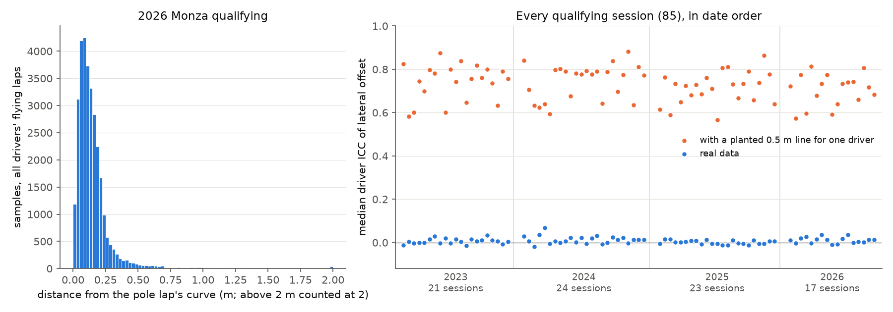

# Snapping audit: the public F1 position feed has no racing-line information

Every flying lap's 3.7 Hz location samples are compared with a cubic-spline curve through
the pole lap. Two tests: (1) distance from the pole lap's curve; (2) whether a driver's
*signed* lateral offset is consistent across their own laps, per 50 m station
(one-way ANOVA, intraclass correlation). Positive controls: pit-lane samples, laps
shifted by known 1-3 m offsets, and a planted 0.5 m line for one driver.

| Session | Laps | Median dist. | p95 | Pit-lane p95 | Injected 2 m -> | Driver ICC | Stations p<0.01 | Driver offset p95 | Planted ICC | Planted detected | Planted offset p95 | Excluded cars |
|---|---|---|---|---|---|---|---|---|---|---|---|---|
| 2023 Sakhir | 78 | 10.4 cm | 31 cm | 16.6 m | 2.00 m | -0.012 | 2.8% | 7.2 cm | +0.82 | 97% | 46 cm | - |
| 2023 Jeddah | 98 | 13.3 cm | 45 cm | 17.6 m | 2.00 m | +0.004 | 1.7% | 10.2 cm | +0.58 | 94% | 45 cm | 21 |
| 2023 Melbourne | 126 | 12.4 cm | 38 cm | 15.0 m | 1.99 m | -0.002 | 2.9% | 7.4 cm | +0.60 | 97% | 43 cm | - |
| 2023 Baku | 105 | 9.5 cm | 29 cm | 13.9 m | 2.01 m | -0.002 | 4.2% | 6.6 cm | +0.75 | 98% | 46 cm | - |
| 2023 Miami | 96 | 11.3 cm | 36 cm | 20.3 m | 2.01 m | -0.000 | 5.7% | 8.0 cm | +0.70 | 99% | 45 cm | - |
| 2023 Monte Carlo | 139 | 10.4 cm | 44 cm | 12.5 m | 2.01 m | +0.016 | 10.8% | 6.6 cm | +0.80 | 97% | 45 cm | - |
| 2023 Catalunya | 101 | 12.4 cm | 41 cm | 17.1 m | 1.99 m | +0.029 | 4.4% | 8.0 cm | +0.78 | 99% | 47 cm | - |
| 2023 Montreal | 103 | 9.5 cm | 24 cm | 24.7 m | 2.00 m | -0.004 | 4.7% | 5.8 cm | +0.87 | 100% | 45 cm | - |
| 2023 Spielberg | 117 | 11.3 cm | 32 cm | 15.4 m | 2.00 m | +0.020 | 7.1% | 8.1 cm | +0.60 | 98% | 46 cm | - |
| 2023 Silverstone | 109 | 12.2 cm | 38 cm | 31.1 m | 2.00 m | -0.002 | 2.6% | 40.9 cm | +0.80 | 93% | 56 cm | - |
| 2023 Hungaroring | 110 | 11.6 cm | 50 cm | 15.0 m | 2.01 m | +0.014 | 3.5% | 6.9 cm | +0.74 | 100% | 46 cm | - |
| 2023 Spa-Francorchamps | 32 | 11.8 cm | 37 cm | 30.3 m | 2.00 m | +0.005 | 2.2% | 10.5 cm | +0.84 | 94% | 46 cm | - |
| 2023 Monza | 108 | 11.9 cm | 39 cm | 18.5 m | 2.00 m | -0.014 | 0.9% | 8.0 cm | +0.65 | 98% | 46 cm | - |
| 2023 Singapore | 88 | 9.8 cm | 29 cm | 17.2 m | 2.01 m | +0.017 | 4.2% | 7.0 cm | +0.76 | 99% | 47 cm | - |
| 2023 Suzuka | 74 | 11.8 cm | 40 cm | 13.4 m | 2.00 m | +0.007 | 2.6% | 9.4 cm | +0.82 | 97% | 46 cm | - |
| 2023 Mexico City | 81 | 10.3 cm | 29 cm | 16.4 m | 2.00 m | +0.012 | 3.5% | 7.1 cm | +0.74 | 100% | 45 cm | - |
| 2023 Yas Marina Circuit | 84 | 11.3 cm | 36 cm | 18.8 m | 2.01 m | +0.004 | 3.8% | 7.3 cm | +0.76 | 98% | 46 cm | - |
| 2023 Austin | 94 | 11.2 cm | 38 cm | 14.1 m | 2.01 m | +0.033 | 10.2% | 8.9 cm | +0.80 | 99% | 47 cm | - |
| 2023 Lusail | 112 | 12.3 cm | 40 cm | 16.8 m | 1.99 m | +0.011 | 5.6% | 7.5 cm | +0.76 | 99% | 44 cm | - |
| 2023 Interlagos | 92 | 11.2 cm | 35 cm | 27.1 m | 2.01 m | +0.005 | 3.6% | 7.8 cm | +0.63 | 96% | 45 cm | - |
| 2023 Las Vegas | 104 | 11.0 cm | 32 cm | 14.3 m | 2.00 m | -0.008 | 5.7% | 8.7 cm | +0.79 | 100% | 45 cm | - |
| 2024 Sakhir | 84 | 10.2 cm | 27 cm | 16.6 m | 2.01 m | +0.030 | 5.7% | 7.0 cm | +0.84 | 99% | 45 cm | - |
| 2024 Jeddah | 94 | 11.8 cm | 30 cm | 16.1 m | 2.02 m | +0.005 | 4.1% | 7.5 cm | +0.71 | 99% | 46 cm | - |
| 2024 Melbourne | 98 | 13.3 cm | 35 cm | 20.5 m | 2.01 m | -0.019 | 1.9% | 8.5 cm | +0.63 | 98% | 45 cm | - |
| 2024 Suzuka | 73 | 13.3 cm | 36 cm | 13.4 m | 2.00 m | +0.035 | 1.7% | 10.2 cm | +0.62 | 98% | 45 cm | - |
| 2024 Miami | 102 | 10.0 cm | 33 cm | 18.2 m | 2.00 m | -0.005 | 8.5% | 7.9 cm | +0.59 | 98% | 44 cm | - |
| 2024 Imola | 86 | 11.0 cm | 27 cm | 8.4 m | 2.00 m | +0.006 | 3.1% | 7.3 cm | +0.80 | 97% | 46 cm | - |
| 2024 Monte Carlo | 142 | 10.5 cm | 47 cm | 7.9 m | 2.01 m | -0.001 | 4.6% | 7.7 cm | +0.80 | 98% | 44 cm | - |
| 2024 Montreal | 130 | 10.8 cm | 29 cm | 26.5 m | 2.01 m | +0.006 | 2.4% | 6.7 cm | +0.79 | 99% | 45 cm | - |
| 2024 Catalunya | 83 | 12.3 cm | 34 cm | 17.2 m | 2.01 m | +0.021 | 1.1% | 7.9 cm | +0.68 | 99% | 46 cm | - |
| 2024 Spielberg | 102 | 11.2 cm | 28 cm | 15.4 m | 2.01 m | +0.002 | 1.2% | 7.6 cm | +0.78 | 99% | 45 cm | - |
| 2024 Silverstone | 79 | 13.3 cm | 45 cm | 30.7 m | 2.01 m | +0.022 | 1.7% | 9.1 cm | +0.78 | 97% | 47 cm | - |
| 2024 Hungaroring | 100 | 11.2 cm | 37 cm | 15.1 m | 2.00 m | -0.005 | 1.2% | 6.5 cm | +0.79 | 100% | 46 cm | - |
| 2024 Spa-Francorchamps | 127 | 10.9 cm | 34 cm | 30.4 m | 1.99 m | +0.020 | 6.5% | 7.8 cm | +0.78 | 99% | 45 cm | - |
| 2024 Zandvoort | 92 | 11.9 cm | 44 cm | 14.8 m | 2.00 m | +0.033 | 7.2% | 9.2 cm | +0.79 | 98% | 46 cm | - |
| 2024 Monza | 86 | 11.5 cm | 30 cm | 18.8 m | 2.00 m | -0.008 | 0.0% | 7.7 cm | +0.64 | 98% | 46 cm | - |
| 2024 Baku | 99 | 9.6 cm | 29 cm | 14.0 m | 2.00 m | -0.001 | 3.4% | 7.2 cm | +0.79 | 99% | 47 cm | - |
| 2024 Singapore | 85 | 10.1 cm | 30 cm | 16.3 m | 2.01 m | +0.025 | 4.2% | 6.9 cm | +0.84 | 99% | 46 cm | - |
| 2024 Austin | 81 | 10.9 cm | 38 cm | 14.2 m | 2.00 m | +0.014 | 5.6% | 13.0 cm | +0.70 | 94% | 46 cm | - |
| 2024 Mexico City | 88 | 9.4 cm | 29 cm | 16.5 m | 1.99 m | +0.022 | 6.0% | 8.3 cm | +0.77 | 99% | 46 cm | - |
| 2024 Interlagos | 54 | 10.0 cm | 30 cm | 26.8 m | 1.99 m | -0.004 | 1.2% | 6.4 cm | +0.88 | 99% | 45 cm | - |
| 2024 Las Vegas | 100 | 11.1 cm | 33 cm | 14.7 m | 2.01 m | +0.012 | 4.1% | 9.0 cm | +0.63 | 99% | 45 cm | - |
| 2024 Lusail | 109 | 12.6 cm | 43 cm | 16.8 m | 2.01 m | +0.013 | 3.7% | 8.6 cm | +0.81 | 99% | 45 cm | - |
| 2024 Yas Marina Circuit | 80 | 11.7 cm | 36 cm | 21.8 m | 2.00 m | +0.013 | 5.8% | 7.8 cm | +0.77 | 99% | 48 cm | - |
| 2024 Shanghai | 87 | 12.0 cm | 36 cm | 17.6 m | 2.01 m | +0.068 | 12.1% | 9.2 cm | +0.64 | 97% | 46 cm | - |
| 2025 Suzuka | 93 | 13.1 cm | 43 cm | 14.1 m | 1.99 m | +0.015 | 1.7% | 9.4 cm | +0.59 | 97% | 43 cm | - |
| 2025 Sakhir | 81 | 10.5 cm | 30 cm | 13.7 m | 1.99 m | +0.003 | 4.7% | 7.6 cm | +0.73 | 97% | 46 cm | - |
| 2025 Jeddah | 86 | 12.2 cm | 33 cm | 14.7 m | 1.99 m | +0.002 | 2.5% | 8.4 cm | +0.65 | 98% | 47 cm | - |
| 2025 Miami | 92 | 11.9 cm | 46 cm | 16.8 m | 1.99 m | +0.004 | 0.9% | 8.8 cm | +0.72 | 98% | 46 cm | - |
| 2025 Melbourne | 89 | 12.2 cm | 33 cm | 14.9 m | 2.01 m | -0.006 | 0.0% | 8.2 cm | +0.61 | 99% | 46 cm | - |
| 2025 Yas Marina Circuit | 91 | 11.7 cm | 42 cm | 20.8 m | 2.00 m | +0.007 | 7.7% | 9.0 cm | +0.64 | 96% | 46 cm | - |
| 2025 Lusail | 115 | 12.8 cm | 55 cm | 16.8 m | 2.00 m | +0.006 | 2.8% | 8.7 cm | +0.78 | 98% | 45 cm | - |
| 2025 Las Vegas | 111 | 9.5 cm | 27 cm | 14.6 m | 2.00 m | -0.004 | 2.5% | 6.4 cm | +0.86 | 99% | 47 cm | - |
| 2025 Interlagos | 95 | 11.1 cm | 31 cm | 26.9 m | 2.00 m | -0.004 | 1.2% | 8.3 cm | +0.74 | 99% | 46 cm | - |
| 2025 Mexico City | 98 | 11.0 cm | 38 cm | 16.5 m | 2.00 m | +0.011 | 3.6% | 7.8 cm | +0.66 | 98% | 44 cm | - |
| 2025 Austin | 77 | 10.6 cm | 37 cm | 14.2 m | 2.01 m | -0.011 | 1.9% | 8.0 cm | +0.79 | 97% | 46 cm | - |
| 2025 Singapore | 88 | 10.3 cm | 31 cm | 16.2 m | 1.99 m | -0.006 | 2.1% | 6.3 cm | +0.73 | 99% | 47 cm | - |
| 2025 Monza | 99 | 12.9 cm | 39 cm | 18.8 m | 2.00 m | -0.002 | 3.5% | 9.4 cm | +0.67 | 97% | 45 cm | - |
| 2025 Zandvoort | 93 | 12.1 cm | 40 cm | 14.9 m | 2.01 m | +0.012 | 2.4% | 9.3 cm | +0.73 | 98% | 46 cm | - |
| 2025 Hungaroring | 87 | 10.9 cm | 42 cm | 14.9 m | 2.00 m | -0.011 | 3.5% | 6.4 cm | +0.81 | 98% | 46 cm | - |
| 2025 Spa-Francorchamps | 84 | 12.2 cm | 48 cm | 29.2 m | 2.00 m | -0.011 | 0.7% | 10.2 cm | +0.81 | 97% | 46 cm | - |
| 2025 Silverstone | 90 | 13.0 cm | 42 cm | 31.2 m | 2.01 m | -0.005 | 1.7% | 8.9 cm | +0.57 | 97% | 45 cm | - |
| 2025 Spielberg | 97 | 11.7 cm | 38 cm | 15.3 m | 2.01 m | -0.005 | 1.2% | 8.5 cm | +0.71 | 99% | 46 cm | - |
| 2025 Montreal | 113 | 10.2 cm | 28 cm | 22.4 m | 2.00 m | +0.013 | 4.7% | 6.7 cm | +0.76 | 100% | 46 cm | - |
| 2025 Catalunya | 77 | 12.7 cm | 45 cm | 17.2 m | 2.00 m | -0.007 | 3.3% | 8.9 cm | +0.69 | 96% | 46 cm | - |
| 2025 Monte Carlo | 134 | 9.4 cm | 41 cm | 15.7 m | 2.01 m | +0.008 | 9.4% | 7.1 cm | +0.73 | 98% | 45 cm | - |
| 2025 Imola | 83 | 11.4 cm | 61 cm | 8.7 m | 1.99 m | +0.008 | 4.2% | 10.3 cm | +0.68 | 94% | 47 cm | - |
| 2025 Shanghai | 97 | 10.6 cm | 36 cm | 17.7 m | 2.00 m | +0.016 | 4.7% | 8.3 cm | +0.76 | 97% | 46 cm | - |
| 2026 Melbourne | 102 | 12.2 cm | 41 cm | 14.9 m | 2.00 m | +0.011 | 5.8% | 8.2 cm | +0.72 | 98% | 45 cm | - |
| 2026 Shanghai | 104 | 11.0 cm | 64 cm | 556.8 m | 2.00 m | -0.003 | 2.8% | 12.1 cm | +0.57 | 88% | 39 cm | - |
| 2026 Suzuka | 108 | 12.2 cm | 47 cm | 14.0 m | 2.00 m | +0.020 | 7.0% | 9.2 cm | +0.77 | 98% | 40 cm | - |
| 2026 Miami | 99 | 11.1 cm | 41 cm | 18.8 m | 2.01 m | +0.026 | 2.8% | 8.9 cm | +0.60 | 97% | 45 cm | - |
| 2026 Montreal | 124 | 10.0 cm | 25 cm | 23.9 m | 2.00 m | -0.002 | 2.4% | 6.7 cm | +0.81 | 99% | 45 cm | - |
| 2026 Monte Carlo | 131 | 10.2 cm | 40 cm | 12.3 m | 2.00 m | +0.017 | 4.6% | 6.7 cm | +0.68 | 98% | 44 cm | - |
| 2026 Catalunya | 75 | 11.7 cm | 37 cm | 17.1 m | 2.01 m | +0.036 | 3.3% | 9.3 cm | +0.73 | 97% | 44 cm | - |
| 2026 Spielberg | 90 | 10.7 cm | 29 cm | 15.7 m | 2.01 m | +0.013 | 4.7% | 7.9 cm | +0.78 | 98% | 44 cm | - |
| 2026 Silverstone | 99 | 12.2 cm | 41 cm | 31.2 m | 2.00 m | -0.010 | 1.7% | 39.5 cm | +0.59 | 91% | 54 cm | - |
| 2026 Spa-Francorchamps | 86 | 12.2 cm | 38 cm | 30.1 m | 2.00 m | -0.008 | 2.9% | 9.0 cm | +0.64 | 96% | 45 cm | - |
| 2026 Hungaroring | 92 | 10.4 cm | 32 cm | 15.0 m | 2.01 m | +0.018 | 8.1% | 7.9 cm | +0.73 | 98% | 45 cm | - |
| 2026 Zandvoort | 101 | 11.6 cm | 42 cm | 15.4 m | 2.00 m | +0.037 | 8.4% | 10.9 cm | +0.74 | 96% | 45 cm | - |
| 2026 Monza | 96 | 11.7 cm | 35 cm | 18.6 m | 2.00 m | -0.001 | 1.8% | 8.9 cm | +0.74 | 99% | 44 cm | - |
| 2026 Madring | 94 | 11.5 cm | 40 cm | 59.3 m | 2.00 m | +0.005 | 1.9% | 7.7 cm | +0.66 | 97% | 43 cm | - |
| 2026 Baku | 111 | 9.5 cm | 24 cm | 13.9 m | 2.00 m | +0.002 | 1.7% | 6.4 cm | +0.81 | 99% | 47 cm | - |
| 2026 Singapore | 113 | 9.8 cm | 29 cm | 16.1 m | 2.02 m | +0.014 | 4.2% | 6.2 cm | +0.68 | 99% | 45 cm | - |
| 2026 Kuala Lumpur | 76 | 10.3 cm | 45 cm | 15.9 m | 1.99 m | +0.012 | 1.9% | 8.8 cm | +0.72 | 96% | 46 cm | - |

**Reading.** Every driver sits ~13 cm from the pole lap's curve, with no driver-specific
offset (ICC ~ 0, significant stations at about the false-positive rate), while the same
test detects a planted 0.5 m line at almost every station and recovers injected offsets
exactly. The feed can represent off-line positions (the pit lane is metres away), so
the positions are projected onto a single track model. Consequence: driver comparisons
use speed, throttle, brake and time as functions of distance, never lateral lines.

*Excluded cars* had a broken coordinate stream: positions far from every other car's
everywhere on the lap, straights included (for example 2023 Jeddah car 21, ~3 m). That
is a per-car data fault, not line information, and is reported rather than hidden.

Data: OpenF1 (CC BY-NC-SA 4.0), aggregate statistics only.

**Flagged for follow-up** (more than 5% of stations significant, or
driver offsets above 20 cm at p95). Effects of a few centimetres are per-car
artefacts such as antenna position or latency, far below racing-line scale
(0.5-2 m); larger ones are open items, not conclusions:
- 2023 Miami: 5.7% of stations significant, driver offset p95 8.0 cm, ICC -0.000
- 2023 Monte Carlo: 10.8% of stations significant, driver offset p95 6.6 cm, ICC +0.016
- 2023 Spielberg: 7.1% of stations significant, driver offset p95 8.1 cm, ICC +0.020
- 2023 Silverstone: 2.6% of stations significant, driver offset p95 40.9 cm, ICC -0.002
- 2023 Austin: 10.2% of stations significant, driver offset p95 8.9 cm, ICC +0.033
- 2023 Lusail: 5.6% of stations significant, driver offset p95 7.5 cm, ICC +0.011
- 2023 Las Vegas: 5.7% of stations significant, driver offset p95 8.7 cm, ICC -0.008
- 2024 Sakhir: 5.7% of stations significant, driver offset p95 7.0 cm, ICC +0.030
- 2024 Miami: 8.5% of stations significant, driver offset p95 7.9 cm, ICC -0.005
- 2024 Spa-Francorchamps: 6.5% of stations significant, driver offset p95 7.8 cm, ICC +0.020
- 2024 Zandvoort: 7.2% of stations significant, driver offset p95 9.2 cm, ICC +0.033
- 2024 Austin: 5.6% of stations significant, driver offset p95 13.0 cm, ICC +0.014
- 2024 Mexico City: 6.0% of stations significant, driver offset p95 8.3 cm, ICC +0.022
- 2024 Yas Marina Circuit: 5.8% of stations significant, driver offset p95 7.8 cm, ICC +0.013
- 2024 Shanghai: 12.1% of stations significant, driver offset p95 9.2 cm, ICC +0.068
- 2025 Yas Marina Circuit: 7.7% of stations significant, driver offset p95 9.0 cm, ICC +0.007
- 2025 Monte Carlo: 9.4% of stations significant, driver offset p95 7.1 cm, ICC +0.008
- 2026 Melbourne: 5.8% of stations significant, driver offset p95 8.2 cm, ICC +0.011
- 2026 Suzuka: 7.0% of stations significant, driver offset p95 9.2 cm, ICC +0.020
- 2026 Silverstone: 1.7% of stations significant, driver offset p95 39.5 cm, ICC -0.010
- 2026 Hungaroring: 8.1% of stations significant, driver offset p95 7.9 cm, ICC +0.018
- 2026 Zandvoort: 8.4% of stations significant, driver offset p95 10.9 cm, ICC +0.037

**Per-car breakdown of the sessions with driver offsets above 20 cm at p95.** The same statistic split by car: per 50 m station, the car's mean signed offset over its laps minus the station mean over cars, and per car the median, p95 and maximum of its absolute value. *Near the seam* counts the car's stations above 20 cm that lie within 600 m of the start or end of the pole lap's curve, where the reference curve begins and ends.

*2023 Silverstone*: 13 cars, each with 7-8 stations above 20 cm; 96 of the 96 car-stations above 20 cm are near the seam. Stations where at least half the cars exceed 20 cm (start, m; lap 5800 m): 0, 5250, 5300, 5350, 5400, 5450, 5700, 5750.

| Car | Laps | Stations | Median (cm) | p95 (cm) | Max (cm) | Stations > 20 cm | Near the seam |
|---|---|---|---|---|---|---|---|
| 63 | 7 | 116 | 2.1 | 64.0 | 1330.7 | 8 | 8 |
| 4 | 9 | 116 | 1.9 | 57.9 | 609.5 | 8 | 8 |
| 31 | 6 | 116 | 2.2 | 55.9 | 1004.2 | 7 | 7 |
| 18 | 5 | 116 | 2.1 | 48.2 | 301.4 | 8 | 8 |
| 44 | 8 | 116 | 1.9 | 45.5 | 647.7 | 8 | 8 |
| 2 | 5 | 116 | 2.2 | 43.0 | 299.2 | 7 | 7 |
| 27 | 5 | 116 | 2.5 | 37.6 | 300.0 | 8 | 8 |
| 55 | 9 | 116 | 1.5 | 35.5 | 299.3 | 7 | 7 |
| 16 | 8 | 116 | 2.0 | 32.8 | 299.1 | 7 | 7 |
| 14 | 8 | 116 | 2.0 | 27.2 | 299.1 | 7 | 7 |
| 10 | 7 | 116 | 2.2 | 24.8 | 298.0 | 7 | 7 |
| 81 | 7 | 116 | 2.0 | 24.4 | 297.7 | 7 | 7 |
| 23 | 7 | 116 | 2.3 | 23.8 | 296.3 | 7 | 7 |

*2026 Silverstone*: 18 cars, each with 6-8 stations above 20 cm; 123 of the 124 car-stations above 20 cm are near the seam. Stations where at least half the cars exceed 20 cm (start, m; lap 5800 m): 0, 5300, 5350, 5400, 5450, 5700, 5750.

| Car | Laps | Stations | Median (cm) | p95 (cm) | Max (cm) | Stations > 20 cm | Near the seam |
|---|---|---|---|---|---|---|---|
| 41 | 6 | 116 | 2.2 | 77.8 | 1193.9 | 8 | 8 |
| 30 | 7 | 116 | 1.8 | 69.1 | 1026.9 | 8 | 8 |
| 44 | 6 | 116 | 2.1 | 65.6 | 1184.7 | 8 | 8 |
| 23 | 5 | 116 | 2.0 | 51.6 | 1591.0 | 7 | 6 |
| 27 | 5 | 116 | 2.3 | 47.5 | 360.0 | 7 | 7 |
| 18 | 3 | 116 | 3.0 | 45.9 | 353.6 | 7 | 7 |
| 87 | 5 | 116 | 2.6 | 44.4 | 359.6 | 7 | 7 |
| 1 | 5 | 116 | 2.3 | 38.6 | 360.0 | 7 | 7 |
| 3 | 6 | 116 | 2.2 | 37.1 | 353.9 | 7 | 7 |
| 11 | 3 | 116 | 3.1 | 34.4 | 354.7 | 7 | 7 |
| 5 | 3 | 116 | 3.4 | 32.8 | 356.1 | 7 | 7 |
| 10 | 4 | 116 | 2.5 | 30.9 | 359.1 | 7 | 7 |
| 63 | 5 | 116 | 3.0 | 28.3 | 360.4 | 7 | 7 |
| 31 | 3 | 116 | 2.7 | 22.4 | 353.5 | 6 | 6 |
| 6 | 6 | 116 | 2.1 | 20.2 | 353.4 | 6 | 6 |
| 55 | 5 | 116 | 2.4 | 19.9 | 360.5 | 6 | 6 |
| 81 | 6 | 116 | 2.5 | 18.5 | 359.9 | 6 | 6 |
| 16 | 6 | 116 | 2.8 | 17.4 | 351.6 | 6 | 6 |

**Reading.** 219 of 220 car-stations above 20 cm lie near the seam, and the stations are the same for every car. An offset that every car shows at the same few places belongs to the place (where the reference curve starts and ends), not to a car's line, so these flags are not a driver signal. Away from the seam no car exceeds 20 cm at more than 1 station(s).

Skipped sessions:
- 2023 Zandvoort: only 0 drivers with >= 3 flying laps
- 2025 Baku: the archived laps table is empty (OpenF1 returned no timed laps for this session; the location feed is there, but no lap can be cut from it)
